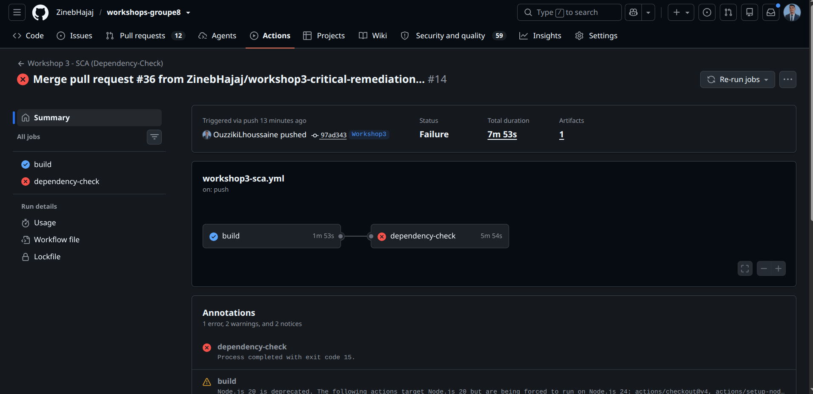

# Workshop 3 — Sécurité des dépendances : Dependabot & OWASP Dependency-Check

**Groupe 8** — Zineb Hajaj · Hasna elhassani · Ouzziki Lhoussaine
**Projet analysé** : OWASP Juice Shop (Node.js / Angular / TypeScript)
**Dépôt** : https://github.com/ZinebHajaj/workshops-groupe8
**Branche de rendu** : `Workshop3`

## Sommaire

1. Objectif
2. Outils et environnement
3. Organisation du dépôt (branches)
4. Pipeline CI : build → Dependency-Check → security gate
5. Résultats OWASP Dependency-Check (état avant)
6. Corrections et comparaison avant / après
7. Dependabot
8. Comparaison Dependabot vs Dependency-Check
9. Difficultés rencontrées et limites
10. Reproduire en local
11. Conclusion
12. Répartition du travail

## 1. Objectif

Une application moderne est surtout composée de bibliothèques tierces : une seule dépendance vulnérable suffit à exposer tout le projet (Log4Shell, Event-Stream). Ce workshop met en place deux protections complémentaires sur le projet commun :

- **OWASP Dependency-Check** détecte les dépendances vulnérables (directes et transitives) et produit un rapport ;
- **Dependabot** propose automatiquement des mises à jour sous forme de pull requests.

Les deux sont intégrés dans un pipeline CI/CD (GitHub Actions) qui vérifie que le projet compile et bloque le pipeline quand une vulnérabilité critique est détectée. Les vulnérabilités ciblées sont ensuite corrigées, avec une comparaison avant / après.

**Adaptation du sujet.** Le support mentionne Maven, mais le dépôt fourni est OWASP Juice Shop, sans `pom.xml`. L'implémentation utilise donc les manifests et lockfiles npm réels du projet ; aucun projet Maven artificiel n'a été ajouté.

## 2. Outils et environnement

| Outil | Version / configuration | Rôle |
|---|---|---|
| OWASP Dependency-Check | 13.0.0, image Docker `owasp/dependency-check:latest` (digest `sha256:0e8f69ad5b00d62000937f4e57189812343f6903d9c83ee712012d51542a020a`) | Détection des dépendances vulnérables, rapport HTML, security gate |
| Node Audit Analyzer | intégré à Dependency-Check, interroge les advisories npm (identifiants GHSA) | Analyse des lockfiles npm |
| NVD (National Vulnerability Database) | API avec clé stockée dans les secrets du dépôt (`NVD_API_KEY`) | Base de CVE mise à jour par Dependency-Check |
| Dependabot | configuration version 2, écosystème npm (racine et `/frontend`) | Pull requests de mise à jour automatiques |
| GitHub Actions | `ubuntu-latest` | Orchestration du pipeline |
| Node.js / npm | Node 22 ; `--legacy-peer-deps` pour le frontend | Build du projet |

## 3. Organisation du dépôt (branches)

Chaque workshop est livré sur sa propre branche. La branche `Workshop3` est le rendu : chaque membre travaille sur sa branche et l'intègre par pull request.

```
main                                          projet de base (Juice Shop)
 └── Workshop3                                LIVRABLE du workshop 3 (intégration)
      ├── workshop3-pipeline-zineb            Pipeline GitHub Actions + README
      ├── workshop3-dependabot-hasna          Dependabot (dependabot.yml, lockfile frontend)
      ├── workshop3-dependency-check-lhoussaine   Scan, premières corrections et preuves
      └── workshop3-critical-remediation-lhoussaine Corrections ciblées supplémentaires
```

| Branche | Auteur | Contenu |
|---|---|---|
| `Workshop3` | — | intégration : pipeline + Dependabot + corrections + README |
| `workshop3-pipeline-zineb` | Zineb Hajaj | `.github/workflows/workshop3-sca.yml`, secret NVD, captures du pipeline |
| `workshop3-dependabot-hasna` | Hasna elhassani | `.github/dependabot.yml`, lockfiles et correctifs de compatibilité des mises à jour |
| `workshop3-dependency-check-lhoussaine` | Ouzziki Lhoussaine | Corrections `pdfkit` et `express-jwt`, résultats, captures et preuves finales |
| `workshop3-critical-remediation-lhoussaine` | Ouzziki Lhoussaine | Corrections ciblées CycloneDX, Basic-FTP et decode-uri-component, avec documentation séparée |

Les branches `dependabot/npm_and_yarn/...` sont créées automatiquement par Dependabot : ce sont ses mises à jour proposées (voir section 7).

**URL de rendu (Google Classroom)** : https://github.com/ZinebHajaj/workshops-groupe8/tree/Workshop3

## 4. Pipeline CI

Fichier : `.github/workflows/workshop3-sca.yml`. Il se déclenche à chaque push sur une branche dont le nom commence par `Workshop3` ou `workshop3`, et peut aussi être lancé à la main (`workflow_dispatch`).

```
 push sur Workshop3* / workshop3*  (ou lancement manuel)
        │
        ▼
 ┌─────────────────────────────────────┐
 │ JOB 1 : build                       │
 │  • npm install (serveur)            │
 │  • npm install --legacy-peer-deps   │
 │    (frontend)                       │
 │  • compilation frontend + serveur   │
 └──────────────────┬──────────────────┘
                    │ needs
                    ▼
 ┌─────────────────────────────────────┐
 │ JOB 2 : dependency-check            │
 │  • génération des lockfiles         │
 │  • mise à jour de la base NVD       │
 │  • scan OWASP Dependency-Check      │
 │  • SECURITY GATE : CVSS ≥ 9         │
 └──────────────────┬──────────────────┘
                    ▼
      Artifact : dependency-check-report (HTML)
      (conservé même si le gate échoue)
```

Étapes clés

1. **Build** — installation des dépendances du serveur puis du frontend, compilation du frontend (`npm run build:frontend`) puis du serveur TypeScript (`npm run build:server`). Ce job prouve que le projet compile sans erreur ; le job d'analyse ne démarre que s'il réussit.
2. **Lockfiles** — `.npmrc` contient `package-lock=false`, mais des lockfiles ont aussi été générés explicitement et commités. Le job d'analyse force `package-lock=true` pour la racine et le frontend afin que Dependency-Check connaisse les versions exactes.
3. **Dependency-Check** — l'image Docker officielle est lancée avec `--scan`, `--exclude "**/test/**"`, `--format HTML`, la clé NVD lue dans une variable d'environnement et le seuil `--failOnCVSS 9`.
4. **Artifact** — le rapport HTML est publié par `actions/upload-artifact` avec `if: always()`.

| Code de sortie | Signification |
|---|---|
| 15 | Le security gate bloque : une dépendance a un score CVSS ≥ 9 |
| 13 | Erreur d'exécution de l'outil (par exemple clé NVD invalide) |

Points importants

- **La clé NVD n'apparaît jamais dans le code** : elle est enregistrée dans *Settings → Secrets and variables → Actions* et transmise au job par variable d'environnement.
- **Le gate est rouge par construction** sur un projet volontairement vulnérable : c'est le comportement attendu, pas une panne.
- **Pourquoi pas l'action officielle ?** Le premier essai avec `dependency-check/Dependency-Check_Action` a produit un rapport peu fiable : l'action ajoute `--noupdate`, donc la base NVD n'était pas mise à jour (analyse NVD en 0 seconde), et nos arguments étaient transmis comme une seule chaîne. Le pipeline lance donc l'image Docker directement.
- **Cache de la base NVD** — une étape de cache est présente, mais GitHub n'enregistre un cache qu'à la fin d'un job réussi : tant que le gate échoue, la base est retéléchargée à chaque exécution.


## 5. Résultats OWASP Dependency-Check : trois états à distinguer

Les rapports ne proviennent pas tous du même moment ni de la même couverture. Ils sont donc présentés comme trois états distincts plutôt que comme une seule comparaison globale.

| État | Référence | Résultat | Utilisation |
|---|---|---|---|
| Baseline locale initiale | `reports/before/` | 46 findings NPM, dont CryptoJS et Express-JWT | Corrections PDFKit et Express-JWT |
| Rapport CI de référence fourni | Généré le 2026-10-31 à 13:27:17 GMT, Dependency-Check 13.0.0 | 21 dépendances analysées et vulnérables, 47 findings, 0 suppression | Référence pour les trois corrections ciblées suivantes |
| Run intégré de vérification | [Run #14](https://github.com/ZinebHajaj/workshops-groupe8/actions/runs/41216021010), commit `97ad343`, rapport généré à 15:48:55 GMT | 18 dépendances analysées et vulnérables, 42 findings, 0 suppression | Vérification intégrée et statut final du gate |

Le HTML de référence ne contient pas d'identifiant de commit : il n'est pas associé arbitrairement à un run. Le run #14 est en revanche relié explicitement à `Workshop3`, au commit `97ad343` et à l'artifact `dependency-check-report`.

**Lecture honnête.** Les chiffres peuvent varier avec les lockfiles, la couverture des analyseurs et les bases d'advisories. Une différence de totaux n'est interprétée qu'après une comparaison normalisée par dépendance et advisory.


## 6. Corrections et comparaison avant / après

Les corrections sont de **Ouzziki Lhoussaine**. Les preuves détaillées sont dans `docs/workshop3/dependency-check/resultats.md` et `docs/workshop3/critical-remediation/`.

### 6.1 Première étape : PDFKit/CryptoJS et Express-JWT

| Dépendance | Avant | Après | Commit |
|---|---|---|---|
| `pdfkit` (qui amenait `crypto-js@3.3.0`) | 0.11.0 | 0.20.2 | `a1c15a5` |
| `express-jwt` | 0.1.3 | 6.0.0 | `c60aca3` |

- `pdfkit@0.20.2` ne dépend plus de `crypto-js` ; la mise à jour du parent supprime la dépendance vulnérable sans l'ajouter comme dépendance directe.
- `express-jwt@6.0.0` utilise `algorithms: ['RS256']` dans `isAuthorized` et `algorithms: ['HS256']` dans `denyAll`. Les casts `as any` qui masquaient les options obligatoires ont été supprimés.
- Builds frontend et serveur réussis ; 10 tests `order` et 54 tests `insecurity` réussis.

Les trois findings ciblés — deux CryptoJS et un Express-JWT — sont présents dans l'extraction initiale et absents de l'extraction locale après correction. Un npm audit indépendant confirme également leur absence.

### 6.2 Deuxième étape : trois corrections ciblées supplémentaires

| Correction | Avant | Après | Code | Documentation |
|---|---|---|---|---|
| CycloneDX npm | `@cyclonedx/cyclonedx-npm@4.2.1` | `6.0.0` | `c099896` | `2ba3ab1` |
| Basic-FTP, dépendance transitive | `5.3.1` | Override exact `6.2.1` | `84e0890` | `bd04da0` |
| decode-uri-component, dépendance transitive | `0.2.2` via `query-string@5.1.1` | Suppression de cette chaîne par override de `normalize-url` vers `3.3.0`, limité à `cacheable-request@2.1.4` | `ab8c121` | `5387f88` |

Points de compatibilité vérifiés :

- CycloneDX : builds et génération SBOM validés.
- Basic-FTP : chaîne `proxy-agent → pac-proxy-agent → get-uri`, import, 55 tests et builds validés.
- decode-uri-component : l'override direct vers `0.5.1` a été écarté car `query-string@5.1.1` utilise CommonJS alors que `0.5.1` est ESM-only. Le téléchargement réel, le cache, les 55 tests et les builds ont été validés avec le parent remplacé.

### 6.3 Résultat intégré du run #14

Le [run intégré #14](https://github.com/ZinebHajaj/workshops-groupe8/actions/runs/41216021010) donne le résultat suivant :

- job `build` : **réussi** ;
- analyse Dependency-Check : **terminée** ;
- rapport HTML : **généré et publié en artifact** ;
- security gate : **échec avec le code 15**, car des findings CVSS ≥ 9 subsistent ;
- suppressions : **0**.

La comparaison normalisée entre le rapport CI de référence et celui du run #14 montre :

| Entrée de la référence | Advisories ciblées | Dans le rapport du run #14 |
|---|---|---|
| `@cyclonedx/cyclonedx-npm:4.2.1` | `GHSA-q69g-4hcv-6jg4`, `GHSA-v75r-vx73-82pj` | Entrée et deux advisories absentes |
| `basic-ftp:5.3.1` | `GHSA-c475-qrg2-pj4r` | Entrée et advisory absentes |
| `decode-uri-component:0.2.2` | `GHSA-qr28-fpjm-wq7f`, `GHSA-vcc3-ghjq-m6fr` | Entrée et deux advisories absentes |

Aucune nouvelle section de dépendance n'est apparue et les ensembles d'advisories des 18 autres dépendances partagées sont inchangés. Cela vérifie les cinq findings ciblés dans le périmètre du scan CI, sans déclarer un projet sans vulnérabilité ni une réduction globale du risque.

### 6.4 Pourquoi le gate final reste rouge

| Composant | Advisories visibles dans le log du gate |
|---|---|
| `decompress@4.2.1` | `GHSA-hrh2-vp3x-79xf`, `GHSA-mp2f-45pm-3cg9` |
| `jsonwebtoken@0.4.0` | `GHSA-c7hr-j4mj-j2w6` |
| `lodash@2.4.2` | `GHSA-4xc9-xhrj-v574`, `GHSA-jf85-cpcp-j695` |
| `marsdb@0.6.11` | `GHSA-5mrr-rgp6-x4gr` |
| `minimatch@3.0.5` | `GHSA-3ppc-4f35-3m26` |

Ces composants n'ont pas été déclarés corrigés. Les 42 findings restants sont conservés dans le rapport final et les décisions de remédiation ultérieures restent séparées.

### 6.5 Limites des comparaisons

- Pour PDFKit/Express-JWT, l'extraction locale contient 46 findings avant et 68 après, mais la couverture change : NPM seul avant, puis NPM et NVD avec une base locale. La comparaison normalisée identifie exactement trois couples ciblés supprimés ; les lignes supplémentaires ne prouvent pas une régression introduite par les commits.
- Le scan local après utilise `--noupdate`, `--network host` et `--disableNodeAuditCache` après des échecs répétés de mise à jour NVD. Cette limite est documentée et n'est pas présentée comme équivalente à une mise à jour réussie.
- Pour le run #14, les dates de dernière modification NVD diffèrent de celles du rapport de référence. La comparaison porte donc sur les dépendances et advisories, pas seulement sur les totaux.
- Les rapports CI ont une couverture limitée et ne doivent pas être comparés directement à des scans locaux plus larges ou aux totaux de npm audit.

### 6.6 Captures





## 7. Dependabot

Configuration (`.github/dependabot.yml`), réalisée par **Hasna elhassani** :

| Paramètre | Valeur |
|---|---|
| Écosystème | `npm` |
| Dossiers surveillés | `/` et `/frontend` |
| Fréquence | Quotidienne à 09:00 et 09:15, fuseau `Africa/Casablanca` |
| Pull requests ouvertes simultanément | 5 maximum par dossier |
| Stratégie | `increase-if-necessary` |
| Messages de commit | Préfixe `chore(deps)` avec le nom du paquet |

Dependabot distingue les **alertes de sécurité** et les **version updates**. Les branches `dependabot/npm_and_yarn/...` observées proposent notamment des mises à jour d'Express Rate Limit, File-Type, des types Express, d'AngularX QRCode, de FontAwesome, de Stylelint et de Vitest. Une mise à jour proposée n'est pas nécessairement compatible ni liée à un finding du gate.

### 7.1 Décisions de compatibilité et mises à jour différées

Les correctifs techniques et les règles suivantes ont été intégrés dans `Workshop3` par la PR #33 :

| Dépendance | Décision documentée | Justification |
|---|---|---|
| Racine : `@types/express` `5.x` | Ignorée | Les types Express 5 ne correspondent pas au runtime Express 4 |
| Racine : `file-type` `22.x` | Ignorée | Version ESM-only alors que la compilation actuelle est CommonJS |
| Frontend : `@fortawesome/free-brands-svg-icons` `7.x` | Ignorée | Conservation d'un ensemble d'icônes compatible avec les autres paquets FontAwesome 5 |
| Frontend : `@vitest/coverage-v8` `5.x` | Ignorée | Alignement du fournisseur de couverture sur Vitest 4 |

Ces règles sont volontairement ciblées, sans exclusion générale des mises à jour.

**Limite opérationnelle importante.** La branche par défaut du dépôt est `main`, et GitHub lit la configuration des version updates sur la branche par défaut. La configuration de `main` ne contient pas ces quatre règles `ignore`. Elles sont donc présentées ici comme des décisions documentées sur la branche de rendu, et non comme des règles prétendument actives sur le Dependabot de `main`. La politique du groupe conserve le rendu sur `Workshop3`.

## 8. Comparaison Dependabot vs Dependency-Check

| Critère | Dependabot | OWASP Dependency-Check |
|---|---|---|
| Nature | Service intégré à GitHub | Outil open source OWASP, CLI/Docker |
| Rôle principal | Proposer des mises à jour et signaler des alertes | Détecter et rapporter les dépendances vulnérables |
| Résultat | Pull requests | Rapport HTML et code de sortie |
| Sources | GitHub Advisory Database | NVD et advisories npm via Node Audit |
| Déclenchement | Planifié ou selon les alertes | À chaque push dans ce pipeline |
| Blocage du pipeline | Pas automatiquement dans cette configuration | Oui, avec `--failOnCVSS 9` |
| Limites | Mises à jour parfois incompatibles ; ne cible pas forcément les findings du gate | Faux positifs/négatifs possibles, couverture variable, dépendance aux bases et à leur disponibilité |
| Durée | Quelques secondes pour ouvrir une proposition | Variable selon la base NVD ; environ 6 minutes pour le job du run #14, mais davantage possible lors des téléchargements initiaux |

**Complémentarité.** Dependency-Check fournit un constat et un gate ; Dependabot automatise des propositions de mise à jour. Dans les deux cas, la compatibilité doit être prouvée par le graphe de dépendances, les builds et les tests. Les corrections critiques de ce rendu ont été examinées individuellement plutôt que fusionnées automatiquement.

## 9. Difficultés rencontrées et limites

| Problème | Traitement retenu |
|---|---|
| Résolution peer du frontend | `--legacy-peer-deps`, limité au frontend et documenté |
| Conflit Stylelint 16 / `stylelint-config-sass-guidelines@13` qui attend Stylelint 17 | Conflit préexistant conservé comme limite ; aucune modification sans rapport dans les commits de remédiation |
| Clé NVD initialement invalide | Activation de la clé et mise à jour du secret, sans la committer |
| Premier rapport peu fiable avec l'action officielle | Lancement direct de l'image Docker avec mise à jour de la base |
| Archives volontairement dangereuses dans les tests Juice Shop | Exclusion de `**/test/**` |
| Échecs répétés de mise à jour NVD en local | Réutilisation de la base locale avec `--noupdate` et limitation explicitée |
| Totaux avant/après différents | Comparaison normalisée par dépendance et advisory plutôt que lecture isolée des totaux |
| Gate rouge | Conservé : aucun abaissement du seuil, suppression générale ou `continue-on-error` |
| Artifact présent malgré le job rouge | Normal avec `if: always()` ; l'artifact ne prouve pas que le gate a réussi |

## 10. Reproduire en local

```bash
git clone https://github.com/ZinebHajaj/workshops-groupe8.git
cd workshops-groupe8
git checkout Workshop3

# 1) Installation propre et builds (Node 22)
npm ci --ignore-scripts
npm rebuild esbuild sqlite3
npm --prefix frontend ci --legacy-peer-deps
npm run build:frontend
npm run build:server

# 2) Lockfiles pour l'analyse, comme dans le workflow
npm install --package-lock-only --package-lock=true --ignore-scripts
(cd frontend && npm install --package-lock-only --package-lock=true --ignore-scripts --legacy-peer-deps)

# 3) Dependency-Check avec la clé NVD dans l'environnement
mkdir -p odc-data reports
docker run --rm -u "$(id -u):$(id -g)" \
  -v "$PWD":/src \
  -v "$PWD/odc-data":/usr/share/dependency-check/data \
  -v "$PWD/reports":/report \
  owasp/dependency-check:latest \
  --scan /src --exclude "**/test/**" \
  --project workshops-groupe8 --format HTML --out /report \
  --nvdApiKey "$NVD_API_KEY" --failOnCVSS 9

# 4) Contrôle complémentaire
npm audit --package-lock-only
```

Pour une comparaison locale strictement reproductible, consigner le digest de l'image et réutiliser exactement la même image. Le digest consigné pour les scans locaux du groupe est `sha256:0e8f69ad5b00d62000937f4e57189812343f6903d9c83ee712012d51542a020a`. Le statut de la commande Docker doit être conservé même si le rapport est généré : un code 15 représente le gate, pas une absence de rapport.

## 11. Conclusion

Le pipeline compile le projet, exécute Dependency-Check, publie le rapport et applique réellement le seuil CVSS 9. Les comparaisons ciblées valident d'abord les corrections de PDFKit/CryptoJS et Express-JWT, puis celles de CycloneDX, Basic-FTP et decode-uri-component. Dans la comparaison CI normalisée du run #14, les trois entrées correspondant à ces dernières corrections et leurs cinq advisories ne sont plus rapportées, sans modification des advisories des 18 autres dépendances partagées.

Le gate reste néanmoins rouge avec le code 15 en raison de `decompress`, `jsonwebtoken`, `lodash`, `marsdb` et `minimatch`. Le rapport final contient encore 42 findings : le groupe ne déclare ni un projet sans vulnérabilité, ni une réduction globale du risque, ni un pipeline vert. Dependency-Check et Dependabot sont complémentaires, mais chaque correction doit rester compatible, mesurable et honnêtement documentée.

## 12. Répartition du travail

| Membre | Tâche |
|---|---|
| Zineb Hajaj | Pipeline GitHub Actions, build, Dependency-Check, security gate, artifact, clé NVD dans les secrets, intégration dans `Workshop3`, README final |
| Hasna elhassani | Dependabot, lockfiles et correctifs de compatibilité, décisions ciblées de mises à jour différées et documentation associée |
| Ouzziki Lhoussaine | Scans Dependency-Check, corrections PDFKit/Express-JWT puis CycloneDX/Basic-FTP/decode-uri-component, tests et builds, comparaisons normalisées, run intégré #14, artifact et captures 01 à 07 |

La comparaison Dependabot / Dependency-Check a été rédigée à partir du cours et des résultats vérifiables du groupe.
