# Workshop 2 — Sécurité du Code Source : SAST avec SonarQube & Semgrep

**Groupe 8** — Zineb Hajaj · Hasna elhassani · Ouzziki Lhoussaine
**Projet analysé :** OWASP Juice Shop (Node.js / Angular / TypeScript)
**Dépôt :** https://github.com/ZinebHajaj/workshops-groupe8
**Branche de rendu :** `workshop2`

---

## Sommaire

1. [Objectif](#1-objectif)
2. [Outils et environnement](#2-outils-et-environnement)
3. [Organisation du dépôt (branches)](#3-organisation-du-dépôt-branches)
4. [Pipeline CI : checkout → SonarQube → Semgrep → security gate](#4-pipeline-ci)
5. [Résultats SonarQube](#5-résultats-sonarqube)
6. [Résultats Semgrep](#6-résultats-semgrep)
7. [Vulnérabilités détectées et corrigées](#7-vulnérabilités-détectées-et-corrigées)
8. [Comparaison SonarQube vs Semgrep](#8-comparaison-sonarqube-vs-semgrep)
9. [Difficultés rencontrées et limites](#9-difficultés-rencontrées-et-limites)
10. [Reproduire en local](#10-reproduire-en-local)
11. [Conclusion](#11-conclusion)
12. [Répartition du travail](#12-répartition-du-travail)

---

## 1. Objectif

Ce workshop met en place une **analyse statique de sécurité (SAST)** sur une application
volontairement vulnérable, puis l'intègre dans un **pipeline CI** capable de bloquer
automatiquement toute nouvelle vulnérabilité.

Trois objectifs :

1. Configurer **SonarQube** (via Docker) et **Semgrep** sur le code du projet ;
2. Détecter puis **corriger** des vulnérabilités intentionnelles (injections, XSS, mauvaises pratiques) ;
3. **Comparer** les deux outils : limites, complémentarité et cas d'usage.

## 2. Outils et environnement

| Outil | Version / configuration | Rôle |
|---|---|---|
| SonarQube Community | `lts-community` via Docker, `http://localhost:9000` | Analyse globale : bugs, vulnérabilités, *code smells*, *security hotspots*, Quality Gate |
| Semgrep | CLI 1.18x + `p/default`, `p/owasp-top-ten`, `p/secrets`, `.semgrep.yml` | Détection de patterns précis, rapide, règles personnalisables |
| GitHub Actions | `ubuntu-latest` | Orchestration du pipeline CI |
| Node.js | 22.x | Exécution de Juice Shop (vérification que les correctifs ne cassent rien) |
| Docker / Docker Compose | — | Exécution locale de SonarQube |

## 3. Organisation du dépôt (branches)

**Chaque workshop est livré sur sa propre branche** : `main` reste le projet de base (import
d'OWASP Juice Shop) et ne reçoit pas le travail des workshops. Le rendu du workshop 2 est donc
la branche **`workshop2`**, pas `main`.

```
main                          projet de base (Juice Shop) — non modifié par les workshops
 └── workshop2                LIVRABLE du workshop 2 (intégration)
      ├── workshop2-sonar-zineb      SonarQube + Docker + corrections
      ├── workshop2-sast-hasna       Semgrep + corrections Terraform/code
      └── workshop2-lhoussaine       Pipeline GitHub Actions + security gate + README

 

```

Convention adoptée : une branche **par workshop** créée depuis `main`, une branche **par membre**
créée depuis la branche du workshop, intégration par **Pull Request** vers la branche du workshop.
Aucune branche de workshop n'est mergée dans `main` : la branche du workshop est le rendu final et
doit être conservée telle quelle.

| Branche | Auteur | Contenu |
|---|---|---|
| `workshop2` | — | intégration : code + captures + pipeline + README |
| `workshop2-sonar-zineb` | Zineb Hajaj | `sonar-project.properties`, instance SonarQube, captures du dashboard, correctifs |
| `workshop2-sast-hasna` | Hasna elhassani | `.semgrep.yml`, scans Semgrep, correctif Terraform, tableau comparatif |
| `workshop2-lhoussaine` | Ouzziki Lhoussaine | `.github/workflows/security-pipeline.yml`, `scripts/security-gate.sh`, README |

> **Branche de rendu :** `workshop2` — c'est l'URL à déposer sur Google Classroom :
> `https://github.com/ZinebHajaj/workshops-groupe8/tree/workshop2`
> Le workflow CI (`.github/workflows/security-pipeline.yml`) est présent sur cette branche : le
> dernier run vert de l'onglet **Actions** sur `workshop2` constitue la preuve d'exécution.

## 4. Pipeline CI

Fichier : `.github/workflows/security-pipeline.yml` — logique du gate : `scripts/security-gate.sh`

```
 push / pull_request sur main, workshop2, workshop2-*
        │
        ▼
 ┌──────────────┐   ┌─────────────────────────────┐   ┌──────────────────────┐
 │ 1. Checkout  │   │ 2a. SonarQube (Docker)      │   │ 2b. Semgrep          │
 │ du code      │──▶│  démarrage + scan            │   │  scan + SARIF        │
 │ (fetch-depth │   │  + Quality Gate             │   │  + Code Scanning     │
 │  = 0)        │   └─────────────────────────────┘   └──────────────────────┘
 └──────────────┘                 │                            │
                                  ▼                            ▼
                    ┌────────────────────────────────────────────────┐
                    │ 3. SECURITY GATE                               │
                    │    scripts/security-gate.sh                    │
                    │    ÉCHEC si :                                  │
                    │     • ≥ 1 finding Semgrep de sévérité ERROR    │
                    │     • Quality Gate SonarQube = FAILED          │
                    └────────────────────────────────────────────────┘
```

**Étapes clés**

1. **Checkout** — `actions/checkout@v4` avec `fetch-depth: 0` (historique complet requis pour le *new code*).
2. **SonarQube** — le serveur `sonarqube:lts-community` démarre dans le runner, un token est généré
   via l'API, `sonar-scanner` analyse le projet, puis le Quality Gate est récupéré.
3. **Semgrep** — scan avec les règles communautaires **et** `.semgrep.yml`, sortie **SARIF** publiée
   dans *Security → Code scanning*, mode `--baseline-commit` pour ne remonter que les **nouvelles** findings.
4. **Security gate** — agrège les deux rapports et **fait échouer le pipeline** si les seuils sont dépassés.

**Détail technique important** : Semgrep laisse `results[].level` à `null` dans son SARIF ; la sévérité
réelle est portée par `tool.driver.rules[].defaultConfiguration.level`. Le gate lit donc cette valeur
(avec repli sur `security-severity` puis `warning`), sinon il ne bloque jamais. Le script dédoublonne
aussi par localisation : une même ligne signalée par deux règles ne compte qu'une fois.

### 4.1 Le pipeline en fonctionnement

Trois jobs, exécutés en parallèle puis agrégés : `SonarQube - scan + quality gate`,
`Semgrep - analyse statique` et `Security Gate - decision`.

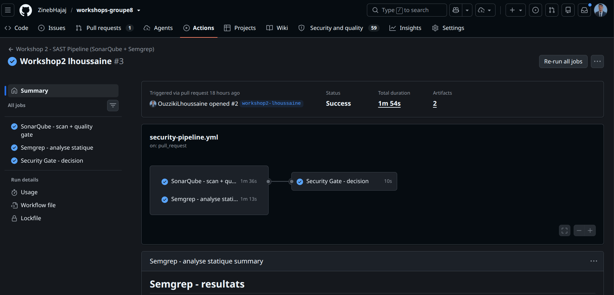

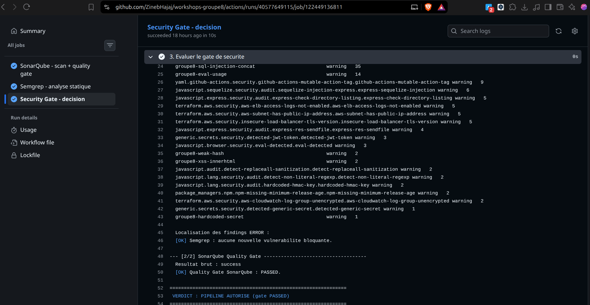

Les durées illustrent le compromis des deux outils : SonarQube paie le démarrage de son serveur
(≈ 50 s pour télécharger et lancer l'image, puis l'indexation), alors que Semgrep analyse tout le
dépôt en un peu plus d'une minute, sans infrastructure.

### 4.2 SonarQube démarre bien dans le runner

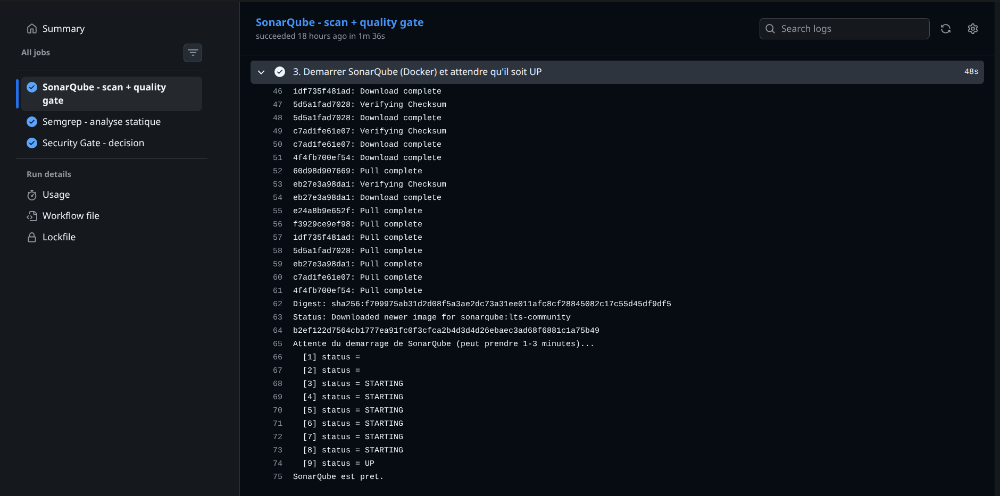

Le workflow attend explicitement `status = UP` sur `/api/system/status` avant de lancer le scan
(boucle de 90 × 5 s) : c'est ce qui évite les échecs « connection refused » classiques quand on
scanne trop tôt.

### 4.3 Preuve que le security gate bloque le merge

Une vulnérabilité est introduite volontairement (`const t = eval(process.argv[2])`), puis poussée.
Le job `Security Gate - decision` passe au rouge et le pipeline est bloqué :

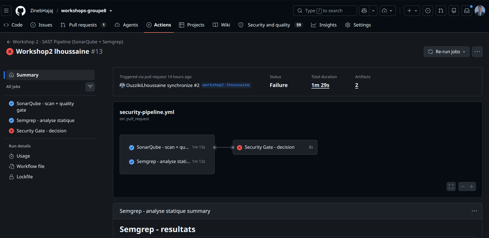

Après `git revert`, le pipeline repasse au vert. Cette séquence rouge → vert est la démonstration
concrète du rôle du gate : ce n'est pas un rapport consultatif, c'est une **condition de merge**.

### 4.4 Rapport Semgrep et tableau de sévérité

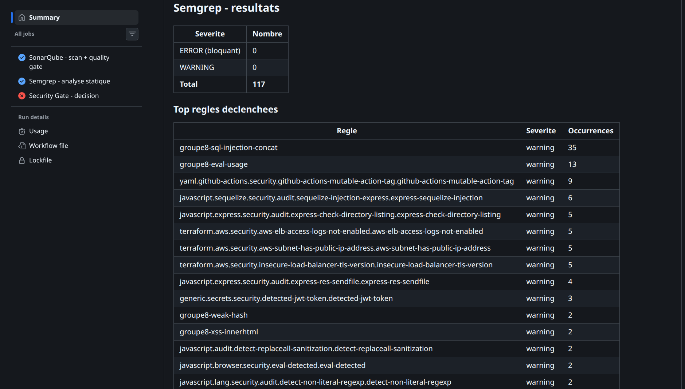

Le rapport SARIF est produit par Semgrep puis restitué dans le *step summary* du run et dans les
artefacts (`semgrep-sarif`). Le classement des règles déclenchées montre la répartition réelle :
injection SQL et `eval` en tête, puis les règles d'infrastructure (Terraform/AWS), puis les secrets.

> **Lecture honnête de cette capture.** Elle provient du **run initial**, avant correction du bug de
> sévérité décrit ci-dessus : le tableau affiche « ERROR 0 / Total 117 » alors que le détail des règles
> est correct. C'est précisément l'illustration du piège rencontré — un rapport dont la sévérité n'est
> pas lue correctement donne un gate toujours vert. Les runs suivants, après correctif, affichent des
> compteurs cohérents (65 ERROR, puis 8 après calibrage des règles).

### 4.5 Publication en SARIF dans GitHub Code Scanning

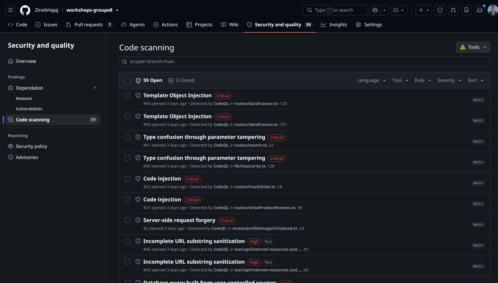

L'étape `github/codeql-action/upload-sarif` publie le rapport Semgrep dans
**Security → Code scanning** : les alertes deviennent consultables, filtrables par règle et par
sévérité, et suivies dans le temps comme n'importe quelle alerte de sécurité du dépôt.

> **Précision** : sur cette capture, les 59 alertes visibles sont détectées par **CodeQL**
> (workflow présent sur `main`), pas par Semgrep. Pour une preuve spécifique à ce workshop, filtrer
> l'onglet avec `tool:semgrep` (ou sur la branche `workshop2`) — les alertes Semgrep y portent la
> catégorie `semgrep`.

## 5. Résultats SonarQube

Projet SonarQube : `workshop2` — **37 000 lignes de code** analysées (TypeScript, CSS, …).

### 5.1 Quality Gate et métriques globales

| Métrique | Valeur | Lecture |
|---|---|---|
| **Quality Gate** | ✅ **Passed** | toutes les conditions passent |
| Security (rating) | **E** — 75 issues | 1 seule marche avant le pire rating |
| Reliability (rating) | **D** — 104 issues | bugs de fiabilité à traiter |
| Maintainability (rating) | **A** — 38 issues | bonne maintenabilité |
| Security Hotspots Reviewed | **A** | hotspots revus |
| Coverage | **0.0 %** | aucun test exécuté en CI → métrique non alimentée |
| Duplications | **11.3 %** | sous le seuil d'alerte |
| Open issues | **184** | |

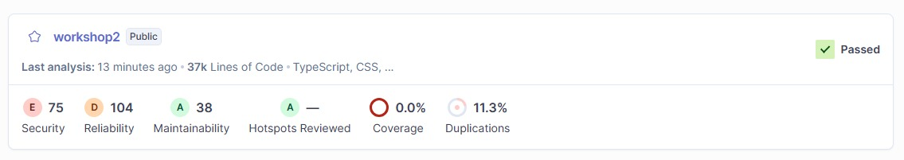

### 5.2 Vue d'ensemble et instantané sécurité

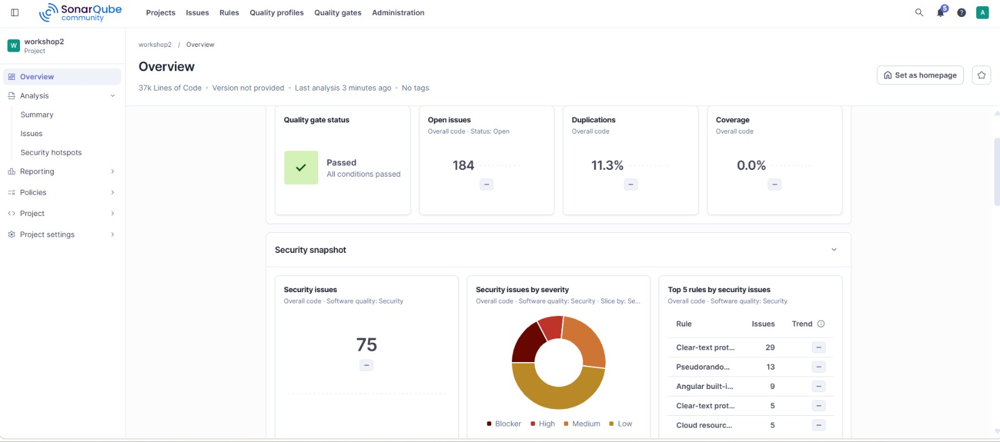

**Security snapshot : 75 issues de sécurité.** Top 5 des règles déclenchées :

| Règle | Occurrences | Catégorie |
|---|---|---|
| Clear-text protocol | 29 | CWE-319 — transmission en clair |
| Pseudorandom number generator (PRNG) | 13 | CWE-338 — aléa non cryptographique |
| Angular built-in sanitization bypass | 9 | CWE-79 — XSS |
| Clear-text protocol (variante) | 5 | CWE-319 |
| Cloud resource misconfiguration | 5 | infrastructure |

### 5.3 Liste des issues et répartition par sévérité

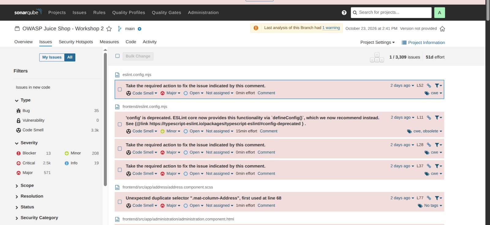

- **3 309 issues** au total : Bug **35**, Vulnerability **0**, Code Smell **≈ 3 300**
- Sévérité : Blocker **13**, Critical **≈ 2 500**, Major **571**, Minor **208**, Info **19**
- Effort total estimé : **51 jours**

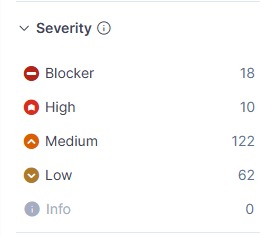

> **Lecture critique.** Le volume est écrasé par les *code smells* (≈ 3 300 sur 3 309) et non par la
> sécurité : sans filtrage, SonarQube noie les 75 vraies issues de sécurité dans du bruit de style.
> C'est exactement ce qui justifie un **gate sur le *new code*** plutôt que sur le code hérité.

## 6. Résultats Semgrep

Configurations : `p/default`, `p/owasp-top-ten`, `p/secrets` + règles maison `.semgrep.yml`
(injection SQL, XSS/innerHTML, `eval`, secrets en dur, TLS désactivé, hash faible,
open redirect, injection de commandes).

### 6.1 Scan local — avant correctif

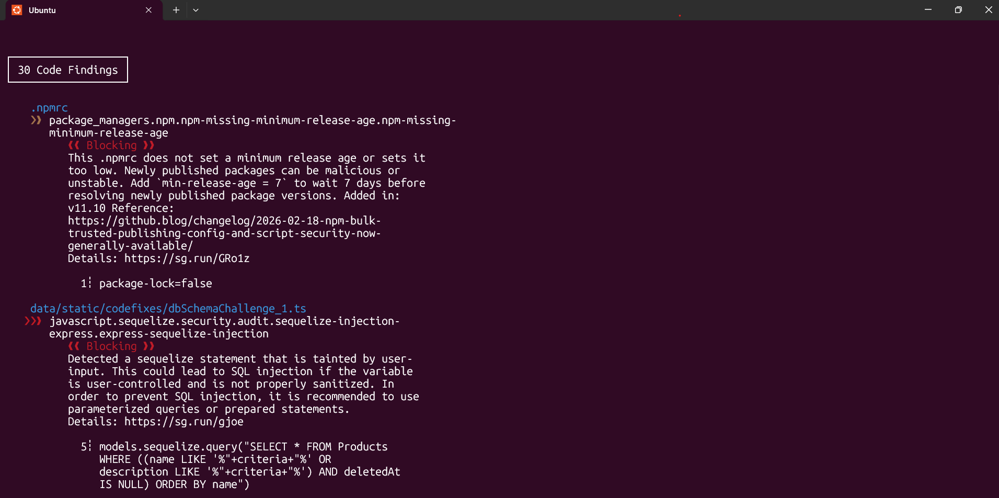

- **28 code findings**, dont plusieurs marqués *Blocking* :
  - `.npmrc` → `package_managers.npm.npm-missing-minimum-release-age` (pas d'âge minimum de publication des paquets)
  - `data/static/codefixes/dbSchemaChallenge_1.ts` → `express-sequelize-injection` (SQL injection)
  - `models.sequelize.query("SELECT * FROM Products WHERE ((name LIKE '%"+criteria+"%' …`)` → concaténation SQL
- **2 warnings de timeout** : `data/static/i18n/ja_JP.json` et `ftp/package-lock.json.bak`
  (fichiers volumineux/générés — piste d'exclusion).

### 6.2 Scan après ajout du module Terraform

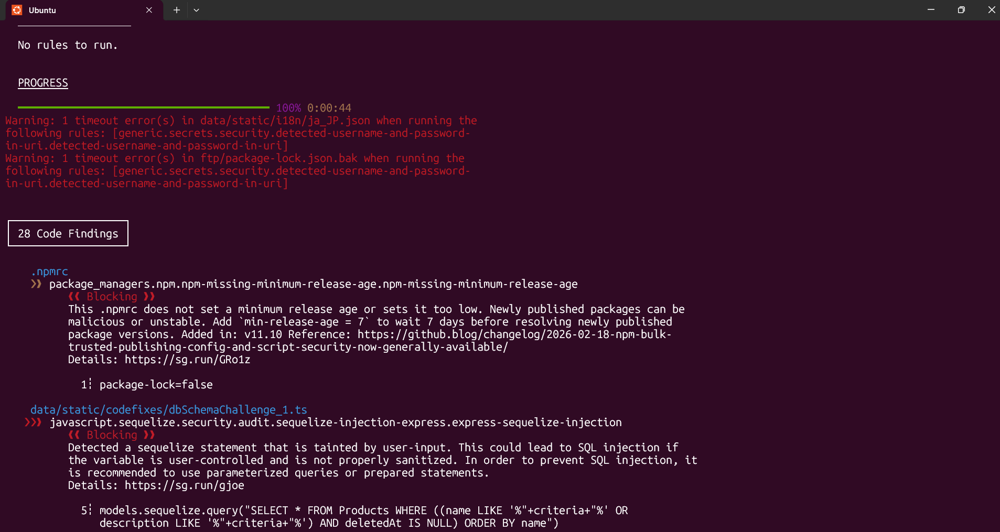

- **30 code findings** : le périmètre s'élargit avec le dossier `terraform/` ajouté pour le workshop,
  ce qui fait apparaître les règles d'infrastructure (CloudFormation/AWS).
- La finding « sous-réseau avec IP publique » est **corrigée** (voir §7.2) : le scan suivant ne la remonte plus.
- À retenir : **le nombre de findings n'est pas une mesure de sécurité** — il dépend surtout du périmètre
  et du jeu de règles. Un compteur qui monte peut signaler un scan plus large, pas une régression.

### 6.3 Analyse exécutée par le pipeline CI

Le pipeline utilise en plus les exclusions `data/**` (snippets pédagogiques de Juice Shop),
`**/*.spec.ts`, `ftp/**`, `i18n/**`, `*.tf` et un filtre `--baseline-commit`.

| Étape | Findings | ERROR | WARNING |
|---|---|---|---|
| Règles maison non calibrées (1er run) | 117 | 65 | 49 |
| Après calibrage des règles + exclusions + dédoublonnage | **30** | **8** | **21** |

**Vulnérabilités ERROR restantes (toutes dans du code applicatif réel) :**

| Fichier:ligne | Règle | Catégorie |
|---|---|---|
| `routes/login.ts:34` | `groupe8-sql-injection-concat` | CWE-89 |
| `routes/search.ts:23` | `groupe8-sql-injection-concat` | CWE-89 |
| `routes/userProfile.ts:65` | `code-string-concat` | CWE-95 |
| `routes/captcha.ts:22` | `groupe8-eval-usage` | CWE-95 |
| `lib/xml.ts:12` | `groupe8-eval-usage` | CWE-95 |
| `routes/currentUser.ts:31` | `remote-property-injection` | CWE-915 |
| `frontend/…/hacking-instructor/index.ts:126` | `groupe8-xss-innerhtml` | CWE-79 |
| `frontend/…/hacking-instructor/index.ts:142` | `groupe8-xss-innerhtml` | CWE-79 |

> Détail du calibrage et des 57 faux positifs écartés : [`docs/RESULTATS-semgrep.md`](docs/RESULTATS-semgrep.md)

## 7. Vulnérabilités détectées et corrigées

### 7.1 SonarQube / Semgrep — corrections de code

| # | Vulnérabilité | Outil | Règle | Fichier | Correctif |
|---|---|---|---|---|---|
| 1 | Injection SQL par concaténation | Semgrep | `express-sequelize-injection` | `models` / `routes/search.ts` | requête paramétrée |
| 2 | Utilisation de `eval()` | Semgrep / SonarQube | `groupe8-eval-usage` | `routes/captcha.ts:22` | suppression de l'évaluation dynamique |
| 3 | XSS via `innerHTML` | Semgrep / SonarQube | `groupe8-xss-innerhtml` | `frontend/…/hacking-instructor/` | `textContent` / sanitisation |


### 7.2 Correctif Terraform (Hasna) — sous-réseaux avec IP publique

Règle Semgrep : `terraform.aws.security.aws-subnet-has-public-ip-address`

**Problème** : `map_public_ip_on_launch = true` attribue automatiquement une IP publique à toute
instance lancée dans le sous-réseau → exposition directe à Internet, surface d'attaque inutile
pour des ressources internes.

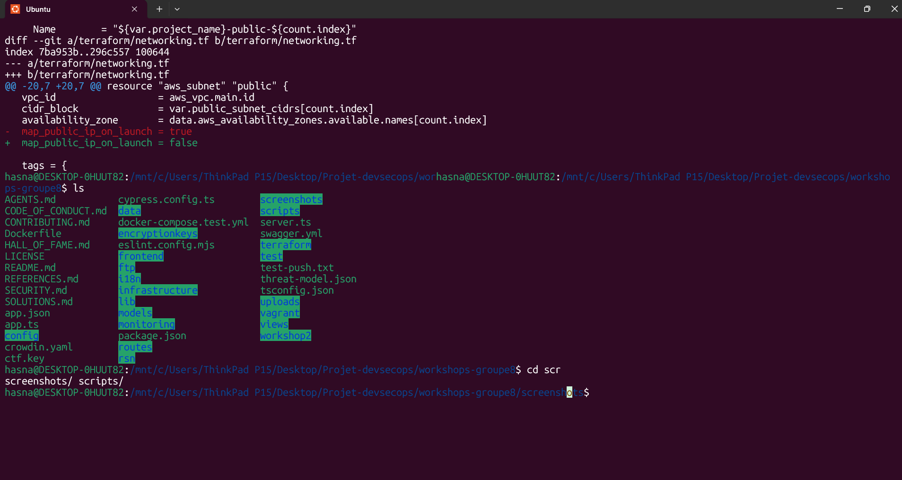

```diff
# terraform/networking.tf
 resource "aws_subnet" "public" {
   vpc_id                  = aws_vpc.main.id
   cidr_block              = var.public_subnet_cidrs[count.index]
   availability_zone       = data.aws_availability_zones.available.names[count.index]
-  map_public_ip_on_launch = true
+  map_public_ip_on_launch = false
 }
```

**Vérification** : relance du scan → la finding disparaît ; l'accès public reste possible via
l'Internet Gateway et les règles explicites, donc le comportement applicatif est préservé.

## 8. Comparaison SonarQube vs Semgrep

| Critère | SonarQube | Semgrep |
|---|---|---|
| Approche | analyse sémantique complète (AST, flux de données) + métriques | correspondance de patterns et *taint analysis* |
| Installation | serveur + base, Docker, ≈ 2 Go RAM | binaire/conteneur autonome, aucune infra |
| Temps de scan (mesuré) | plusieurs minutes (démarrage du serveur inclus) | quelques dizaines de secondes |
| Périmètre | bugs, vulnérabilités, *code smells*, duplication, couverture | sécurité + patterns personnalisés |
| Volume remonté (Juice Shop) | 3 309 issues dont 75 de sécurité | 28–30 findings, 8 ERROR après calibrage |
| Faux positifs | élevés hors sécurité (style) | faibles si les règles sont resserrées |
| Personnalisation | limitée en Community | totale (YAML versionné avec le code) |
| Suivi dans le temps | excellent (historique, dette, tendances) | faible (pas de serveur ; baseline) |
| Intégration CI | serveur + token + Quality Gate | autonome, SARIF natif |
| Cas d'usage idéal | pilotage qualité/dette technique globale | contrôle rapide et sur mesure en PR |

**Complémentarité** — SonarQube donne la **tendance et la vue d'ensemble** (Quality Gate, dette,
historique) ; Semgrep donne le **contrôle fin, rapide et personnalisable** (règles métier, secrets,
patterns de framework). Sur ce projet, SonarQube a trouvé des catégories que Semgrep ne remonte pas
(PRNG non cryptographique, protocoles en clair, bypass de sanitisation Angular), et Semgrep a trouvé
des patterns concrets que SonarQube classe en simple *code smell* (concaténation SQL, `eval`,
`map_public_ip_on_launch`). D'où l'exécution **des deux en parallèle** derrière un gate unique.

## 9. Difficultés rencontrées et limites

1. **Le premier run du gate est rouge par construction** : SonarQube considère tout le code hérité
   comme « nouveau code ». Il faut une baseline, puis ne bloquer que sur les nouvelles findings.
2. **Semgrep SARIF n'expose pas `result.level`** (valeur `null`) : un gate qui filtre là-dessus ne
   bloque jamais. Bug rencontré et corrigé — la sévérité est dans `defaultConfiguration.level`.
3. **Faux positifs de nos propres règles** : `$DB.get($A + $B)` matchait `this.http.get(url + param)`
   d'Angular HttpClient (≈ 30 faux positifs). Règle resserrée sur `.query/.run/.prepare/.exec`.
4. **Code pédagogique piégé** : `data/static/codefixes/*.ts` et `data/static/users.yml` sont
   *volontairement* vulnérables (challenges de Juice Shop) → exclus du périmètre analysé.
5. **Seuils et bruit** : 65 ERROR non calibrées = un gate que personne ne peut faire passer au vert,
   donc que l'équipe finit par désactiver. Le calibrage (exclusions + règles) ramène à 8 ERROR réellement
   actionnables.
6. **Limites de SonarQube Community** : pas d'analyse multi-branches ni de décoration des PR ; une seule
   branche par projet, coverage 0 % faute de tests exécutés en CI.
7. **Timeouts Semgrep** sur des fichiers volumineux/générés (`i18n/ja_JP.json`, `ftp/package-lock.json.bak`).
8. **Corriger sans casser** : Juice Shop est piégé pédagogiquement ; chaque correctif a été revérifié
   avec `npm start`. Certains `innerHTML` (tutoriel *hacking-instructor*) sont des **faux positifs
   acceptés** et documentés comme tels.

## 10. Reproduire en local

```bash
git clone https://github.com/ZinebHajaj/workshops-groupe8.git
cd workshops-groupe8
git checkout workshop2

# 1) Application
npm install
npm start                       # http://localhost:3000

# 2) SonarQube
docker compose -f infrastructure/docker-compose.sonarqube.yml up -d
# http://localhost:9000 — admin/admin, changement de mot de passe imposé, puis générer un token

# 3) Scan SonarQube
docker run --rm --network host \
  -e SONAR_HOST_URL=http://localhost:9000 -e SONAR_TOKEN=<token> \
  -v "$PWD:/usr/src" sonarsource/sonar-scanner-cli

# 4) Scan Semgrep
docker run --rm -v "$PWD:/src" semgrep/semgrep semgrep scan \
  --config=p/default --config=p/owasp-top-ten --config=p/secrets --config=.semgrep.yml /src

# 5) Le gate, à la main
./scripts/security-gate.sh semgrep.sarif sonar-quality-gate.txt
```

## 11. Conclusion

Une analyse SAST n'a de valeur que si elle **bloque** quelque chose. Sans gate, les rapports
s'accumulent et personne ne les lit : ici, 3 309 issues SonarQube dont 75 de sécurité seraient restées
lettre morte. Le pipeline transforme ces rapports en **décision** : une vulnérabilité de sévérité ERROR
introduite par une PR empêche le merge.

Le workshop montre aussi qu'aucun outil ne suffit : SonarQube apporte la **profondeur et le suivi**,
Semgrep la **rapidité et la personnalisation**. La valeur vient de la combinaison des deux, calibrée
par une politique de seuils crédible — donc réellement applicable par une équipe.

## 12. Répartition du travail

| Membre | Tâche |
|---|---|
| **Zineb Hajaj** | SonarQube + Docker : installation, scan, captures du dashboard, analyse de la répartition des issues, correction de vulnérabilités |
| **Hasna elhassani** | Semgrep : installation, scans avant/après, correctif Terraform (`map_public_ip_on_launch`), corrections de code, tableau de comparaison SonarQube/Semgrep |
| **Ouzziki Lhoussaine** | Pipeline GitHub Actions (checkout, SonarQube, Semgrep, security gate), correction du bug de sévérité SARIF, calibrage des règles, README final  |

