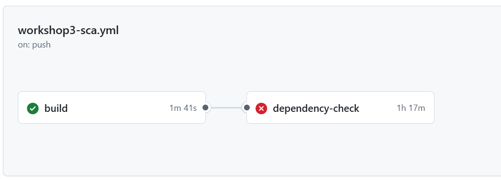
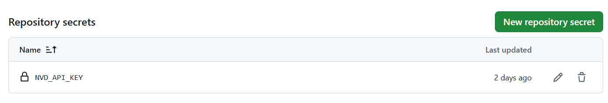
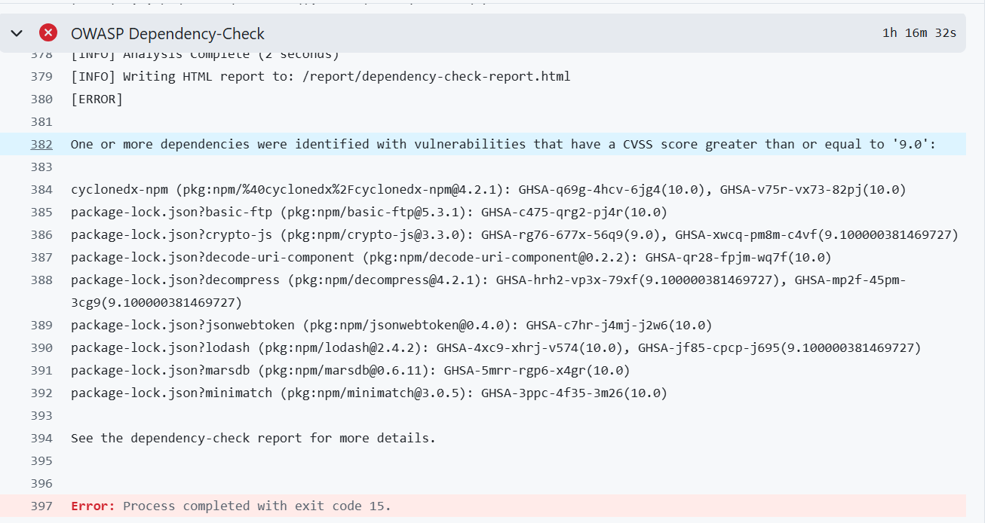
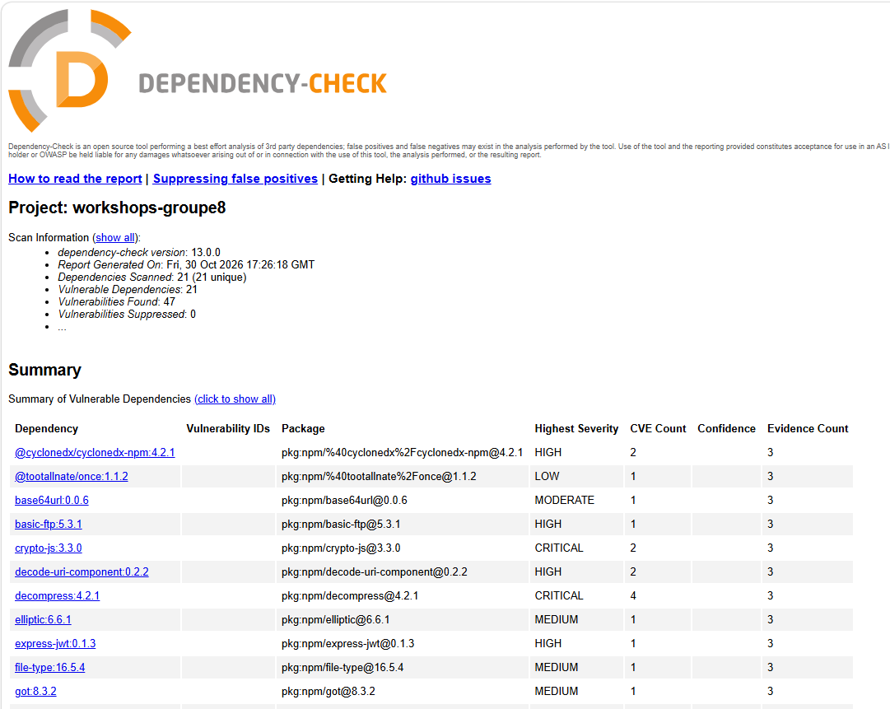
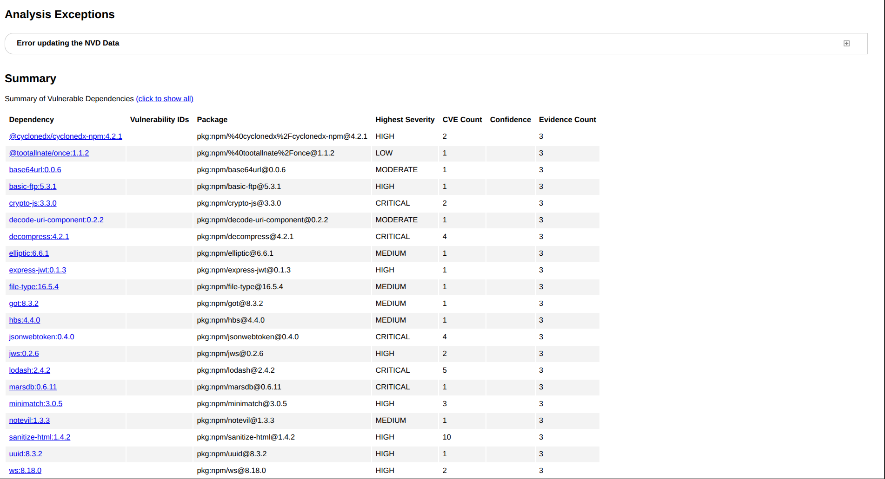
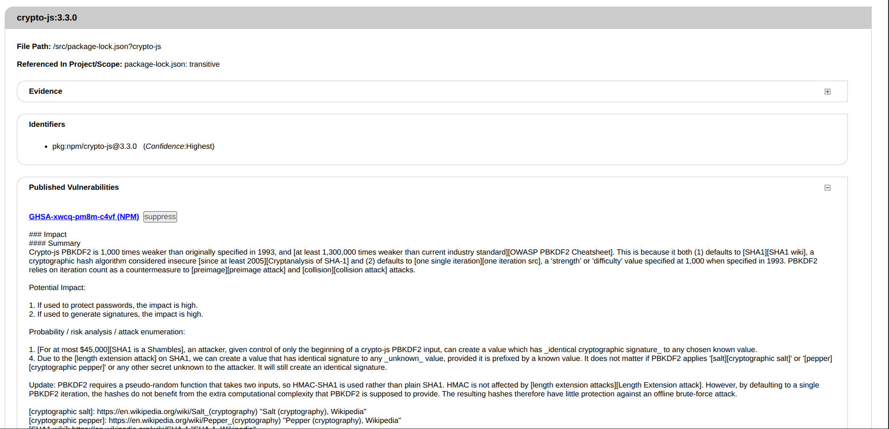
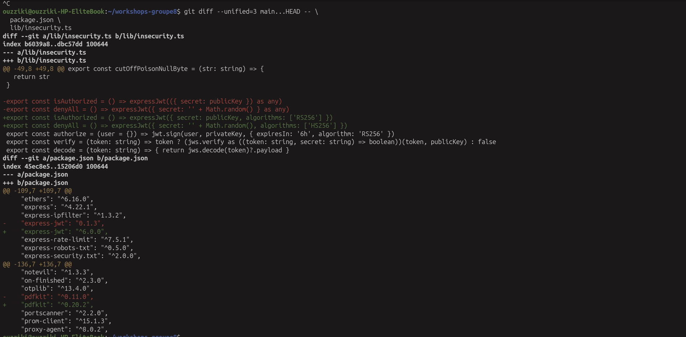
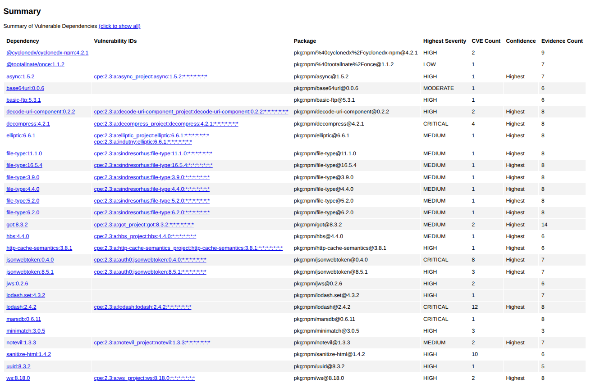
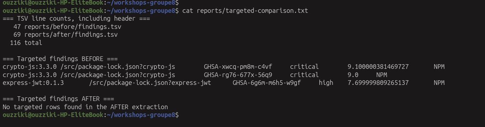
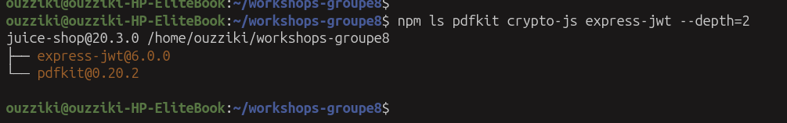

# Workshop 3 — Sécurité des dépendances : Dependabot & OWASP Dependency-Check

**Groupe 8** — Zineb Hajaj · Hasna elhassani · Ouzziki Lhoussaine
**Projet analysé** : OWASP Juice Shop (Node.js / Angular / TypeScript)
**Dépôt** : https://github.com/ZinebHajaj/workshops-groupe8
**Branche de rendu** : `Workshop3`

## Sommaire

1. Objectif
2. Outils et environnement
3. Organisation du dépôt (branches)
4. Pipeline CI : build → Dependency-Check → security gate
5. Résultats OWASP Dependency-Check (état avant)
6. Corrections et comparaison avant / après
7. Dependabot
8. Comparaison Dependabot vs Dependency-Check
9. Difficultés rencontrées et limites
10. Reproduire en local
11. Conclusion
12. Répartition du travail

## 1. Objectif

Une application moderne est surtout composée de bibliothèques tierces : une seule dépendance vulnérable suffit à exposer tout le projet (Log4Shell, Event-Stream). Ce workshop met en place deux protections complémentaires sur le projet commun :

- **OWASP Dependency-Check** détecte les dépendances vulnérables (directes et transitives) et produit un rapport ;
- **Dependabot** propose automatiquement des mises à jour sous forme de pull requests.

Les deux sont intégrés dans un pipeline CI/CD (GitHub Actions) qui vérifie que le projet compile et bloque le pipeline quand une vulnérabilité critique est détectée. Les vulnérabilités ciblées sont ensuite corrigées, avec une comparaison avant / après.

## 2. Outils et environnement

| Outil | Version / configuration | Rôle |
|---|---|---|
| OWASP Dependency-Check | 13.0.0, image Docker `owasp/dependency-check:latest` (digest `sha256:0e8f69ad5b00d62000937f4e57189812343f6903d9c83ee712012d51542a020a`) | Détection des dépendances vulnérables, rapport HTML, security gate |
| Node Audit Analyzer | intégré à Dependency-Check, interroge les advisories npm (identifiants GHSA) | Analyse des lockfiles npm |
| NVD (National Vulnerability Database) | API avec clé stockée dans les secrets du dépôt (`NVD_API_KEY`) | Base de CVE mise à jour par Dependency-Check |
| Dependabot | configuration version 2, écosystème npm (racine et `/frontend`) | Pull requests de mise à jour automatiques |
| GitHub Actions | `ubuntu-latest` | Orchestration du pipeline |
| Node.js / npm | Node 22 ; `--legacy-peer-deps` pour le frontend | Build du projet |

## 3. Organisation du dépôt (branches)

Chaque workshop est livré sur sa propre branche. La branche `Workshop3` est le rendu : chaque membre travaille sur sa branche et l'intègre par pull request.

```
main                                          projet de base (Juice Shop)
 └── Workshop3                                LIVRABLE du workshop 3 (intégration)
      ├── workshop3-pipeline-zineb            Pipeline GitHub Actions + README
      ├── workshop3-dependabot-hasna          Dependabot (dependabot.yml, lockfile frontend)
      └── workshop3-dependency-check-lhoussaine   Scan, corrections de versions, preuves avant/après
```

| Branche | Auteur | Contenu |
|---|---|---|
| `Workshop3` | — | intégration : pipeline + Dependabot + corrections + README |
| `workshop3-pipeline-zineb` | Zineb Hajaj | `.github/workflows/workshop3-sca.yml`, secret NVD, captures du pipeline |
| `workshop3-dependabot-hasna` | Hasna elhassani | `.github/dependabot.yml`, lockfile du frontend |
| `workshop3-dependency-check-lhoussaine` | Ouzziki Lhoussaine | corrections `pdfkit` et `express-jwt`, `docs/workshop3/` (résultats, captures, scripts) |

Les branches `dependabot/npm_and_yarn/...` sont créées automatiquement par Dependabot : ce sont ses mises à jour proposées (voir section 7).

**URL de rendu (Google Classroom)** : https://github.com/ZinebHajaj/workshops-groupe8/tree/Workshop3

## 4. Pipeline CI

Fichier : `.github/workflows/workshop3-sca.yml`. Il se déclenche à chaque push sur une branche dont le nom commence par `Workshop3` ou `workshop3`, et peut aussi être lancé à la main (`workflow_dispatch`).

```
 push sur Workshop3* / workshop3*  (ou lancement manuel)
        │
        ▼
 ┌─────────────────────────────────────┐
 │ JOB 1 : build                       │
 │  • npm install (serveur)            │
 │  • npm install --legacy-peer-deps   │
 │    (frontend)                       │
 │  • compilation frontend + serveur   │
 └──────────────────┬──────────────────┘
                    │ needs
                    ▼
 ┌─────────────────────────────────────┐
 │ JOB 2 : dependency-check            │
 │  • génération des lockfiles         │
 │  • mise à jour de la base NVD       │
 │  • scan OWASP Dependency-Check      │
 │  • SECURITY GATE : CVSS ≥ 9         │
 └──────────────────┬──────────────────┘
                    ▼
      Artifact : dependency-check-report (HTML)
      (conservé même si le gate échoue)
```

Étapes clés

1. **Build** — installation des dépendances du serveur puis du frontend, compilation du frontend (`npm run build:frontend`) puis du serveur TypeScript (`npm run build:server`). Ce job prouve que le projet compile sans erreur ; le job d'analyse ne démarre que s'il réussit.
2. **Lockfiles** — le projet désactive les lockfiles (`package-lock=false`). Le job d'analyse en génère un pour la racine et un pour le frontend, afin que Dependency-Check connaisse les versions exactes.
3. **Dependency-Check** — l'image Docker officielle est lancée avec `--scan`, `--exclude "**/test/**"`, `--format HTML`, la clé NVD lue dans une variable d'environnement et le seuil `--failOnCVSS 9`.
4. **Artifact** — le rapport HTML est publié par `actions/upload-artifact` avec `if: always()`.

| Code de sortie | Signification |
|---|---|
| 15 | Le security gate bloque : une dépendance a un score CVSS ≥ 9 |
| 13 | Erreur d'exécution de l'outil (par exemple clé NVD invalide) |

Points importants

- **La clé NVD n'apparaît jamais dans le code** : elle est enregistrée dans *Settings → Secrets and variables → Actions* et transmise au job par variable d'environnement.
- **Le gate est rouge par construction** sur un projet volontairement vulnérable : c'est le comportement attendu, pas une panne.
- **Pourquoi pas l'action officielle ?** Le premier essai avec `dependency-check/Dependency-Check_Action` a produit un rapport peu fiable : l'action ajoute `--noupdate`, donc la base NVD n'était pas mise à jour (analyse NVD en 0 seconde), et nos arguments étaient transmis comme une seule chaîne. Le pipeline lance donc l'image Docker directement.
- **Cache de la base NVD** — une étape de cache est présente, mais GitHub n'enregistre un cache qu'à la fin d'un job réussi : tant que le gate échoue, la base est retéléchargée à chaque exécution.





## 5. Résultats OWASP Dependency-Check (état avant)

Rapport produit par le pipeline sur le code d'origine (avant les corrections de la section 6) : 21 dépendances analysées, 21 dépendances vulnérables, 47 vulnérabilités trouvées.

Neuf composants ont un score CVSS ≥ 9 et déclenchent le security gate :

| Composant | Version | Identifiants | Score maximum |
|---|---|---|---|
| @cyclonedx/cyclonedx-npm | 4.2.1 | GHSA-q69g-4hcv-6jg4, GHSA-v75r-vx73-82pj | 10.0 |
| basic-ftp | 5.3.1 | GHSA-c475-qrg2-pj4r | 10.0 |
| crypto-js | 3.3.0 | GHSA-rg76-677x-56q9, GHSA-xwcq-pm8m-c4vf | 9.1 |
| decode-uri-component | 0.2.2 | GHSA-qr28-fpjm-wq7f | 10.0 |
| decompress | 4.2.1 | GHSA-hrh2-vp3x-79xf, GHSA-mp2f-45pm-3cg9 | 9.1 |
| jsonwebtoken | 0.4.0 | GHSA-c7hr-j4mj-j2w6 | 10.0 |
| lodash | 2.4.2 | GHSA-4xc9-xhrj-v574, GHSA-jf85-cpcp-j695 | 10.0 |
| marsdb | 0.6.11 | GHSA-5mrr-rgp6-x4gr | 10.0 |
| minimatch | 3.0.5 | GHSA-3ppc-4f35-3m26 | 10.0 |





**Lecture honnête.** Les chiffres varient légèrement d'une exécution à l'autre (46 puis 47 vulnérabilités, 8 puis 9 composants ≥ 9) : les advisories interrogées par Node Audit évoluent dans le temps. Les identifiants sont de type GHSA : ces résultats viennent surtout de l'analyseur Node Audit, et non de la correspondance NVD classique (l'analyse NVD du pipeline ne remonte rien sur les paquets npm).

## 6. Corrections et comparaison avant / après

Les corrections sont de **Ouzziki Lhoussaine** ; le détail complet est dans `docs/workshop3/dependency-check/resultats.md`.

### 6.1 Corrections appliquées

| # | Dépendance | Avant | Après | Commit |
|---|---|---|---|---|
| 1 | `pdfkit` (qui amenait `crypto-js@3.3.0`) | 0.11.0 | 0.20.2 | `a1c15a5` |
| 2 | `express-jwt` | 0.1.3 | 6.0.0 | `c60aca3` |

- **Correction 1** : `pdfkit@0.20.2` ne dépend plus de `crypto-js`. Mettre à jour le parent supprime la dépendance vulnérable sans l'ajouter comme dépendance directe. Résultat : `crypto-js` est absent du lockfile et de `npm ls`.
- **Correction 2** : passage à `express-jwt@6.0.0`, avec `algorithms: ['RS256']` dans `isAuthorized`, `algorithms: ['HS256']` dans `denyAll`, et suppression des casts `as any` qui masquaient les options devenues obligatoires.

| Vérification | Résultat |
|---|---|
| Build frontend et serveur TypeScript | Réussis |
| `test/server/order.unit.test.ts` | 10 réussis, 0 échoué |
| `insecurity.unit.test.ts` | 54 réussis, 0 échoué |

### 6.2 Résultat ciblé

| Dépendance avant | Advisory | Sévérité | Correction | Après |
|---|---|---|---|---|
| `crypto-js@3.3.0` via `pdfkit@0.11.0` | GHSA-xwcq-pm8m-c4vf | Critical 9.1 | PDFKit 0.20.2 | Absente |
| `crypto-js@3.3.0` via `pdfkit@0.11.0` | GHSA-rg76-677x-56q9 | Critical 9.0 | PDFKit 0.20.2 | Absente |
| `express-jwt@0.1.3` | GHSA-6g6m-m6h5-w9gf | High 7.7 | Express-JWT 6.0.0 | Absente |

Les trois findings sont présents dans l'extraction « avant » et absents de l'extraction « après ». Un `npm audit --package-lock-only --json` indépendant confirme l'absence des trois advisories.

### 6.3 Lecture correcte des totaux

| Extraction | NPM | NVD | Total |
|---|---:|---:|---:|
| Avant | 46 | 0 | 46 |
| Après | 45 | 23 | 68 |

Le total « après » est plus élevé, mais ce n'est pas une régression : la couverture n'est pas la même (analyse npm seule avant ; npm et NVD après, avec une base NVD locale). Une comparaison normalisée par `package:version + advisory/CVE` donne **3 couples supprimés** (exactement les trois findings ciblés) et 25 couples supplémentaires (23 NVD, 2 NPM), à trier. Ils ne prouvent pas que les corrections aient introduit de nouvelles vulnérabilités.

### 6.4 Limites

- Le scan « après » a été exécuté **en local** avec la même image Docker et les mêmes manifests, avec `--noupdate`, `--network host` et `--disableNodeAuditCache`, car la mise à jour de la base NVD échouait à plusieurs reprises. Le pipeline exécuté sur `Workshop3` (onglet *Actions*) complète cette preuve.
- Les autres composants à score ≥ 9 de la section 5 (`lodash`, `jsonwebtoken`, `marsdb`, `minimatch`, `basic-ftp`, `decompress`, `decode-uri-component`, `@cyclonedx/cyclonedx-npm`) ne sont **pas** déclarés corrigés : le gate continue donc de bloquer, ce qui est son rôle.
- `jsonwebtoken@0.4.0` reste une dépendance directe à traiter ; `express-jwt@6.0.0` introduit `jsonwebtoken@8.5.1`, dont les CVE nécessitent un tri distinct.

### 6.5 Captures













## 7. Dependabot

Configuration (`.github/dependabot.yml`), réalisée par **Hasna elhassani** :

| Paramètre | Valeur |
|---|---|
| Écosystème | `npm` |
| Dossiers surveillés | `/` (serveur) et `/frontend` (Angular) |
| Fréquence | tous les jours (09:00 et 09:15, fuseau Africa/Casablanca) |
| Pull requests ouvertes en même temps | 5 maximum par dossier |
| Stratégie de version | `increase-if-necessary` |
| Messages de commit | préfixe `chore(deps)` avec le nom du paquet |

Dependabot propose deux mécanismes : les **alertes** (détection de vulnérabilités connues) et les **version updates** (mises à jour automatiques), configurées par ce fichier. Dès l'activation, il a ouvert des branches de mise à jour :

| Paquet | Version proposée | Dossier |
|---|---|---|
| express-rate-limit | 8.7.1 | racine |
| express-robots-txt | 1.0.0 | racine |
| file-type | 22.2.0 | racine |
| neostandard | 0.14.1 | racine |
| @types/express | 5.0.6 | racine |
| angularx-qrcode | 22.0.1 | frontend |
| @fortawesome/free-brands-svg-icons | 7.3.1 | frontend |
| stylelint-config-sass-guidelines | 13.0.0 | frontend |
| @vitest/coverage-v8 | 5.0.5 | frontend |

Une autre pull request, `vitest` 4.1.12 vers 5.0.5 (PR n°21), a été fusionnée dans `main`.

**Lecture critique.** Ces pull requests sont des mises à jour de version : parmi celles observées, aucune ne concerne les composants critiques du gate (section 5). Dependabot maintient le projet à jour, mais il ne remplace pas une analyse de sécurité avec un seuil bloquant. Chaque mise à jour doit aussi passer par le build avant d'être fusionnée.

## 8. Comparaison Dependabot vs Dependency-Check

| Critère | Dependabot | OWASP Dependency-Check |
|---|---|---|
| Nature | Service intégré à GitHub | Outil open source OWASP (CLI / Docker) |
| Rôle | **Corriger** : propose les mises à jour | **Détecter** : liste les dépendances vulnérables |
| Résultat | Pull requests de mise à jour | Rapport HTML + code de sortie utilisable comme gate |
| Sources de données | GitHub Advisory Database | NVD, plus les advisories npm (Node Audit) |
| Déclenchement | Planifié (quotidien ici) | À chaque push, dans le pipeline |
| Installation | Un fichier `dependabot.yml` | Image Docker, clé NVD, lockfiles |
| Durée | Quelques secondes par mise à jour | 30 minutes à plus d'1 h (téléchargement de la base NVD) |
| Blocage du pipeline | Non | Oui (`--failOnCVSS`) |
| Limites | Les mises à jour peuvent casser le build ; ne cible pas forcément les vulnérabilités | Faux positifs possibles, dépend de la disponibilité de la NVD, lent |
| Cas d'usage idéal | Maintenir les dépendances à jour en continu | Auditer et bloquer un état dangereux avant le déploiement |

**Complémentarité.** Dependency-Check dit *ce qui est dangereux* et bloque le pipeline ; Dependabot propose *comment avancer* en ouvrant les mises à jour. Sur ce projet, Dependency-Check a désigné `crypto-js@3.3.0` et `express-jwt@0.1.3` ; la correction a été faite à la main en mettant à jour le parent (`pdfkit`) puis `express-jwt`. D'où l'usage des deux outils ensemble, chacun avec son rôle.

## 9. Difficultés rencontrées et limites

| Problème | Cause | Solution |
|---|---|---|
| `npm install` du frontend échoue : `Cannot read properties of null (reading 'edgesOut')` | Erreur interne de npm pendant la résolution des dépendances peer, reproduite aussi en local | `npm install --legacy-peer-deps` |
| `Invalid API Key` lors de la mise à jour de la NVD | Clé NVD non activée (lien d'activation par e-mail) | Activation, test de la clé (réponse HTTP 200), mise à jour du secret |
| Premier rapport peu fiable | L'action officielle ajoute `--noupdate` et reçoit les arguments en une seule chaîne | Lancement direct de l'image Docker, avec mise à jour de la base |
| Erreurs d'archives pendant l'analyse | ZIP d'exploit volontaires dans `test/files` (Juice Shop) | `--exclude "**/test/**"` |
| Warnings sur `node_modules` et formats CVSS | Analyse basée sur les lockfiles, vecteurs CVSS non reconnus | Non bloquant, conservés dans les journaux |
| Job très long | Téléchargement de plus de 416 000 enregistrements NVD : de 30 minutes à plus d'1 h | Accepté pour le workshop ; le cache ne se sauvegarde qu'après un job réussi |
| Mise à jour NVD en échec côté scan « après » | Indisponibilité répétée de la base | Scan avec la base locale (`--noupdate`), limites documentées en 6.4 |
| Totaux avant / après non comparables (46 puis 68) | Couverture différente (npm seul, puis npm et NVD) | Comparaison normalisée par `package:version + advisory/CVE` |
| Pipeline rouge dès le premier run | Le projet contient volontairement des dépendances critiques | C'est le rôle du gate ; il ne passera au vert qu'après correction des composants de la section 5 |

## 10. Reproduire en local

```bash
git clone https://github.com/ZinebHajaj/workshops-groupe8.git
cd workshops-groupe8
git checkout Workshop3

# 1) Build (Node 22)
npm install --ignore-scripts
(cd frontend && npm install --legacy-peer-deps)
npm run build:frontend
npm run build:server

# 2) Lockfiles
npm install --package-lock-only --package-lock=true --ignore-scripts
(cd frontend && npm install --package-lock-only --package-lock=true --ignore-scripts --legacy-peer-deps)

# 3) OWASP Dependency-Check (clé NVD dans la variable NVD_API_KEY)
mkdir -p odc-data reports
docker run --rm -u "$(id -u):$(id -g)" \
  -v "$PWD":/src \
  -v "$PWD/odc-data":/usr/share/dependency-check/data \
  -v "$PWD/reports":/report \
  owasp/dependency-check:latest \
  --scan /src --exclude "**/test/**" \
  --project workshops-groupe8 --format HTML --out /report \
  --nvdApiKey "$NVD_API_KEY" --failOnCVSS 9

# 4) Contrôle indépendant avec npm
npm audit --package-lock-only
```

Pour Dependabot : le fichier `.github/dependabot.yml` suffit ; les pull requests apparaissent ensuite dans l'onglet *Pull requests*.

## 11. Conclusion

Une analyse de dépendances n'a de valeur que si elle bloque quelque chose. Le pipeline compile le projet, analyse ses dépendances à chaque push, conserve le rapport en artifact et fait échouer le build dès qu'un composant atteint un score CVSS de 9. Ici, neuf composants critiques sont détectés : sans gate, ces résultats resteraient dans un rapport que personne n'ouvre.

Le workshop montre aussi que les deux outils se complètent : Dependency-Check détecte et bloque, Dependabot propose les mises à jour en continu. Trois findings ciblés ont été corrigés et vérifiés (`crypto-js` via `pdfkit`, et `express-jwt`) ; les autres, notamment la dette autour de `jsonwebtoken`, restent ouverts et documentés. La principale limite est la durée de l'analyse, due au téléchargement de la base NVD : un cache fiable de cette base est la première amélioration à apporter.

## 12. Répartition du travail

| Membre | Tâche |
|---|---|
| Zineb Hajaj | Pipeline GitHub Actions (build, Dependency-Check, security gate, artifact du rapport), clé NVD dans les secrets, intégration dans `Workshop3`, README final |
| Hasna elhassani | Dependabot : `dependabot.yml`, lockfile du frontend, pull requests automatiques |
| Ouzziki Lhoussaine | Scan Dependency-Check, rapport HTML, corrections `pdfkit` et `express-jwt`, comparaison avant / après, captures et scripts de preuve |

La comparaison Dependabot / Dependency-Check (section 8) a été rédigée à partir du cours et des résultats du groupe.
