# Workshops DevSecOps — Group 8 

**Groupe 8** — Zineb Hajaj · Hasna elhassani · Ouzziki Lhoussaine \
**Projet analysé :** Workshops DevSecOps \
**Dépôt :** https://github.com/ZinebHajaj/workshops-groupe8

---

# Workshop 4 — Tests de sécurité dynamiques (DAST) avec OWASP ZAP

Cible : **OWASP Juice Shop 20.3.0**, lancée en local dans un réseau Docker privé.
Scanner : **OWASP ZAP 2.17.0**.

| | |
|---|---|
| **Statut** | ✅ les trois volets sont livrés : scan passif, scan actif, intégration continue |
| **Scan passif** (Lhoussaine) | 31/10/2026 18:22 — 116 URLs — 16 alertes (0 High, 2 Medium, 5 Low, 9 Info) — code de sortie `0` — intégré dans `Workshop4` (PR #40) |
| **Scan actif** (Zineb) | 01/11/2026 01:22 → 01:36 UTC — 155 URLs — 19 alertes (0 High, 5 Medium, 5 Low, 9 Info) — intégré dans `Workshop4` (commit `7323e7a`) |
| **Intégration continue** (Hasna) | workflow `DAST - ZAP Baseline` — **fusionné dans `Workshop4`** (PR #55 → merge `7f33a69`) — run #1 réussi sur la branche de travail, **run #6 réussi (1 min 53 s) sur la branche de remise** |
| **Preuves** | 29 captures + rapports + journaux dans `docs/workshop4/` |

## Sommaire

1. [Contexte et objectifs](#1-contexte-et-objectifs)
2. [Les trois volets du workshop](#2-les-trois-volets-du-workshop)
3. [Architecture du banc de test](#3-architecture-du-banc-de-test)
4. [Préparer la cible](#4-préparer-la-cible)
5. [Scan passif (baseline)](#5-scan-passif-baseline)
6. [Analyser le scan passif](#6-analyser-le-scan-passif)
7. [Scan actif](#7-scan-actif)
8. [Intégration continue](#8-intégration-continue)
9. [Limites et angles morts](#9-limites-et-angles-morts)
10. [Tout reproduire en local](#10-tout-reproduire-en-local)
11. [Preuves, captures et reproductibilité](#11-preuves-captures-et-reproductibilité)

---

## 1. Contexte et objectifs

Ce workshop clôt la chaîne DevSecOps du module : après l'analyse des dépendances (workshop 2) et l'industrialisation du pipeline (workshop 3), il ajoute les **tests de sécurité dynamiques** — l'analyse de l'application *telle qu'elle tourne*, sans lire son code.

Objectifs :

- préparer une cible vulnérable isolée et **prouver** qu'elle est joignable depuis le scanner ;
- exécuter un scan **passif** et produire des rapports exploitables (HTML, JSON, Markdown, XML) ;
- exécuter un scan **actif autorisé** sur la même cible et trier ses résultats ;
- **corréler** les alertes dynamiques avec les résultats SAST / SCA des workshops précédents ;
- **automatiser** le scan dans la CI pour qu'il devienne un garde-fou permanent ;
- documenter et versionner chaque preuve.

> Aucun scan n'a visé un système tiers, un site public ou la production. La cible est un conteneur local sur un réseau Docker dédié, et le scan actif a fait l'objet d'un périmètre écrit (`docs/workshop4/zap-actif/perimetre.txt`).

## 2. Les trois volets du workshop

| Membre | Volet | Branche | Preuves | État |
|---|---|---|---|---|
| **Ouzziki Lhoussaine** | préparation de la cible, scan **passif** de référence, analyse et captures | [`workshop4-zap-passif-lhoussaine`](https://github.com/ZinebHajaj/workshops-groupe8/tree/workshop4-zap-passif-lhoussaine) (`81372f8`, `2557d68`, `ae74dd0`) | `docs/workshop4/zap-passif/` + 14 captures `zap-01…zap-12` | ✅ intégré dans `Workshop4` |
| **Zineb Hajaj** | scan **actif** autorisé, alertes actives, rejeu manuel, corrélation SAST | [`workshop4-zap-actif-zineb`](https://github.com/ZinebHajaj/workshops-groupe8/tree/workshop4-zap-actif-zineb) (`0d1770d`, `7323e7a`, `6df4f5d`) | `docs/workshop4/zap-actif/` + 15 captures `zap-actif-01…12` | ✅ intégré dans `Workshop4` |
| **Hasna elhassani** | workflow GitHub Actions, artefacts de CI, discussion DAST, remise | [`workshop4-zap-pipeline-hasna`](https://github.com/ZinebHajaj/workshops-groupe8/tree/workshop4-zap-pipeline-hasna) (`d54fdde`) | `.github/workflows/zap-baseline.yml`, `.zap/rules.tsv`, run #1 | ✅ fusionné dans `Workshop4` (PR #55 → `7f33a69`) |

Principe de travail : une branche par personne, un périmètre par personne, aucun résultat repris d'un autre. Chaque affirmation de ce README se rattache à un fichier de `docs/workshop4/`, à un commit ou à un run de CI.

### 2.1 La méthode : une branche par membre, puis une fusion

Chaque membre a travaillé sur **sa propre branche**, créée depuis la branche d'atelier, et **personne n'a poussé directement sur la branche de remise**. Les trois volets ont ensuite été fusionnés dans `Workshop4`, un par un, après relecture. Ce choix a trois conséquences concrètes :

- **l'attribution est vérifiable** : l'historique de chaque volet porte le nom de son auteur, et le professeur peut isoler un travail sans le confondre avec celui des autres ;
- **les conflits restent rares et tardifs** : chaque membre travaillant sur des fichiers différents, les contradictions n'apparaissent qu'au moment de la fusion, où elles sont visibles et arbitrables ;
- **chaque volet est relisible seul** : une branche peut être ouverte, comparée et validée indépendamment des deux autres — ce qui n'est pas possible quand tout le monde pousse sur la même branche.

```
main ────┬─────────────────────────────────────────────────────────────────►
         │
         ├─ workshop4-zap-passif-lhoussaine  81372f8 ─ 2557d68 ─ ae74dd0 ─┐
         │                                                                 │  PR #40
         ├─ workshop4-zap-actif-zineb        0d1770d ─ 7323e7a ─ 6df4f5d ─┤  merge 2792a49
         │                                                                 │  7323e7a
         └─ workshop4-zap-pipeline-hasna     d54fdde ─ eb2faa7 ───────────┴─► Workshop4
                                                          │  PR #55            run #6
                                                          └─ merge 7f33a69 ──────►
```

**Les quatre branches, en un clic :** [`Workshop4`](https://github.com/ZinebHajaj/workshops-groupe8/tree/Workshop4) · [`workshop4-zap-passif-lhoussaine`](https://github.com/ZinebHajaj/workshops-groupe8/tree/workshop4-zap-passif-lhoussaine) · [`workshop4-zap-actif-zineb`](https://github.com/ZinebHajaj/workshops-groupe8/tree/workshop4-zap-actif-zineb) · [`workshop4-zap-pipeline-hasna`](https://github.com/ZinebHajaj/workshops-groupe8/tree/workshop4-zap-pipeline-hasna)

| Membre | Branche de travail | Commits | Mode d'intégration | État |
|---|---|---|---|---|
| Ouzziki Lhoussaine | [`workshop4-zap-passif-lhoussaine`](https://github.com/ZinebHajaj/workshops-groupe8/tree/workshop4-zap-passif-lhoussaine) | `81372f8`, `2557d68`, `ae74dd0` | pull request **#40** → fusion `2792a49` | ✅ dans `Workshop4` |
| Zineb Hajaj | [`workshop4-zap-actif-zineb`](https://github.com/ZinebHajaj/workshops-groupe8/tree/workshop4-zap-actif-zineb) | `0d1770d`, `7323e7a`, `6df4f5d` | fusion du commit `7323e7a` | ✅ dans `Workshop4` |
| Hasna elhassani | [`workshop4-zap-pipeline-hasna`](https://github.com/ZinebHajaj/workshops-groupe8/tree/workshop4-zap-pipeline-hasna) | `d54fdde`, `eb2faa7` | pull request **#55** → fusion `7f33a69` | ✅ dans `Workshop4` — run #6 réussi (1 min 53 s) sur la branche de remise |

**Les quatre règles que le groupe s'est données :**

1. **une branche par personne**, nommée `workshop4-zap-<volet>-<prénom>` et créée depuis `Workshop4` ;
2. **aucun push sur la branche d'un camarade** — on propose, on ne corrige pas le travail des autres ;
3. **aucun force-push** : l'historique publié est définitif, sinon les preuves et les runs de CI deviennent invérifiables ;
4. **la branche de remise ne reçoit que des fusions**, jamais de commit direct : elle raconte l'assemblage, pas le travail.

**Comment le vérifier soi-même** (trois commandes, sans rien installer d'autre que `git`) :

```bash
git log --graph --oneline --all --decorate -20        # la forme de l'historique
git shortlog -sn origin/Workshop4                     # qui a écrit combien de commits
git log --oneline --author="Hasna" origin/Workshop4   # les commits d'un seul membre
```

**Pourquoi ne pas avoir tout fait sur une seule branche ?** Parce que le rendu attendu n'est pas seulement un résultat technique, c'est aussi un travail d'équipe réparti : avec une branche unique, impossible de dire qui a produit quoi, et le premier conflit sur `docs/workshop4/screenshots/` aurait coûté plus de temps que la mise en place des branches.

---

## 3. Architecture du banc de test

Deux instances de Juice Shop ont été utilisées : une pour le passif, une pour l'actif. Les deux vivent sur le même réseau Docker privé `zap-net` et n'exposent leur port que sur `127.0.0.1`.

```
   HOTE (navigateur humain)                    RESEAU DOCKER  zap-net
 +------------------------------+          +------------------------------------+
 |  127.0.0.1:3000              |   NON    |  juice-shop-groupe8:3000  (passif) |
 |  (seulement pour l'oeil)     | <------> |  juice-shop-zineb:3000    (actif)  |
 +------------------------------+          +----------------+-------------------+
                                                           | OUI / HTTP 200
                                           +---------------v-------------------+
                                           |  conteneur ZAP (ephemere)         |
                                           |  zap-baseline.py / zap-full-scan  |
                                           +-----------------------------------+
```

Un test dans le navigateur de l'hôte ne prouve **rien** sur ce que voit le scanner : ZAP vit dans un autre conteneur et doit résoudre les noms `juice-shop-groupe8` et `juice-shop-zineb` sur le réseau Docker.

### Images utilisées

| Élément | Valeur |
|---|---|
| Cible | `bkimminich/juice-shop:latest` — version **20.3.0** |
| Digest cible | `sha256:42843723a7bf4246aa5d63c324978b17ef296ac78434aeddd34c427bfb5853f4` |
| Création image cible | 2026-10-12T14:53:52Z |
| Scanner | `ghcr.io/zaproxy/zaproxy:stable` — **ZAP 2.17.0** |
| Digest scanner | `sha256:030d3df57735dacbb83464854758e674dd9ad01d79d12a129a8e58b1fd384238` |
| Création image scanner | 2026-10-26T13:34:27Z |

Les digests sont enregistrés dans `docs/workshop4/zap-passif/image-digest.txt`. Un tag peut changer de contenu ; un digest non.

## 4. Préparer la cible

### 4.1 Réseau et conteneur

```bash
docker network create zap-net
docker run -d --name juice-shop-groupe8 --network zap-net \
  -p 127.0.0.1:3000:3000 bkimminich/juice-shop:latest
```

Le port n'est publié que sur `127.0.0.1` : l'application n'est pas exposée au réseau local.

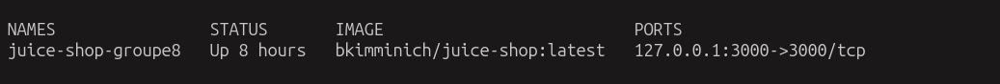

### 4.2 Vérification d'accessibilité depuis le réseau du scanner

```bash
docker run --rm --network zap-net curlimages/curl -s -o /dev/null -w '%{http_code}\n' \
  http://juice-shop-groupe8:3000
# -> 200
```

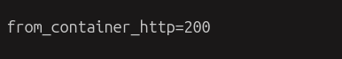

### 4.3 Identité des images

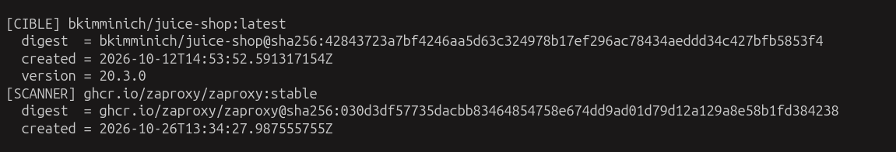

### 4.4 Échecs rencontrés et décisions

| Problème | Cause | Décision |
|---|---|---|
| `docker build` de la cible | `npm error code ERESOLVE` à la ligne 5 du `Dockerfile` (conflit `vitest` 5.0.5 ↔ `@vitest/coverage-v8 ^4.1.2`, branche principale) | ne pas reconstruire l'image : utiliser l'image publiée. Le `Dockerfile` n'est pas modifié. |
| `docker run` → `Conflict` | le nom `juice-shop-groupe8` était déjà pris par un conteneur de la veille | ancien conteneur renommé (`juice-shop-groupe8-ee5ff44-30oct`), journal conservé, puis relance |

Journaux : `docs/workshop4/zap-passif/logs/docker-build-echec.log.txt` et `logs/ancien-conteneur-30oct.log.txt`.

## 5. Scan passif (baseline)

### 5.1 Commande exécutée

```bash
docker run --rm \
  -v "$(pwd)/docs/workshop4/zap-passif:/zap/wrk/:rw" \
  --network zap-net -t ghcr.io/zaproxy/zaproxy:stable \
  zap-baseline.py -t http://juice-shop-groupe8:3000 \
  -r reports/zap-baseline.html -J reports/zap-baseline.json \
  -w reports/zap-baseline.md   -x reports/zap-baseline.xml \
  -a -I | tee logs/zap-baseline.log.txt
```

| Option | Signification |
|---|---|
| `-t` | URL cible (le nom du conteneur sur le réseau Docker) |
| `-r` / `-J` / `-w` / `-x` | rapports HTML / JSON / Markdown / XML |
| `-a` | inclure aussi les règles passives **alpha** |
| `-I` | ne pas renvoyer un code d'échec sur un WARN |

### 5.2 Résultat

```
Total of 116 URLs
FAIL-NEW: 0   FAIL-INPROG: 0   WARN-NEW: 10   WARN-INPROG: 0   INFO: 0   IGNORE: 0   PASS: 61
code_de_sortie = 0
```

> Sans `-I`, ce run aurait renvoyé **2** (avertissements sans échec) et fait échouer un job de CI. Le code `0` signifie « aucun FAIL, et les WARN ont été explicitement tolérés » — pas « application sûre ».

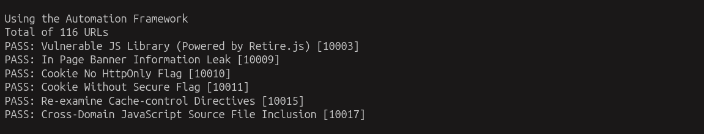

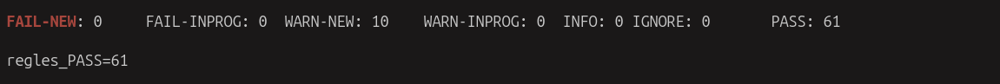

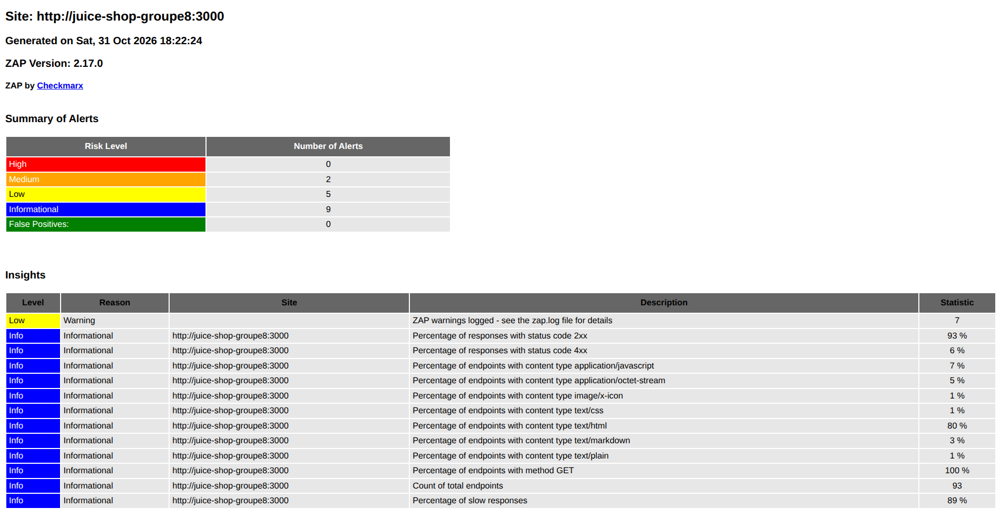

Rapports : `docs/workshop4/zap-passif/reports/` (HTML 134 Ko, JSON 54 Ko, MD 43 Ko, XML 65 Ko, `zap.yaml` 1,2 Ko).

### 5.3 Les 16 alertes

| Alerte | Plugin | Risque | Conf. | Occ. | Verdict |
|---|---|---|---|---|---|
| Content Security Policy (CSP) Header Not Set | 10038 | Medium | 3 | 5 | réel — à corriger |
| Cross-Domain Misconfiguration | 10098 | Medium | 2 | 5 | réel — `Access-Control-Allow-Origin: *` |
| Deprecated Feature Policy Header Set | 10063 | Low | 2 | 5 | réel — migrer vers `Permissions-Policy` |
| Cross-Origin-Embedder-Policy Header Missing or Invalid | 90004 | Low | 2 | 5 | réel — défense en profondeur |
| Cross-Origin-Opener-Policy Header Missing or Invalid | 90004 | Low | 2 | 5 | réel — défense en profondeur |
| Full Path Disclosure | 110009 | Low | 1 | 6 | **réel, confirmé par rejeu** |
| Dangerous JS Functions | 10110 | Low | 1 | 2 | réel mais attendu (`bypassSecurityTrustHtml`) |
| Base64 Disclosure | 10094 | Informationnel | 2 | 11 | **faux positif** |
| Storable / Storable but Non-Cacheable / Non-Storable | 10049 | Informationnel | 2 | 2 | informationnel |
| Modern Web Application | 10109 | Informationnel | 2 | 5 | informationnel |
| Sec-Fetch-Dest / -Mode / -Site / -User is Missing | 90005 | Informationnel | 3 | 3 | informationnel |

**10 plugins produisent 16 noms d'alertes** : `10049` en produit 3, `90004` en produit 2, `90005` en produit 4. Vérification :

```bash
jq '[.site[].alerts[].pluginid] | unique | length' docs/workshop4/zap-passif/reports/zap-baseline.json  # -> 10
jq '[.site[].alerts[].name] | length'            docs/workshop4/zap-passif/reports/zap-baseline.json  # -> 16
```

Détail des alertes d'en-têtes dans le rapport HTML :

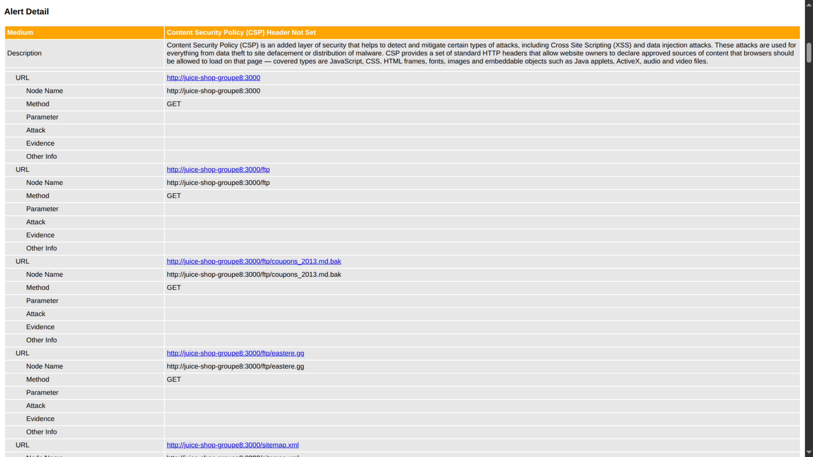

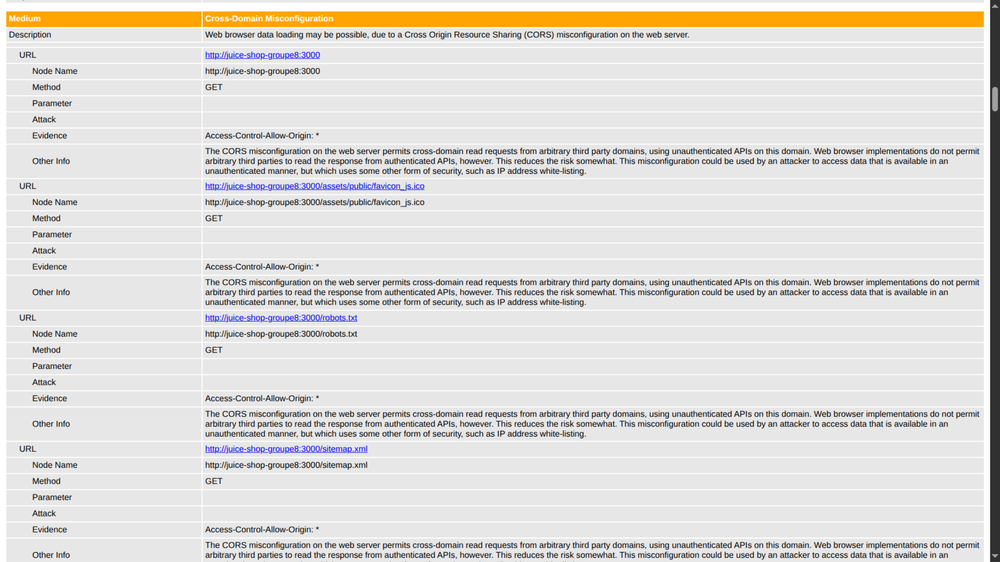

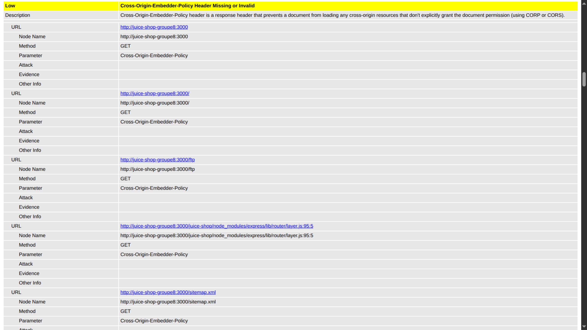

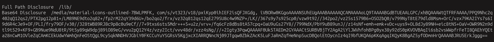

Synthèse et détail d'une alerte Medium, extraits du même rapport :

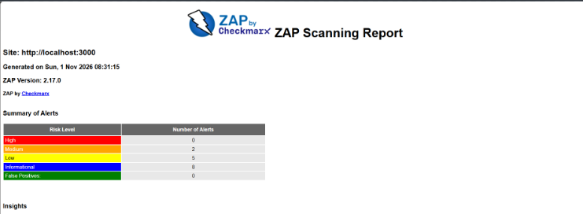

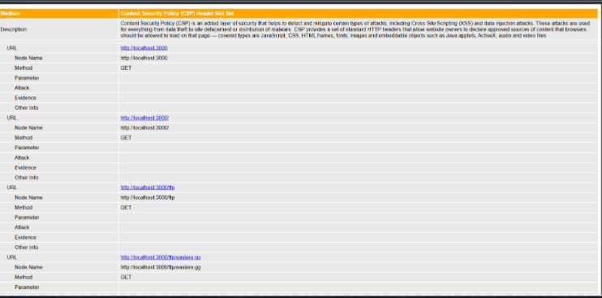

## 6. Analyser le scan passif

### 6.1 Constat confirmé : Full Path Disclosure

L'évidence fournie par ZAP est faible (fragment `/lib/`, confiance 1). Le constat a été **rejoué à la main** :

```bash
curl -i "http://juice-shop-groupe8:3000/juice-shop/node_modules/express/lib/router/layer.js:95:5"
# HTTP/1.1 403 Forbidden
# le corps de la réponse expose : /juice-shop/build/routes/fileServer.js:68:18
```

### 6.2 Faux positif écarté : Base64 Disclosure

Les 11 occurrences correspondent à des chemins de polices Google, une image PNG en data-URI dans le CSS, et un nom de fichier d'asset contenant un hachage. Aucun secret, aucune donnée personnelle.

### 6.3 Cookies : non applicables, pas « bien configurés »

Les quatre règles de cookie sont en `PASS` (`10010`, `10011`, `10029`, `10054`), mais **aucun en-tête `Set-Cookie`** n'est émis sur le périmètre public :

```bash
curl -D /tmp/h.txt -o /dev/null http://juice-shop-groupe8:3000/
grep -ci '^set-cookie' /tmp/h.txt   # -> 0
```

Vérifié sur `GET /`, `GET /rest/products/search?q=apple` et `POST /rest/user/login` (compte fictif, HTTP 401). Les attributs `HttpOnly`, `Secure` et `SameSite` sont donc **non applicables** ici.

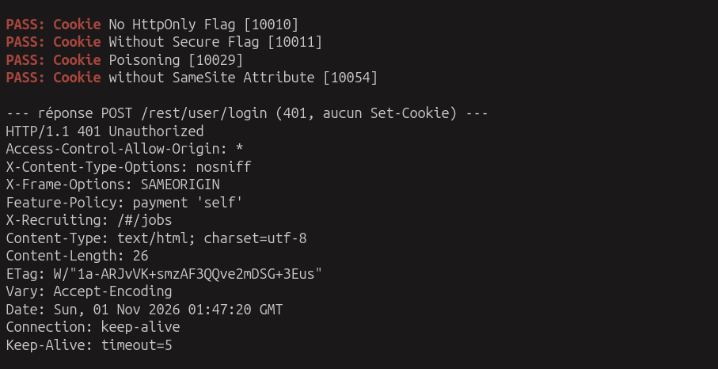

> `False Positives: 0` dans le rapport HTML ne signifie pas « aucun faux positif » : ce compteur ne compte que les alertes marquées manuellement dans ZAP. Le tri est dans `docs/workshop4/zap-passif/resultats.md`.

### 6.4 En-têtes observés sur une réponse 401

| En-tête | Valeur |
|---|---|
| `Access-Control-Allow-Origin` | `*` |
| `X-Content-Type-Options` | `nosniff` |
| `X-Frame-Options` | `SAMEORIGIN` |
| `Feature-Policy` | `payment 'self'` (déprécié) |
| `Content-Security-Policy` | absent |
| `Cross-Origin-Embedder-Policy` / `-Opener-Policy` | absents |

## 7. Scan actif

### 7.1 Cadre et autorisation

Le scan actif envoie de véritables charges d'attaque : il n'est légitime que sur une cible locale, avec un périmètre écrit.

| Élément | Valeur |
|---|---|
| Responsable | Zineb Hajaj |
| Cible | `http://juice-shop-zineb:3000` (réseau Docker privé `zap-net`, accès hôte `127.0.0.1:3000`) |
| Propriétaire / autorisation | instance lancée sur son PC personnel, accord de l'équipe Groupe 8 (répartition du 2026-11-01) |
| Plage horaire | `2026-11-01T01:22:02Z` → `2026-11-01T01:36:31Z` (≈ 14 min) |
| Chemins exclus | `/logout`, `/socket.io/*` |
| Hors périmètre | aucun site public, aucun domaine tiers, aucun service de l'école, pas GitHub, pas de production |
| Données | comptes fictifs uniquement, aucun identifiant réel |

Fichiers de cadre : `perimetre.txt` (périmètre écrit) et `scope.context` (contexte ZAP utilisé par le scan).

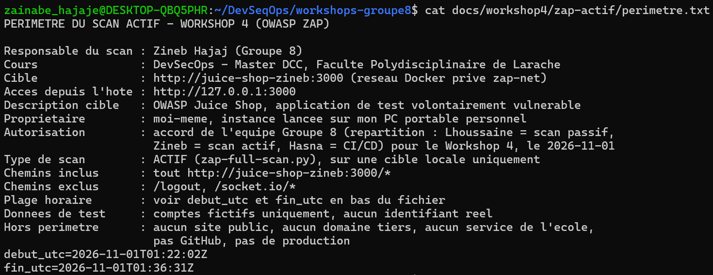

### 7.2 Commande exécutée

```bash
docker run --rm -v "$(pwd)/docs/workshop4/zap-actif:/zap/wrk/:rw" \
  --network zap-net -t ghcr.io/zaproxy/zaproxy:stable \
  zap-full-scan.py -t http://juice-shop-zineb:3000 -n scope.context \
  -m 2 -T 60 -a -I \
  -r zap-actif.html -J zap-actif.json -w zap-actif.md -x zap-actif.xml \
  | tee zap-actif.log.txt
```

| Option | Signification |
|---|---|
| `-n scope.context` | contexte ZAP : périmètre et exclusions |
| `-m 2` | 2 minutes de spider |
| `-T 60` | délai maximal de 60 minutes pour le scan |
| `-a` | inclure les règles **alpha** (actives et passives) |
| `-I` | ne pas échouer sur un WARN |

Spider AJAX **non** activé, scan **non authentifié** — deux points qui expliquent une partie des limites (section 9).

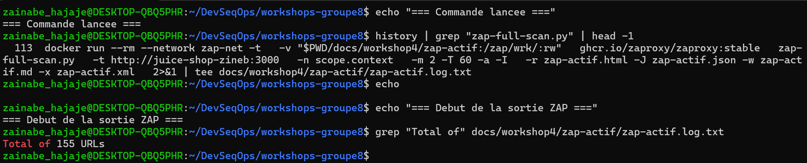

### 7.3 Résultat

| Indicateur | Valeur |
|---|---|
| URLs explorées | **155** |
| Résumé console | `FAIL-NEW 0`, `WARN-NEW 9`, `PASS 141` |
| Alertes du rapport | **19** : 0 High, 5 Medium, 5 Low, 9 Informationnel |
| Durée | ≈ 14 minutes |
| Code de sortie | non utilisé comme seuil : le scan a été lancé avec `-I`, qui neutralise l'échec sur les `WARN` |

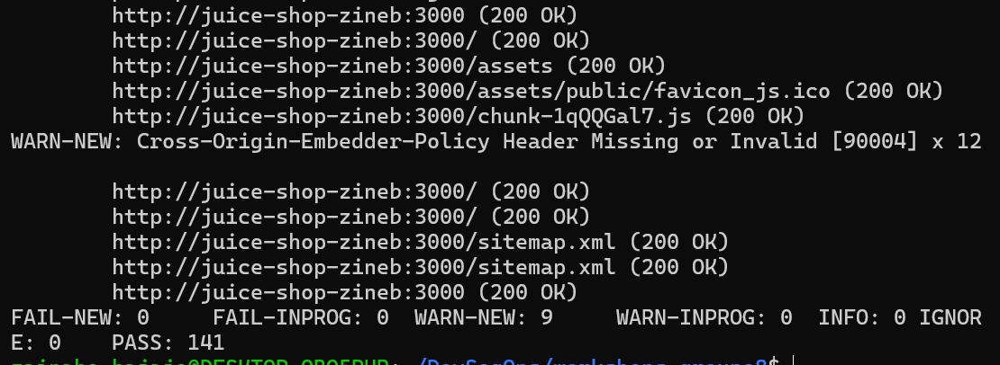

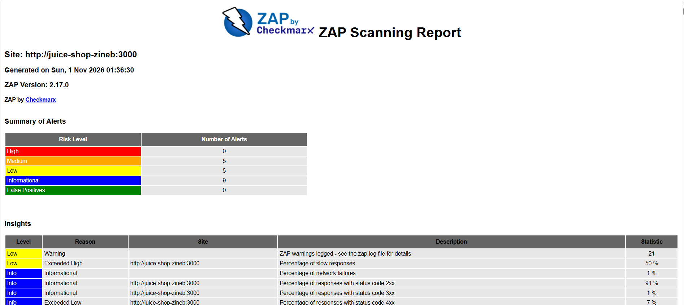

### 7.4 Les alertes retenues

| # | Alerte ZAP | Risque (confiance) | Instances | Verdict | Correction proposée |
|---|---|---|---|---|---|
| 1 | Backup File Disclosure | Medium (Medium) | 31 | **confirmé** : `/ftp/quarantine.bak` répond `200` | retirer les sauvegardes du dossier public, bloquer `/ftp` |
| 2 | Bypassing 403 | Medium (Medium) | 6 | **confirmé** : `/ftp/eastere.gg` → 403, `/%2e/ftp/eastere.gg` → 200 | normaliser le chemin avant le contrôle d'accès |
| 3 | CORS Misconfiguration | Medium (High) | 3 | **confirmé** : `Access-Control-Allow-Origin: *` | limiter aux origines de confiance |
| 4 | CSP Header Not Set | Medium (High) | 5 | détecté, non rejoué | ajouter un en-tête `Content-Security-Policy` |
| 5 | Cross-Domain Misconfiguration | Medium (Medium) | 5 | détecté, non rejoué | même correction que le CORS |
| 6 | Full Path Disclosure | Low (Low) | 6 | **confirmé** : la réponse 403 expose `juice-shop/build/routes/fileServer.js:68:18` | pages d'erreur génériques, sans chemins serveur |
| 7 | Dangerous JS Functions (CWE-749) | Low (Low) | 2 | détecté : `bypassSecurityTrustHtml(` dans `main.js` et `chunk-Cv2YgWUq.js` ; exploitabilité non prouvée | ne pas l'utiliser avec des données contrôlables par l'utilisateur |
| 8 | Cross-Origin-Embedder-Policy Missing or Invalid | Low (Medium) | 5 | détecté, non rejoué | ajouter l'en-tête COEP |
| 9 | Cross-Origin-Opener-Policy Missing or Invalid | Low (Medium) | 5 | détecté, non rejoué | ajouter `Cross-Origin-Opener-Policy` |
| 10 | Deprecated Feature Policy Header Set | Low (Medium) | 5 | **confirmé** : `Feature-Policy: payment 'self'` | remplacer par `Permissions-Policy` |

Neuf alertes informatives complètent le rapport : `Sec-Fetch-Dest/Mode/Site/User Header is Missing`, `Base64 Disclosure`, `Modern Web Application`, `Storable and Cacheable Content`, `Storable but Non-Cacheable Content`, `User Agent Fuzzer`.

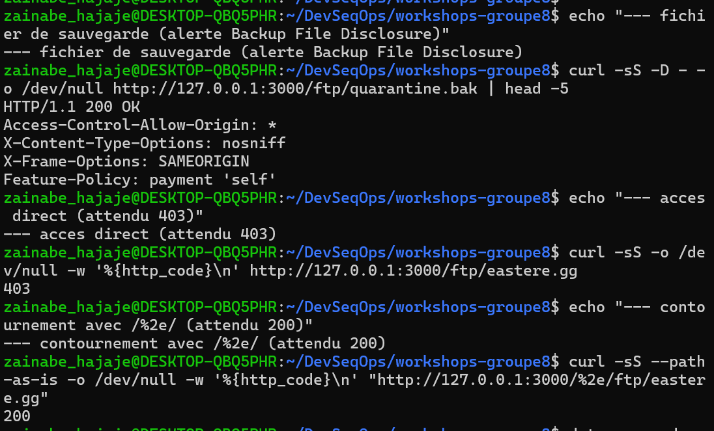

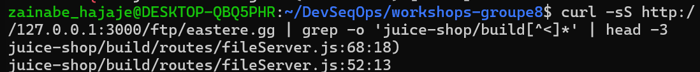

### 7.5 XSS et injections : rien de détecté, et ce que cela veut dire

Aucune alerte XSS ni injection (SQL, NoSQL, commande, LDAP, XPath) : ces règles sont en **PASS** dans le journal. Cela ne prouve **pas** l'absence de ces failles — voir la section 9.

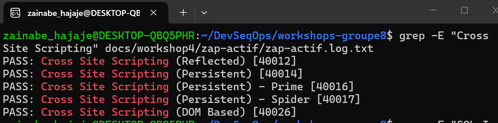

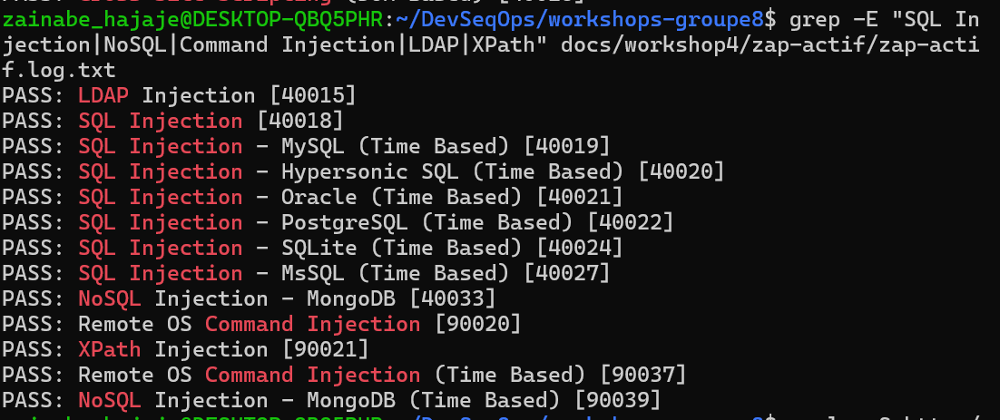

### 7.6 Corrélation avec le SAST (workshop 2)

Rapports SAST réellement consultés : SonarQube (`workshop2-sonar-zineb`, `docs/vulnerabilites-zainabe.md`), Semgrep (`workshop2-sonar-zineb`, `docs/RESULTATS-semgrep.md`), Semgrep (`workshop2-sast-hasna`, `workshop2/semgrep/semgrep-report-complet.json`).

| Alerte ZAP | CWE | Rapport SAST | Fichier:ligne | Statut |
|---|---|---|---|---|
| Dangerous JS Functions | 749 | SonarQube | `frontend/src/app/last-login-ip/last-login-ip.component.ts:40` | **corrélée** — même fonction `bypassSecurityTrustHtml`, mais ZAP ne donne pas le composant : identité non prouvée |
| Dangerous JS Functions | 749 | Semgrep (Hasna) | — | non corrélée — 0 occurrence de `bypassSecurityTrust` |
| aucune alerte XSS | — | Semgrep | `frontend/src/hacking-instructor/index.ts:126` et `:142` | **divergence** — Semgrep signale un risque `innerHTML` (CWE-79), ZAP n'a rien levé : page probablement non explorée (SPA, 2 min de spider, sans AJAX spider) |
| Backup File Disclosure, Bypassing 403, CORS, CSP, Full Path Disclosure | — | — | — | non corrélées : défauts de configuration observés dans les réponses HTTP, sans correspondance dans les rapports SAST |

Deux précisions de méthode :

- ZAP a scanné l'**image publiée** (20.3.0), pas le code corrigé de la branche `workshop2-sonar-zineb` : la correction du commit `2b738be` n'est donc pas visible dans le scan.
- Une alerte corrélée n'est pas une faille exploitable prouvée ; c'est un faisceau de deux méthodes indépendantes.

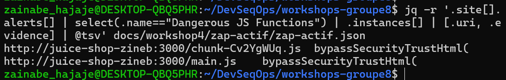

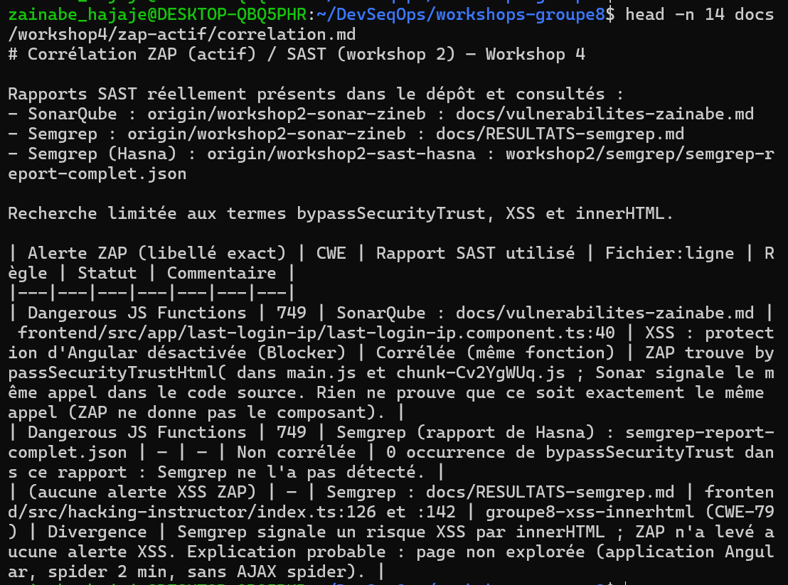

### 7.7 Passif contre actif : ce que chaque scan apporte

| | Passif | Actif |
|---|---|---|
| URLs explorées | 116 | 155 |
| Alertes | 16 | 19 |
| Dont Medium | 2 | 5 |
| Alertes propres | Non-Storable Content (informatif) | Backup File Disclosure, Bypassing 403, CORS Misconfiguration, User Agent Fuzzer |
| Alertes communes | 15 | 15 |

Les trois Medium propres à l'actif viennent de requêtes **construites** (noms de fichiers de sauvegarde, variantes de chemin encodé, en-tête `Origin`) : un scan passif ne peut pas les produire. Aucun des deux scans n'a détecté de XSS ni d'injection.

## 8. Intégration continue

### 8.1 Le workflow

`.github/workflows/zap-baseline.yml` — à la racine du dépôt, **branche `Workshop4`** ; introduit par le commit
`d54fdde` (branche `workshop4-zap-pipeline-hasna`) et fusionné par la PR #55 (merge `7f33a69`) :

```yaml
name: DAST - ZAP Baseline

on:
  push:
    branches: [ main, Workshop4, workshop4-zap-pipeline-hasna ]
  pull_request:
    branches: [ main, Workshop4 ]
  workflow_dispatch:

permissions:
  contents: read
  issues: write

jobs:
  zap-baseline:
    runs-on: ubuntu-latest
    steps:
      - name: Checkout
        uses: actions/checkout@v4

      - name: Lancer Juice Shop
        run: |
          docker run -d --name juice-shop -p 3000:3000 bkimminich/juice-shop
          for i in $(seq 1 30); do
            curl -sf http://localhost:3000 > /dev/null && echo "Juice Shop prêt" && exit 0
            sleep 5
          done
          echo "Juice Shop n'a pas démarré" && exit 1

      - name: ZAP Baseline Scan
        uses: zaproxy/action-baseline@v0.14.0
        with:
          target: 'http://localhost:3000'
          rules_file_name: '.zap/rules.tsv'
          cmd_options: '-a'
          allow_issue_writing: false
          fail_action: false

      - name: Publier le rapport
        if: always()
        uses: actions/upload-artifact@v4
        with:
          name: zap-report
          path: |
            report_html.html
            report_md.md
            report_json.json
```

### 8.2 Les étapes, expliquées

| Étape | Rôle | Détail utile |
|---|---|---|
| Déclencheurs | quand le scan tourne | à chaque push sur les branches de travail et sur `Workshop4`, à chaque pull request, et à la demande (`workflow_dispatch`) |
| Lancer Juice Shop | cible de la CI | conteneur `juice-shop` sur le port 3000, avec boucle d'attente : la cible doit répondre **avant** le scan |
| ZAP Baseline | le scan | action officielle `zaproxy/action-baseline@v0.14.0`, options `-a` (règles alpha) |
| `rules.tsv` | politique d'alertes | `.zap/rules.tsv` déclare trois règles en `WARN` : `10020` anti-clickjacking, `10021` X-Content-Type-Options, `10038` CSP |
| Publication | preuve | `upload-artifact` avec `if: always()` : les rapports sont conservés même si le scan échoue |

### 8.3 Preuve d'exécution

**Deux runs, deux rôles.** Le run du volet, exécuté sur la branche de travail de Hasna, prouve que le workflow
fonctionne. Le run de la branche de remise prouve que le workflow **déposé** fonctionne. Les deux sont cités, aucun
des deux n'est extrapolé.

| Élément | Valeur |
|---|---|
| Workflow | `DAST - ZAP Baseline` |
| Run | **#1** — commit `d54fdde` |
| Branche | `workshop4-zap-pipeline-hasna` |
| Date | 1er novembre 2026, 04:29 |
| Résultat | **succès** |
| Durée | 1 min 37 s |
| Artefact | `zap-report` : `report_html.html`, `report_md.md`, `report_json.json` |

Les trois captures du run, dans `screenshots/workshop4/` à la racine du dépôt :

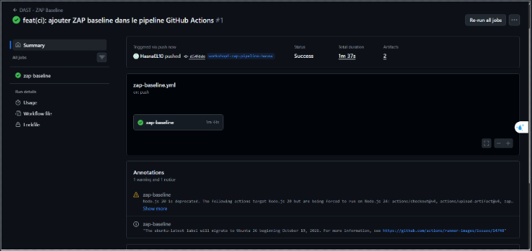

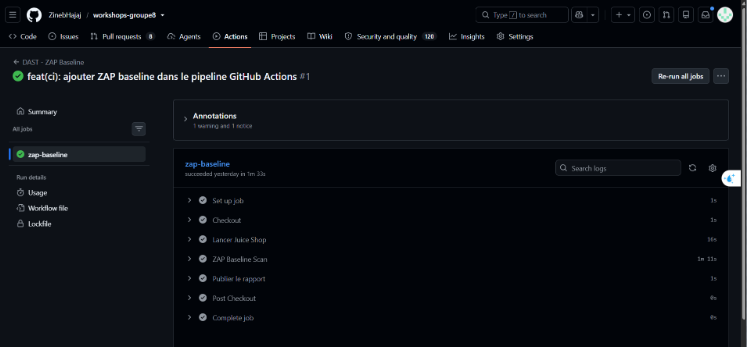

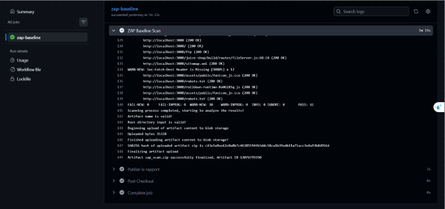

**Le run de la branche de remise.** La fusion de la PR #55 (`7f33a69`) a déclenché le run **#6** **sur
`Workshop4`** : même workflow, même cible, mais cette fois **sur le code réellement déposé**. C'est ce run qui fait
foi pour la remise ; le run #1 reste la preuve historique du volet.

| Élément | Valeur |
|---|---|
| Run | **#6** — commit `7f33a69` (merge PR #55) |
| Branche | `Workshop4` (branche de remise) |
| Déclencheur | `push` sur `Workshop4` — ce qui prouve que le déclencheur du YAML fonctionne |
| Date | 4 novembre 2026, 22 h 15 |
| Résultat | ✅ **succès** |
| Durée | 1 min 53 s (job `zap-baseline` : 1 min 48 s) |
| Artefacts | **2** — `zap-report` (34,4 Ko) et `zap_scan` (34,4 Ko) |

### 8.4 Bonnes pratiques pour intégrer le DAST dans un pipeline CI/CD

| Pratique | Pourquoi | Où en est ce projet |
|---|---|---|
| **Passif à chaque PR, actif planifié** (nuit, sur pré-prod) | le baseline coûte ~1 min ; le full scan coûte ~14 min et ne doit pas bloquer une revue | ✅ baseline en CI ; ❌ full scan encore manuel |
| **Épingler les images par digest** (cible *et* scanner) | un tag peut changer de contenu et faire varier les résultats sans qu'une ligne de code ait bougé | ⚠️ scanner et cible épinglés par tag en CI ; digests relevés dans `docs/workshop4/zap-passif/` |
| **Seuil de rupture explicite** | un rapport vert qui ne bloque rien ne protège rien | ⚠️ `fail_action: false` aujourd'hui ; passer à `true` avec un `rules.tsv` trié |
| **Règles gérées en code** (`.zap/rules.tsv` versionné) | un faux positif écarté une fois ne doit pas revenir à chaque run | ✅ 3 règles (`10020`, `10021`, `10038`) en `WARN` |
| **Archiver les rapports et suivre la tendance** | comparer deux runs vaut mieux que lire un rapport isolé | ✅ artefact `zap-report` ; ❌ pas encore de diff entre runs |
| **Périmètre écrit et autorisation avant tout scan actif** | un scan actif attaque réellement la cible | ✅ `docs/workshop4/zap-actif/perimetre.txt`, exclusions `/logout` et `/socket.io/*` |
| **Jamais la production** | ZAP actif peut dégrader un service ou corrompre des données | ✅ instances jetables uniquement |
| **Scan authentifié** (context + utilisateur de test) | sans session, les zones privées restent invisibles | ❌ angle mort documenté en § 9 |
| **Ne pas mélanger les familles de résultats** | DAST, SAST et SCA ne se comparent pas ligne à ligne | ✅ 16 / 19 alertes ZAP tenues séparées des 61 vulnérabilités Dependabot |


### 8.5 Ce que la CI couvre — et ce qu'elle ne couvre pas

- **Couvert** : le baseline est rejoué automatiquement, les rapports sont archivés à chaque exécution, et la commande ne dépend plus d'une machine personnelle.
- **À améliorer** (pistes, pas des défauts) : `fail_action: false` rend le job **non bloquant** — un FAIL ne fait pas échouer la PR ; l'image de la cible est épinglée par tag (`bkimminich/juice-shop`) et non par digest ; le `code de sortie` du scan n'est pas exploité comme seuil. Ces trois points sont documentés ici pour la suite du module, pas cachés.

> Le job de CI exécute un **baseline passif** : il ne remplace ni le scan actif de la section 7, ni le tri humain. Les **61 vulnérabilités Dependabot** de la branche principale relèvent du **SCA** : encore un autre tableau.

## 9. Limites et angles morts

| Limite | Conséquence |
|---|---|
| Scan passif **non authentifié** | aucune zone privée testée (panier, compte, administration) ; failles de contrôle d'accès invisibles |
| Aucun cookie émis sur le périmètre public | les règles `HttpOnly` / `Secure` / `SameSite` n'ont rien pu évaluer (passif **et** actif) |
| Scan actif **non authentifié** | mêmes angles morts côté application connectée ; les règles actives ne voient que la surface publique |
| Spider limité (1 min en passif, 2 min en actif) et **sans AJAX spider** | sur une SPA Angular, les routes dynamiques échappent au spider : c'est l'explication probable de la divergence XSS avec Semgrep |
| Aucune logique métier | coupons, prix négatifs, usages multiples : invisibles pour un scanner |
| Code de sortie du scan actif neutralisé par `-I` | le run actif n'est pas exploitable tel quel comme seuil de CI ; seul le baseline l'est |
| HTTP local, sans TLS | les attributs `Secure` et les redirections HTTPS ne sont pas évaluables ici |
| 50 % de réponses lentes pendant l'actif | cible modeste : peut faire varier les résultats d'un run à l'autre |

**On peut affirmer** : sur 116 URLs publiques (passif, 31/10) et 155 URLs (actif, 01/11), la cible n'envoie ni CSP ni COEP/COOP, autorise les lectures cross-origin (`*`), conserve un `Feature-Policy` déprécié, expose des fichiers de sauvegarde (`/ftp/quarantine.bak`), laisse contourner un refus 403 par un chemin encodé (`/%2e/ftp/eastere.gg`), et divulgue des chemins serveur dans ses erreurs — ces quatre derniers constats ont été **reproduits à la main**.

**On ne peut pas affirmer** que l'application est sûre, que les cookies sont bien configurés, ou qu'il n'y a ni XSS ni injection : ces catégories n'ont pas été démontrées.

## 10. Tout reproduire en local

Prérequis : Docker, `git`, `jq`, `curl`.

```bash
# 1. dépôt et branche de travail
git clone https://github.com/ZinebHajaj/workshops-groupe8
cd workshops-groupe8
git checkout Workshop4

# 2. réseau + cible (instance « passif »)
docker network create zap-net
docker run -d --name juice-shop-groupe8 --network zap-net \
  -p 127.0.0.1:3000:3000 bkimminich/juice-shop:latest

# 3. attendre la cible (ne pas lancer le scan immédiatement)
docker run --rm --network zap-net curlimages/curl -s -o /dev/null -w '%{http_code}\n' \
  http://juice-shop-groupe8:3000     # attendre 200

# 4. scan passif
docker run --rm -v "$(pwd)/docs/workshop4/zap-passif:/zap/wrk/:rw" --network zap-net \
  ghcr.io/zaproxy/zaproxy:stable zap-baseline.py \
  -t http://juice-shop-groupe8:3000 \
  -r reports/zap-baseline.html -J reports/zap-baseline.json -a -I

# 5. scan actif (cible locale déclarée uniquement, cf. perimetre.txt)
docker run -d --name juice-shop-zineb --network zap-net \
  -p 127.0.0.1:3001:3000 bkimminich/juice-shop:latest
docker run --rm -v "$(pwd)/docs/workshop4/zap-actif:/zap/wrk/:rw" --network zap-net \
  ghcr.io/zaproxy/zaproxy:stable zap-full-scan.py \
  -t http://juice-shop-zineb:3000 -n scope.context -m 2 -T 60 -a -I \
  -r zap-actif.html -J zap-actif.json

# 6. vérifier l'intégrité des rapports
sha256sum docs/workshop4/zap-passif/reports/*
```

Pour la CI : rien à installer — pousser sur `Workshop4` ou ouvrir une pull request déclenche `DAST - ZAP Baseline`, et les rapports sont téléchargeables dans l'onglet *Actions* → *Artifacts*.

## 11. Preuves, captures et reproductibilité

### 11.1 Arborescence

```
docs/workshop4/
  screenshots/                       29 captures
    zap-01 ... zap-12                 volet passif (14 fichiers)
    zap-actif-01 ... zap-actif-12      volet actif (15 fichiers)
  zap-passif/
    commandes.txt                    commandes exécutées
    tool-versions.txt                versions des outils
    image-digest.txt                 digests des deux images
    resultats.md                     analyse : tableaux, tri, verdicts
    reports/
      zap-baseline.html              134 793 o   SHA-256 aa0b0691…f66b48
      zap-baseline.json               54 893 o   SHA-256 9ab82559…c8c542
      zap-baseline.md                 43 714 o   SHA-256 8ea8ddc7…2f222
      zap-baseline.xml                65 674 o   SHA-256 487dd82b…52f55e
      zap.yaml                        1 235 o
    logs/
      zap-baseline.log.txt           run du 31/10/2026
      docker-build-echec.log.txt     échec documenté (ERESOLVE)
      ancien-conteneur-30oct.log.txt
  zap-actif/
    README.md                       cadre, méthode, résultats
    perimetre.txt                   périmètre écrit et autorisation
    scope.context                   contexte ZAP (inclusions / exclusions)
    correlation.md                  corrélation ZAP / SAST
    resultats.md                    alertes, verdicts, comparaison passif-actif
    zap-actif.html / .json / .md / .xml
    zap-actif.log.txt
.github/workflows/zap-baseline.yml  CI (branche Workshop4 depuis la PR #55)
screenshots/workshop4/              5 captures de CI et de rapport (3 du run, 2 du rapport ZAP)
.zap/rules.tsv                      politique d'alertes de la CI (idem)
```

### 11.2 Galerie complète des captures

<details>
<summary><b>Volet passif — 14 captures</b> (cliquer pour afficher)</summary>

| Capture | Ce qu'elle prouve |
|---|---|
| `zap-01-branche-et-dossiers.png` | branche de travail et arborescence des preuves |
| `zap-02-juice-shop-docker-ps.png` | cible lancée : image, port publié sur 127.0.0.1 |
| `zap-03-juice-shop-navigateur.png` | application réellement servie |
| `zap-04-accessibilite-conteneur.png` | cible joignable depuis le réseau Docker (200) |
| `zap-05-version-digest.png` | digests des deux images, version 20.3.0 |
| `zap-06-baseline-execution.png` | Automation Framework, 116 URLs |
| `zap-07-baseline-resume.png` | FAIL 0 / WARN 10 / PASS 61 |
| `zap-08-rapport-html-sommaire.png` | ZAP 2.17.0, 0/2/5/9 alertes |
| `zap-09-rapport-cookies.png` | règles cookies en PASS, 401 sans Set-Cookie |
| `zap-10a-detail-csp.png` | détail CSP (risque, confiance, URLs) |
| `zap-10b-detail-cors.png` | `Access-Control-Allow-Origin: *` |
| `zap-10c-detail-coep.png` | détail COEP |
| `zap-11-rapport-json.png` | évidences extraites du JSON |
| `zap-12-git-commit.png` | commit des preuves |

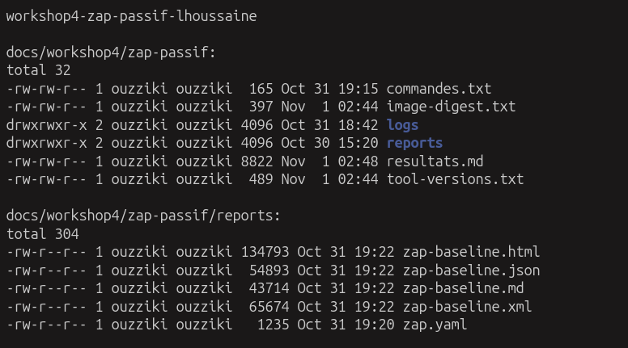
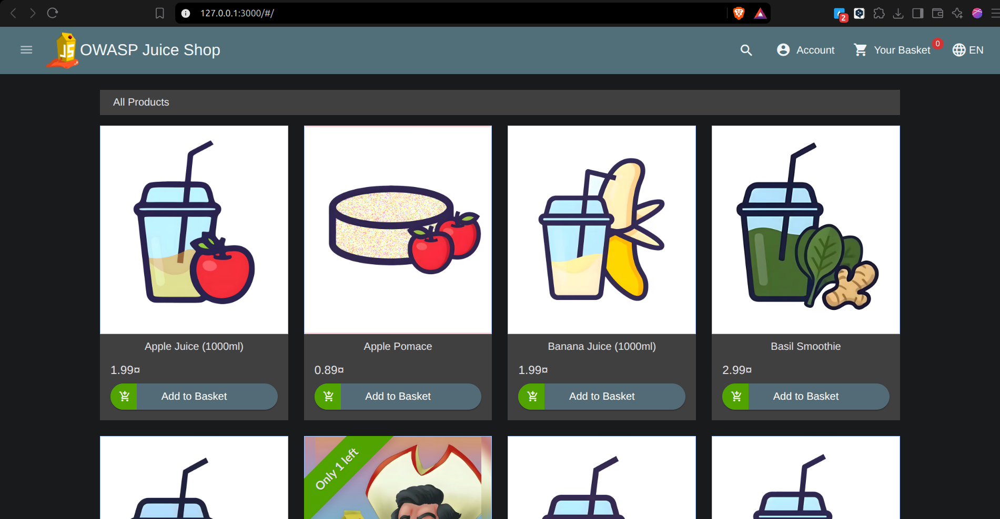
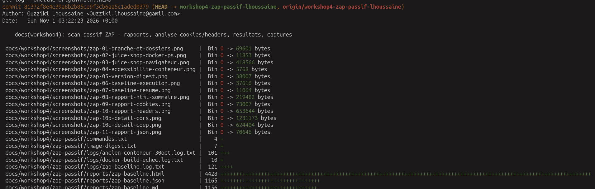

</details>

<details>
<summary><b>Volet actif — 15 captures</b> (cliquer pour afficher)</summary>

| Capture | Ce qu'elle prouve |
|---|---|
| `zap-actif-01-perimetre.png` | périmètre écrit du scan actif |
| `zap-actif-02-cible-locale.png` | cible locale déclarée |
| `zap-actif-02b-demarrage-juice-shop.png` | démarrage de l'instance dédiée |
| `zap-actif-03-docker-ps.png` | conteneurs ZAP et cible sur `zap-net` |
| `zap-actif-04-contexte.png` | contexte ZAP et exclusions |
| `zap-actif-05-fullscan-execution.png` | exécution du `zap-full-scan.py` |
| `zap-actif-06-fullscan-fin.png` | fin du scan (155 URLs, FAIL 0 / WARN 9 / PASS 141) |
| `zap-actif-07-rapport-sommaire.png` | rapport HTML, 0/5/5/9 alertes |
| `zap-actif-08-xss-non-detecte.png` | règles XSS sans alerte |
| `zap-actif-08b-dangerous-js.png` | `bypassSecurityTrustHtml(` dans le JS livré |
| `zap-actif-09-injection-non-detectee.png` | règles d'injection sans alerte |
| `zap-actif-10-rejeu-manuel.png` | rejeu manuel des constats confirmés |
| `zap-actif-10b-rejeu-path-disclosure.png` | chemin serveur exposé dans une erreur 403 |
| `zap-actif-11-correlation.png` | tableau de corrélation ZAP / SAST |
| `zap-actif-12-git.png` | historique git du volet actif |

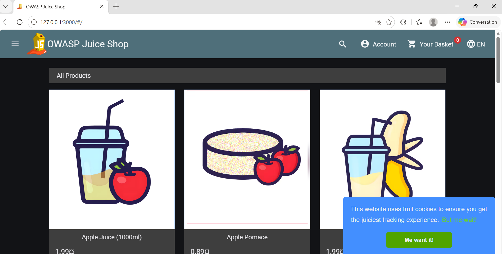
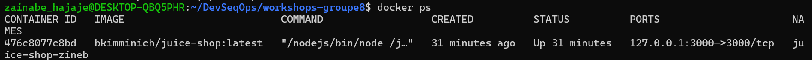
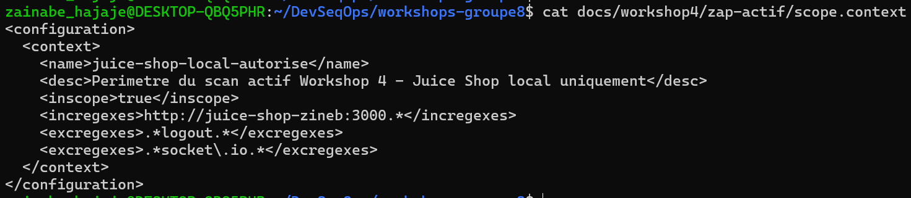
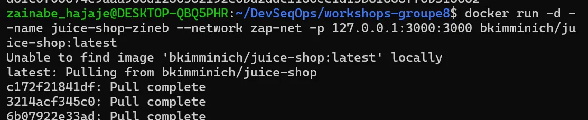
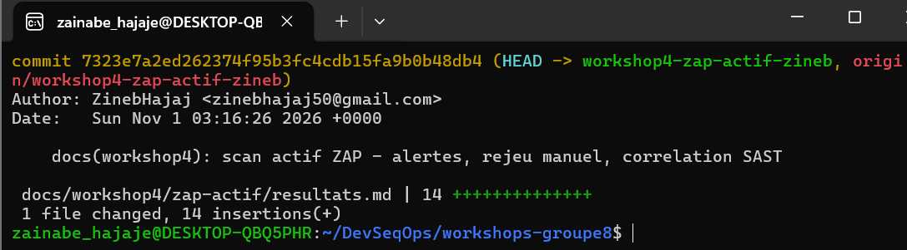

</details>

### 11.3 Les quatre qualités d'une preuve

| Qualité | Comment elle est assurée |
|---|---|
| Datée | `2026-10-31T18:20:05Z` (passif), `2026-11-01T01:22:02Z` → `01:36:31Z` (actif), date des captures, date des commits |
| Attribuable | auteur et branche par volet, hôte, version de ZAP, digest de l'image |
| Intègre | SHA-256 des quatre rapports passifs + digests des deux images |
| Reproductible | commandes complètes archivées, `zap.yaml` et `scope.context` versionnés, images identifiées |

### 11.4 Commits par volet

| Volet | Branche | Commits |
|---|---|---|
| Passif | [`workshop4-zap-passif-lhoussaine`](https://github.com/ZinebHajaj/workshops-groupe8/tree/workshop4-zap-passif-lhoussaine) | `81372f8` (run et preuves, 25 fichiers), `2557d68` (capture du commit), `ae74dd0` (renommage capture CSP) |
| Actif | [`workshop4-zap-actif-zineb`](https://github.com/ZinebHajaj/workshops-groupe8/tree/workshop4-zap-actif-zineb) | `0d1770d` (rapports, cadre, captures), `7323e7a` (alertes, rejeu manuel, corrélation), `6df4f5d` (capture git log) |
| CI | [`workshop4-zap-pipeline-hasna`](https://github.com/ZinebHajaj/workshops-groupe8/tree/workshop4-zap-pipeline-hasna) | `d54fdde` (workflow `zap-baseline.yml` + `.zap/rules.tsv`) |
| Intégration | [`Workshop4`](https://github.com/ZinebHajaj/workshops-groupe8/tree/Workshop4) | merge PR #40 (`2792a49`) pour le passif ; commit `7323e7a` pour l'actif ; **merge PR #55 (`7f33a69`) pour la CI** |
