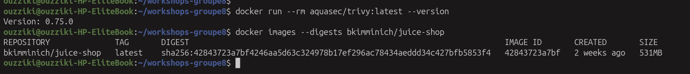
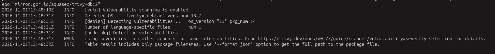
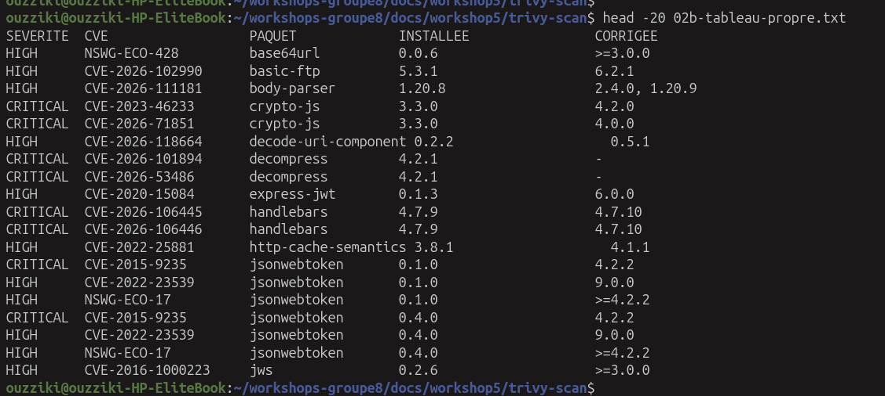
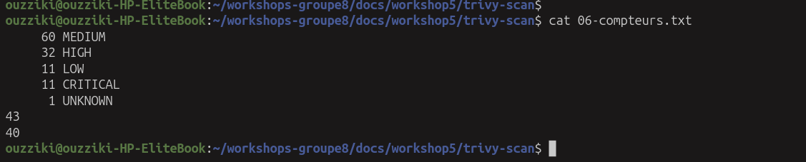
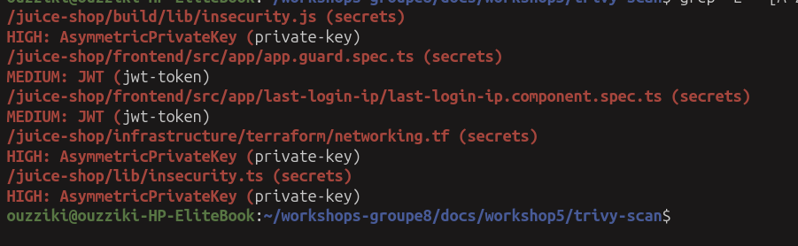
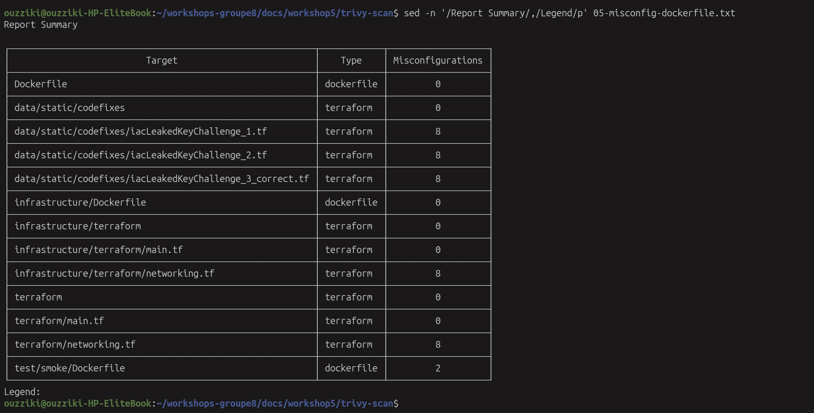

# Workshop 5 — Analyse de sécurité d'une image Docker (Trivy)

**Groupe 8** · Ouzziki Lhoussaine · Zineb Hajaj · Hasna elhassani
Module DevSecOps — chapitre 5 · année scolaire 2026-2027

Branche de remise : **`workshop5-Groupe8`**

---

## 1. Ce que demande l'atelier, et où le trouver

| Exigence du professeur | Où elle est traitée | État |
|---|---|---|
| Trivy sur une image Docker | [`trivy-scan/`](docs/workshop5/trivy-scan/) — `00` à `03` | ✅ livré |
| Vulnérabilités (CVE) | [section 4](#4-résultats-du-scan-de-référence) · `03-rapport.json` | ✅ livré |
| Mauvaises configurations | [section 8](#8-mauvaises-configurations--42-alertes-dont-0-dans-le-dockerfile) · `05-misconfig-dockerfile.txt` | ✅ livré |
| Secrets | [section 7](#7-secrets--5-constats-3-high-2-medium) · `04-secrets.txt` | ✅ livré |
| Focus HIGH / CRITICAL | [section 4](#4-résultats-du-scan-de-référence) · `06-inventaire.tsv` | ✅ livré |
| Remédiation (image **et** Dockerfile durci) | branche `workshop5-trivy-remediation-hasna` | ⏳ **en cours — Hasna** |
| CI/CD avec seuil de blocage par sévérité | branche `workshop5-trivy-pipeline-zineb` | ⏳ **en cours — Zineb** |
| Branche dédiée, rapport, captures | cette branche · ce README · [`screenshots/`](docs/workshop5/screenshots/) | ✅ livré |

> **À lire avant de juger le dossier :** le volet 1 (scan de référence) est terminé et documenté.
> Les volets 2 et 3 sont en cours. **Aucun chiffre n'est annoncé pour ces deux volets** : leurs sections
> indiquent ce qui est attendu et où le livrable arrivera. Tous les nombres présents ci-dessous viennent
> des fichiers de [`trivy-scan/`](docs/workshop5/trivy-scan/), produits par les commandes de la
> [section 10](#10-reproduire-le-scan).

---

## 2. Les trois volets et leur enchaînement

| Volet | Qui | Branche | Contenu |
|---|---|---|---|
| 1 — scan de référence | Lhoussaine | `workshop5-trivy-scan-lhoussaine` | image, digest, 115 alertes, inventaire, secrets, configuration, preuves, captures |
| 2 — remédiation | Hasna | `workshop5-trivy-remediation-hasna` | tri des 43 alertes, `Dockerfile.durci`, re-scan avant / après |
| 3 — CI/CD et rapport | Zineb | `workshop5-trivy-pipeline-zineb` | workflow GitHub Actions, seuil de blocage, SARIF, README final |
| Remise | groupe | `workshop5-Groupe8` | fusion des trois volets, dans cet ordre |

L'ordre n'est pas décoratif : on ne corrige pas ce qu'on n'a pas inventorié (Hasna a besoin des 43 lignes
et du digest de départ), et on ne fixe pas un seuil sur des chiffres qu'on n'a pas remesurés (Zineb a besoin
du stock d'alertes restant).

---

## 3. La cible et l'outil

| Élément | Valeur |
|---|---|
| Image scannée | `bkimminich/juice-shop:latest` |
| Digest | `sha256:42843723a7bf4246aa5d63c324978b17ef296ac78434aeddd34c427bfb5853f4` |
| Système détecté | Debian 13.7 — `pkg_num=14` · 1 fichier de dépendances de langage |
| Scanner | Trivy **0.75.0** (`aquasec/trivy:latest`) — 0.76.1 disponible au moment du run, écart assumé |
| Run de référence | `2026-11-01T15:47:26Z` (UTC) |
| Cibles du rapport | **7** blocs `Results` |
| Formats produits | table, JSON, SARIF, SBOM CycloneDX |

Le **digest est identique** à celui relevé au workshop 4 (`docs/workshop4/zap-passif/image-digest.txt`) :
la même image a donc été attaquée en fonctionnement par ZAP, puis analysée au repos par Trivy.

---

## 4. Résultats du scan de référence

| Sévérité | Nombre |
|---|---|
| CRITICAL | **11** |
| HIGH | **32** |
| MEDIUM | 60 |
| LOW | 11 |
| UNKNOWN | 1 |
| **Total, toutes sévérités** | **115** |
| **HIGH + CRITICAL** | **43** |

Parmi les **43** alertes HIGH et CRITICAL :

| Indicateur | Valeur |
|---|---|
| avec une version corrigée disponible | **40** |
| sans version corrigée | **3** |
| paquets les plus touchés | `libc6` 22 · `tar` 12 · `sanitize-html` 11 · `jsonwebtoken` 10 · `minimatch` 6 |

> Formulation correcte : « **43 vulnérabilités HIGH et CRITICAL** », et non « 115 vulnérabilités » —
> 115 est le total toutes sévérités, MEDIUM et UNKNOWN compris.

Les compteurs sont **recalculés** depuis l'inventaire, jamais saisis à la main :

```bash
cut -f1 06-inventaire.tsv | sort | uniq -c | sort -rn
awk -F'\t' '$1=="CRITICAL"||$1=="HIGH"' 06-inventaire.tsv | wc -l
awk -F'\t' '($1=="CRITICAL"||$1=="HIGH") && $5!="" && $5!="-" && $5!="NA"' 06-inventaire.tsv | wc -l
```

---

## 5. Les huit cibles rentables (transmises au volet 2)

« Rentable » = un paquet dont la mise à jour ferme **plusieurs** alertes, ou dont la version installée est
si ancienne que la corriger ferme aussi les conséquences futures.

| Paquet | Installée | Corrigée | Alertes | À savoir avant de toucher |
|---|---|---|---|---|
| `tar` | 6.2.1 | 7.5.x | 10 | livré par l'image Debian ; montée majeure, à faire dans le Dockerfile |
| `jsonwebtoken` | 0.1.0 **et** 0.4.0 | 4.2.2 puis 9.0.0 | 3 + 3 | deux versions en parallèle ; 0.1.0 → 9.0.0 casse l'API |
| `lodash` | 2.4.2 | 4.17.12 / 4.17.21 | plusieurs | dépendance transitive : forcer la résolution |
| `minimatch` | 3.0.5 | 3.1.3+ | 6 | montée mineure sûre, la plus simple du lot |
| `undici` | 6.29.0 | 6.29.1 / 7.30.1 / 8.12.2 | plusieurs | choisir la branche compatible avec la version de Node |
| `crypto-js` | 3.3.0 | 4.0.0 / 4.2.0 | 2 CRITICAL | meilleur rapport effort / gain |
| `handlebars` | 4.7.9 | 4.7.10 | 2 CRITICAL | correctif de patch, aucun changement d'API attendu |
| `moment` | 2.0.0 | 2.19.3 / 2.29.2 | plusieurs | bibliothèque en fin de vie : mise à jour utile, remplacement à prévoir |

---

## 6. Les trois alertes sans correctif

Ces trois-là ne peuvent pas être fermées par une mise à jour : elles se documentent, elles ne se corrigent pas.

| Sévérité | Identifiant | Paquet | Installée | Corrigée |
|---|---|---|---|---|
| CRITICAL | `CVE-2026-101894` | `decompress` | 4.2.1 | — |
| CRITICAL | `CVE-2026-53486` | `decompress` | 4.2.1 | — |
| CRITICAL | `GHSA-5mrr-rgp6-x4gr` | `marsdb` | 0.6.11 | — |

```bash
awk -F'\t' '($1=="CRITICAL"||$1=="HIGH") && ($5==""||$5=="-")' 06-inventaire.tsv
```

Statut retenu dans le tableau de tri : **accepter et surveiller** (justification + mitigation écrites),
jamais « faux positif » — la faille est réelle, c'est le remède qui manque.

---

## 7. Secrets — 5 constats (3 HIGH, 2 MEDIUM)

| # | Sévérité | Règle | Fichier | Nature |
|---|---|---|---|---|
| 1 | HIGH | `AsymmetricPrivateKey` | `lib/insecurity.ts:21` | clé privée RSA des JWT, dans le source TypeScript |
| 2 | HIGH | `AsymmetricPrivateKey` | `build/lib/insecurity.js:55` | **la même clé**, dans le JavaScript compilé livré |
| 3 | HIGH | `AsymmetricPrivateKey` | `infrastructure/terraform/networking.tf:171` | clé privée de certificat TLS |
| 4 | MEDIUM | `JWT` | `frontend/src/app/app.guard.spec.ts:46` | jeton en dur dans un test unitaire |
| 5 | MEDIUM | `JWT` | `frontend/src/app/last-login-ip/last-login-ip.component.spec.ts:72` | second jeton de test |

Les deux HIGH `insecurity` sont **la même clé présente deux fois** (source et compilation) : la clé de
signature des jetons est donc livrée dans l'image publiée. Aucune valeur n'est recopiée ici — Trivy masque
les chaînes sensibles, et le rapport cite uniquement fichier, ligne et règle.

---

## 8. Mauvaises configurations — 42 alertes, dont **0** dans le Dockerfile

`trivy config` analyse un **répertoire** : 13 fichiers examinés, 42 alertes (22 HIGH, 20 CRITICAL).

| Cible | Type | Alertes |
|---|---|---|
| `Dockerfile` (racine) | dockerfile | **0** |
| `infrastructure/Dockerfile` | dockerfile | **0** |
| `test/smoke/Dockerfile` | dockerfile | 2 (HIGH ×2) |
| `data/static/codefixes/iacLeakedKeyChallenge_1.tf` | terraform | 8 |
| `data/static/codefixes/iacLeakedKeyChallenge_2.tf` | terraform | 8 |
| `data/static/codefixes/iacLeakedKeyChallenge_3_correct.tf` | terraform | 8 |
| `infrastructure/terraform/networking.tf` | terraform | 8 |
| `terraform/networking.tf` | terraform | 8 |
| `terraform/main.tf`, autres fichiers `.tf` | terraform | 0 |
| **Total** | | **42** |

Règles rencontrées : `DS-0002` (aucun `USER` non-root), `DS-0025` (`apk add` sans `--no-cache`),
`AWS-0037`, `AWS-0052`, `AWS-0053`, `AWS-0054`, `AWS-0104`, `AWS-0164`.

**Lecture critique, à ne pas perdre de vue :** ces 42 alertes **ne concernent pas l'image livrée**. Trois
fichiers `.tf` sont des **fixtures pédagogiques** volontairement vulnérables, deux décrivent une
infrastructure AWS d'exemple non utilisée, et le `Dockerfile` de l'application est **propre**. Le scan ne dit
pas « notre image est mal configurée », il dit « le dépôt contient des exemples d'infrastructure non
conformes ». Les deux règles réellement actionnables (`DS-0002`, `DS-0025`) alimentent le durcissement du
volet 2.

---

## 9. Captures d'écran

Les six captures sont versionnées dans [`docs/workshop5/screenshots/`](docs/workshop5/screenshots/). Chacune
répond à une question précise ; elles sont affichées ci-dessous et non liées, pour que la relecture se fasse
sans quitter la page.

### 1. L'outil et la cible — `trivy-01-identite.png`



*Ce qu'elle prouve :* Trivy **0.75.0** pour l'outil, et pour la cible le digest
`sha256:42843723a7bf…5853f4` — l'identité réelle de l'image, celle qui rend le scan reproductible.

### 2. Le scan en cours d'exécution — `trivy-02-scan-execution.png`



*Ce qu'elle prouve :* `Detected OS family="debian" version="13.7"`, `pkg_num=14` et un fichier de dépendances
de langage — exactement les valeurs annoncées en section 3, et le fait que le scan est allé jusqu'au bout.

### 3. Le tableau des alertes — `trivy-03-vulns-tableau.png`



*Ce qu'elle prouve :* les 20 premières lignes des **43** alertes HIGH et CRITICAL, sur cinq colonnes —
sévérité, identifiant, paquet, version installée, version corrigée. Les tirets en dernière colonne annoncent
la section 6.

### 4. Les compteurs — `trivy-04-compteurs.png`



*Ce qu'elle prouve :* `60 / 32 / 11 / 11 / 1`, puis **43** et **40** — les nombres recalculés depuis
l'inventaire, et non recopiés d'un résumé.

### 5. Les secrets — `trivy-05-secret.png`



*Ce qu'elle prouve :* les cinq fichiers concernés et leur règle — trois `HIGH: AsymmetricPrivateKey`, deux
`MEDIUM: JWT`. Trivy masque les valeurs, il n'y a rien de confidentiel dans cette image.

### 6. Les mauvaises configurations — `trivy-06-misconfig.png`



*Ce qu'elle prouve :* la colonne des compteurs, fichier par fichier — `Dockerfile` à **0**,
`infrastructure/Dockerfile` à **0**, `test/smoke/Dockerfile` à **2**, cinq fichiers `.tf` à **8** : le total
retombe sur 42, et les Dockerfiles de l'application sont propres.

---

## 10. Reproduire le scan

```bash
# identité de l'outil et de la cible
docker run --rm aquasec/trivy:latest --version
docker images --digests bkimminich/juice-shop

# vulnérabilités, sortie console filtrée (lecture humaine)
docker run --rm -v /var/run/docker.sock:/var/run/docker.sock \
  aquasec/trivy:latest image --severity HIGH,CRITICAL --scanners vuln \
  bkimminich/juice-shop:latest | tee 02-vulns-high-critical.txt

# rapport complet (source de tous les compteurs), SARIF et SBOM
docker run --rm -v /var/run/docker.sock:/var/run/docker.sock -v "$PWD:/out" \
  aquasec/trivy:latest image --format json --output /out/03-rapport.json \
  bkimminich/juice-shop:latest
docker run --rm -v /var/run/docker.sock:/var/run/docker.sock -v "$PWD:/out" \
  aquasec/trivy:latest image --format sarif --output /out/03-rapport.sarif \
  bkimminich/juice-shop:latest
docker run --rm -v /var/run/docker.sock:/var/run/docker.sock -v "$PWD:/out" \
  aquasec/trivy:latest image --format cyclonedx --output /out/03-sbom.cdx.json \
  bkimminich/juice-shop:latest

# secrets, puis configuration du dépôt
docker run --rm -v /var/run/docker.sock:/var/run/docker.sock \
  aquasec/trivy:latest image --scanners secret bkimminich/juice-shop:latest \
  | tee 04-secrets.txt
docker run --rm -v "$PWD:/src" aquasec/trivy:latest config --severity HIGH,CRITICAL /src \
  | tee 05-misconfig-dockerfile.txt
```

Tableau lisible des 43 lignes, dérivé du JSON (sans relancer de scan) :

```bash
jq -r '.Results[]?.Vulnerabilities // [] | .[] | select(.Severity=="CRITICAL" or .Severity=="HIGH")
  | [.Severity,.VulnerabilityID,.PkgName,.InstalledVersion,(.FixedVersion // "-")] | @tsv' \
  03-rapport.json > /tmp/lignes.tsv
awk -F'\t' 'BEGIN{printf "%-9s %-20s %-18s %-24s %s\n","SEVERITE","CVE","PAQUET","INSTALLEE","CORRIGEE"}
  {printf "%-9s %-20s %-18s %-24s %s\n",$1,$2,$3,$4,$5}' /tmp/lignes.tsv > 02b-tableau-propre.txt
wc -l 02b-tableau-propre.txt      # 44 lignes = en-tête + 43 alertes
```

---

## 11. Fichiers de preuve

| Fichier | Contenu | Ce qu'il permet de prouver |
|---|---|---|
| [`00-version-trivy.txt`](docs/workshop5/trivy-scan/00-version-trivy.txt) | version, date UTC, état du poste | avec quel outil, et quand |
| [`01-digest-image.txt`](docs/workshop5/trivy-scan/01-digest-image.txt) | digest de l'image | quelle image exactement |
| [`02-vulns-high-critical.txt`](docs/workshop5/trivy-scan/02-vulns-high-critical.txt) | journal du scan filtré | que le scan est allé au bout |
| [`02b-tableau-propre.txt`](docs/workshop5/trivy-scan/02b-tableau-propre.txt) | tableau des 43 lignes | la lecture humaine, sans bruit |
| [`03-rapport.json`](docs/workshop5/trivy-scan/03-rapport.json) | rapport complet non filtré | la source de tous les compteurs |
| [`03-rapport.sarif`](docs/workshop5/trivy-scan/03-rapport.sarif) | même analyse au format forge | le lien vers GitHub Security |
| [`03-sbom.cdx.json`](docs/workshop5/trivy-scan/03-sbom.cdx.json) | inventaire du contenu (CycloneDX) | la composition de l'image |
| [`04-secrets.txt`](docs/workshop5/trivy-scan/04-secrets.txt) | rapport du scanner de secrets | les 5 constats et leur localisation |
| [`05-misconfig-dockerfile.txt`](docs/workshop5/trivy-scan/05-misconfig-dockerfile.txt) | rapport de configuration | les 42 alertes par fichier |
| [`06-inventaire.tsv`](docs/workshop5/trivy-scan/06-inventaire.tsv) | une ligne par vulnérabilité | le tri et les filtres |
| [`06-compteurs.txt`](docs/workshop5/trivy-scan/06-compteurs.txt) | compteurs recalculés | la cohérence 115 / 43 / 40 |
| [`07-sha256.txt`](docs/workshop5/trivy-scan/07-sha256.txt) | empreinte de chaque preuve | que rien n'a bougé depuis |

```bash
cd docs/workshop5/trivy-scan && sha256sum -c 07-sha256.txt
```

> ⚠️ Trois pièges de lecture, rencontrés et documentés :
> `02-vulns-high-critical.txt` fait ~2 700 lignes (barre de progression de la base, manifestes à 0) — le
> tableau utile est en fin de fichier, d'où `02b` ; `04-secrets.txt` compte 1 575 **lignes de journal** pour
> **5** constats ; la table `Report Summary` d'un rapport de vulnérabilités affiche des zéros et ne doit pas
> être photographiée comme « résultat ».

---

## 12. Volet 2 — remédiation (Hasna) · ⏳ en cours

**Ce qui est attendu**, conformément à la consigne (mise à jour de l'image **et** durcissement du Dockerfile) :

| Livrable | Contenu attendu |
|---|---|
| Tableau de tri des 43 alertes | statut (`corrigé` / `corrigé, adaptation à prévoir` / `accepter et surveiller`), justification, mitigation |
| `Dockerfile.durci` | image de base épinglée par digest, `USER` non-root (`DS-0002`), pas de cache de paquets (`DS-0025`), multi-étapes |
| Re-scan « après » | mêmes commandes que le scan de référence, nouvelles preuves |
| Comparaison avant / après | digest, HIGH+CRITICAL, corrigeables, sans correctif (3 attendus), secrets, configuration |
| Captures | le re-scan et la comparaison |

**Méthode retenue** : trois filtres successifs (corrigeable sans risque d'API → corrigeable avec montée
majeure → sans correctif), puis un faux positif doit être **démontré**, jamais décrété.

Branche : `workshop5-trivy-remediation-hasna`, créée depuis `workshop5-trivy-scan-lhoussaine`.
Les chiffres « après » seront ajoutés ici **quand le second scan existera** — aucune valeur n'est avancée
d'avance.

---

## 13. Volet 3 — CI/CD et seuil de blocage (Zineb) · ✅ livré (run vert à produire après le volet 2)

**Livré :**

| Livrable | Où | État |
|---|---|---|
| Workflow GitHub Actions | `.github/workflows/trivy-image.yml` | ✅ actions épinglées par SHA |
| Seuil de blocage | `docs/workshop5/ci/seuil.md` | ✅ `CRITICAL` bloque (`exit-code: '1'`) |
| Preuve du blocage | run #2 (rouge) | ✅ 8 constats CRITICAL, `exit code 1` |
| Publication SARIF | onglet *Security* → *Code scanning* | ✅ alertes « Detected by Trivy » |
| SBOM + rapport | artefact `trivy-report` | ✅ SARIF, table et SBOM CycloneDX |
| Run vert après remédiation | `docs/workshop5/ci/passation-hasna.md` | ⏳ à produire après le volet 2 — procédure prête |

**Le workflow** — un seul job (`timeout-minutes: 15`), déclenché sur `push`, `pull_request`, chaque jour à
3 h UTC et à la demande. Trois scans de la même image : SARIF, table et SBOM en `exit-code: '0'` (ils
produisent les preuves sans bloquer), puis une dernière étape **bloquante**. Les preuves sont archivées
*avant* le blocage (`if: always()`), pour qu'un run rouge laisse quand même ses rapports.

**Le seuil** (détail et justification : `docs/workshop5/ci/seuil.md`) :

| | Preuves | Blocage |
|---|---|---|
| `severity` | `HIGH,CRITICAL` | `CRITICAL` |
| `exit-code` | `0` | `1` |
| `ignore-unfixed` | `true` | `true` |

`CRITICAL` bloque parce qu'une faille critique corrigeable doit être traitée avant fusion. `HIGH` est
rapporté mais ne bloque pas encore : un pipeline rouge en permanence apprend à être ignoré. Le seuil
descendra à `HIGH,CRITICAL` quand le stock sera ramené à zéro.

**Preuve du blocage — run #2, rouge voulu.** Sur l'image non corrigée, l'étape bloquante affiche
`Total: 8 (CRITICAL: 8)`, soit 8 constats pour 7 CVE distinctes (`jsonwebtoken` est présent en deux
versions), puis `Error: Process completed with exit code 1`. Les cinq étapes de preuve précédentes
sont vertes. Le scan de référence compte 11 CRITICAL : l'écart de 3 est attribué à `ignore-unfixed`
(à recouper avec la section 6).

| Bibliothèque | CVE | Installée | Corrigée |
|---|---|---|---|
| crypto-js | CVE-2023-46233, CVE-2026-71851 | 3.3.0 | 4.2.0 / 4.0.0 |
| handlebars | CVE-2026-106445, CVE-2026-106446 | 4.7.9 | 4.7.10 |
| jsonwebtoken | CVE-2015-9235 | 0.1.0 et 0.4.0 | 4.2.2 |
| lodash | CVE-2019-10744 | 2.4.2 | 4.17.12 |
| tar | CVE-2026-59873 | 6.2.1 | 7.5.19 |

**SARIF.** Le rapport est publié dans *Security → Code scanning* (filtre
`branch:workshop5-trivy-pipeline-zineb tool:Trivy`). GitHub y compte **80 alertes** : il en crée une
par CVE **et par emplacement**, donc ce nombre n'est pas comparable aux 43 du scan de référence. La
comparaison se fait sur les identifiants CVE.

**Chaîne d'approvisionnement.** Les quatre actions sont épinglées par SHA de commit (tableau dans
`seuil.md`), jamais par tag : en mars 2026, 76 des 77 tags de `trivy-action` ont été réécrits vers du
code malveillant (CVE-2026-33634), alors qu'un SHA ne peut pas l'être. Notre premier run (#1) a échoué
avant tout scan à cause d'un SHA mal recopié (`codeql-action`) ; il a été vérifié avec `git fetch` sur le
dépôt d'origine, puis corrigé. Le garde-fou s'est donc aussi appliqué à nous-mêmes.

**Captures** (`docs/workshop5/ci/screenshots/`) : `trivy-ci-01` et `01b` (workflow et seuil),
`trivy-ci-03` et `03b` (run rouge, total CRITICAL), `trivy-ci-04` (SARIF), `trivy-ci-05` (artefacts).

**Passation vers le volet 2 (Hasna).** Le pipeline est terminé et n'attend plus que l'image remédiée. Le run vert et la comparaison avant / après ne seront ajoutés qu'une fois le volet 2 livré : aucune valeur n'est avancée d'avance. La marche à suivre (modifications du workflow, critères de réussite, tableau avant / après à remplir) est dans [`docs/workshop5/ci/passation-hasna.md`](docs/workshop5/ci/passation-hasna.md). Valeurs « avant » de référence : run #2, `Total: 8 (CRITICAL: 8)`, 7 CVE distinctes.

Branche : `workshop5-trivy-pipeline-zineb`.

---

## 14. Limites assumées

- Scan de l'image **au repos** : aucune logique métier n'est testée ; les failles d'exécution relèvent du
  workshop 4 (ZAP).
- Les chiffres valent **au 2026-11-01** avec **Trivy 0.75.0** et la base de vulnérabilités de ce jour.
- L'alerte `UNKNOWN` n'a pas de score : comptée à part, jamais fondue dans les HIGH.
- Les secrets trouvés sont un **choix de conception** de Juice Shop (image publique de démonstration) ; ils
  illustrent la règle, ils ne l'infirment pas.
- Les 42 alertes de configuration visent des fixtures et des exemples Terraform, pas l'image livrée.
- **Volet 2 non livré à ce jour** (section 12). Le volet 3 est livré jusqu'au run rouge ; le run vert et la comparaison avant / après en dépendent (section 13).

---

## 15. Journal des commits (volet 1)

| Commit | Contenu |
|---|---|
| `769b7b3` | scan de référence : 11 fichiers de preuves |
| `6ff0ac8` | README du volet et compteurs |
| `47f50b2` | les 6 captures, le tableau lisible (`02b`) |
| `8e5f8a2` | README corrigé : 5 secrets, section des captures |
| `09a6296` | fusion du volet 1 dans `workshop5-Groupe8` |

---

## 16. Règles du groupe

1. **Aucun chiffre sans source** : tout nombre affiché se retrouve dans un fichier de preuve ou une commande
   rejouable.
2. **Aucun secret recopié** : on cite fichier, ligne et règle, jamais la valeur.
3. **Une branche par membre**, une branche d'assemblage ; pas de force-push, pas de fusion dans `main`.
4. **Cibles autorisées uniquement** : images construites par le groupe ou explicitement fournies par l'atelier.
5. **Une remédiation se mesure** : jamais de « corrigé » sans second scan.
