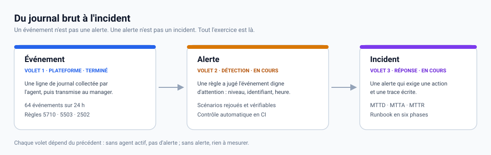
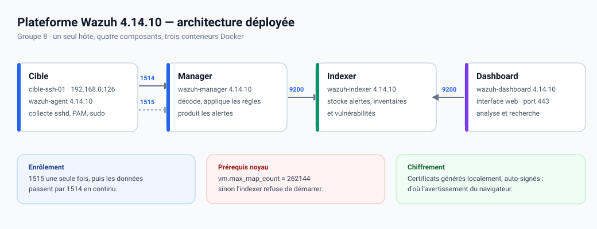
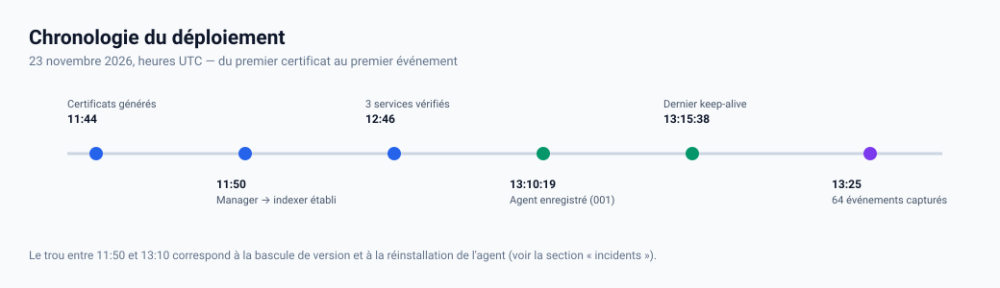
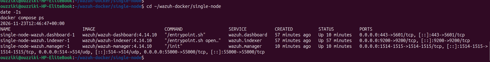
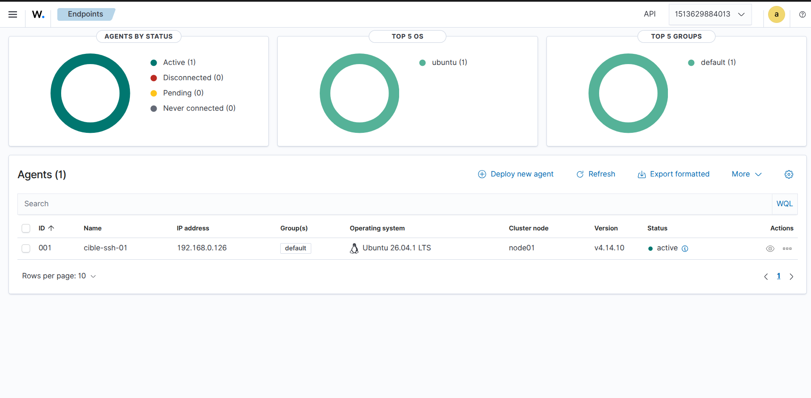
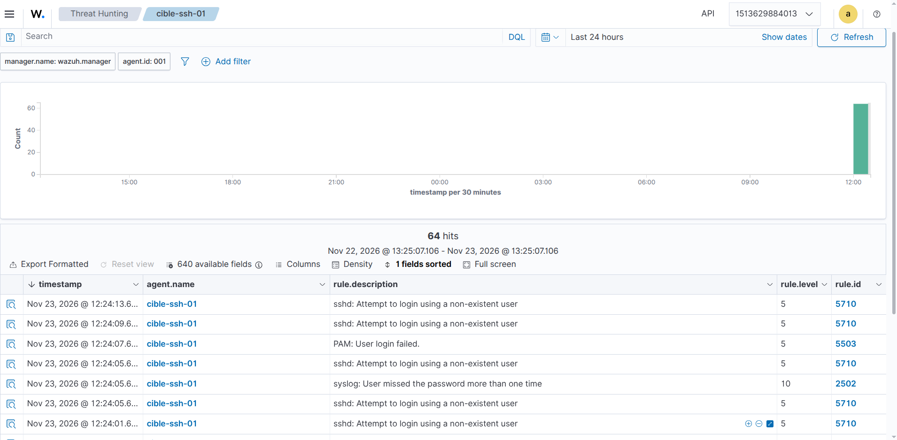
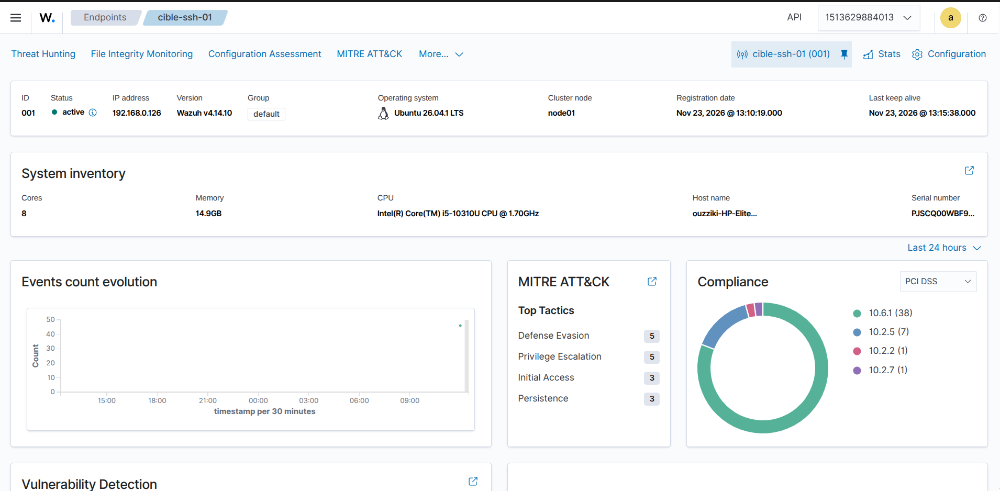
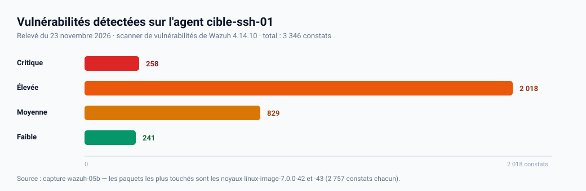

# Workshops DevSecOps — Group 8

**Groupe 8** — Ouzziki Lhoussaine · Hasna elhassani · Zineb Hajaj \
**Dépôt :** https://github.com/ZinebHajaj/workshops-groupe8 \

---

# Workshop 6 — Supervision, détection et réponse avec Wazuh

Une application qu'on n'observe pas ne se défend pas. Ce workshop installe la brique qui manquait aux
précédents : après avoir cherché des failles dans le code (workshop 3), attaqué l'application (workshop
4) puis scanné les dépendances et les images (workshop 5), il restait à répondre à une question :
**que se passe-t-il sur nos machines en ce moment, et comment le savons-nous ?**

Wazuh est une plateforme de détection d'intrusion et de supervision de sécurité, entièrement libre. Elle
collecte les journaux des machines surveillées, les analyse à l'aide de règles, et remonte les
événements anormaux dans une interface de recherche.

Le fil directeur du workshop tient en une phrase : **un événement n'est pas une alerte, et une alerte
n'est pas un incident.** Tout l'exercice consiste à distinguer les trois, puis à mesurer le temps qu'on
met à passer de l'un à l'autre.

## Les trois volets

| Volet | Auteur | Branche | Statut | Dossier |
|---|---|---|---|---|
| 1. Plateforme | Lhoussaine | `workshop6-wazuh-plateforme-lhoussaine` | ✅ terminé | [`docs/workshop6/plateforme/`](docs/workshop6/plateforme/README.md) |
| 2. Détection | Hasna | `workshop6-wazuh-detection-hasna` | ⏳ en cours | [`docs/workshop6/detection/`](docs/workshop6/detection/) |
| 3. Réponse et mesure | Zineb | `workshop6-wazuh-reponse-zineb` | ⏳ en cours | [`docs/workshop6/reponse/`](docs/workshop6/reponse/) |

Chaque volet dépend du précédent : la détection a besoin d'un agent actif pour produire des alertes, et
la mesure a besoin d'alertes pour calculer des durées. **L'ordre de fusion suit cette chaîne.**



## Architecture déployée

Quatre composants, dont trois tournent dans des conteneurs Docker sur une seule machine :

- **l'agent** est installé sur la machine surveillée. Il lit ses journaux et les transmet au manager ;
- **le manager** reçoit ces journaux, les décode, applique les règles de détection et produit des
  alertes ;
- **l'indexer** stocke les alertes, les inventaires et les résultats du scanneur de vulnérabilités —
  c'est la base de données de la plateforme ;
- **le dashboard** est l'interface web : on y cherche, on filtre, on visualise.



Deux ports méritent d'être retenus. **1515** sert une seule fois, à l'enrôlement de l'agent : c'est la
porte d'entrée administrative. **1514** sert ensuite en permanence, pour les données. Confondre les deux
est l'erreur la plus fréquente — et c'est exactement ce qui a bloqué ce déploiement au premier essai
(voir les incidents plus bas).

## Versions et reproductibilité

| Composant | Version | Identifié par |
|---|---|---|
| manager | 4.14.10 | `sha256:eabfa7ee…fa21517` |
| indexer | 4.14.10 | `sha256:1d2aeadb…eb629ea` |
| dashboard | 4.14.10 | `sha256:4d48be72…abda95a` |
| agent | 4.14.10 | paquet `.deb` 4.14.10-1 |

Le dépôt `wazuh-docker` est épinglé au tag **`v4.14.10`** (commit `76ddb88b`). Ce n'est pas un détail :
le clone par défaut récupère la branche `main`, qui contenait alors la version **5.0.0-rc2**, une
*release candidate*. La stack démarrait, mais l'arborescence `/var/ossec` avait disparu et aucune
commande du cours ne fonctionnait plus. Le détail complet est dans
[`01-versions.txt`](docs/workshop6/plateforme/01-versions.txt).

## Chronologie du déploiement



Le déploiement complet tient en une heure et demie. L'écart entre le démarrage des services et
l'enrôlement de l'agent correspond à la bascule de version et à la purge d'un agent trop ancien.

## Preuves du volet plateforme

| Les trois services tournent | L'agent est enrôlé et actif |
|---|---|
|  |  |

| Les événements remontent, avec leurs règles | La fiche de l'agent |
|---|---|
|  |  |

Ces captures disent trois choses précises. La première : les trois services sont `Up` avec la même
version — un décalage de version entre manager et indexer suffirait à tout casser. La deuxième :
l'agent porte l'identifiant `001`, le statut `active`, et le manager connaît son adresse et sa date de
dernière connexion. La troisième : les événements ne sont pas « des lignes » indifférenciées, ils sont
rattachés à des règles nommées — `5710` (tentative avec un utilisateur inexistant), `5503` (échec
d'authentification PAM), `2502` (mot de passe manqué plus d'une fois, niveau 10).

## Ce que la plateforme a détecté d'elle-même

Une fois l'agent enrôlé, le scanneur de vulnérabilités de Wazuh a inventorié les paquets de la machine
et croisé cet inventaire avec les bases de CVE connues. Résultat, sans aucune action de notre part :



Ce résultat est intéressant pour deux raisons. D'abord parce qu'il **recoupe le workshop 5** : les
mêmes paquets vulnérables, vus cette fois depuis la machine et non depuis l'image. Ensuite parce qu'il
montre une limite du laboratoire : ces constats portent en grande partie sur le noyau de la machine
hôte (`linux-image-7.0.0-42` et `-43`, 2 757 constats chacun) et **ne sont pas corrigeables sans
redémarrer le poste de travail** — un correcteur qui lit ce graphique doit savoir qu'il décrit une
machine de test, pas un serveur durci.

## Incidents réels, et ce qu'ils ont appris

Un déploiement qui se passe bien n'apprend rien. Ceux-ci ont coûté du temps et sont documentés dans
[`docs/workshop6/plateforme/README.md`](docs/workshop6/plateforme/README.md) :

1. **Une release candidate récupérée sans le vouloir.** Trois conteneurs `healthy`, et pourtant
   `/var/ossec/bin/agent_control` introuvable : la 5.0 avait changé toute l'arborescence. *Leçon : une
   version se fige par tag, et se vérifie par digest.*
2. **Un agent de la mauvaise génération.** L'agent 5.0 tentait de s'enrôler toutes les 60 secondes sur
   le port **1517**, qui n'existe pas en 4.14. *Leçon : la version de l'agent doit être identique à
   celle du manager.*
3. **`find: command not found` pendant la génération des certificats.** Erreur bruyante, conséquence
   nulle : les neuf certificats étaient bien écrits. *Leçon : vérifier le résultat, pas le message.*
4. **Un mot de passe changé à moitié.** Modifier le compose sans que l'indexer ait accepté le nouveau
   mot de passe coupe les alertes sans message d'erreur. *Leçon : un secret vit à trois endroits et
   doit rester synchrone.*

## Limites assumées

1. **Agent et manager sur la même machine** — contrainte de mémoire (5,6 Gi disponibles). Une vraie
   compromission de la cible n'est donc pas simulée.
2. **Mot de passe du dashboard laissé par défaut**, valeur non consignée dans le dépôt ; l'interface
   est exposée sur le réseau local.
3. **Trois ports exposés sans nécessité** (`9200`, `55000`, `443`) : utiles en laboratoire, à restreindre
   en production.
4. **Règle `5712` (force brute) non déclenchée** : elle exige huit tentatives rapprochées du même
   utilisateur.
5. **Un seul agent** : la vue multi-agents du dashboard n'est pas démontrée.

## Reproduire de zéro

```bash
sysctl -w vm.max_map_count=262144                  # sans ça, l'indexer refuse de démarrer
git clone https://github.com/wazuh/wazuh-docker && cd wazuh-docker
git checkout v4.14.10                              # épingler, ne pas rester sur main
cd single-node && docker compose -f generate-indexer-certs.yml run --rm generator
docker compose up -d
docker compose logs --tail=30 wazuh.manager | grep -i "connection to backoff"   # attendre "established"
```

Puis installer l'agent **de la même version** que le manager :

```bash
sudo WAZUH_MANAGER='<adresse-hote>' WAZUH_AGENT_NAME='<nom-agent>' \
  dpkg -i /tmp/wazuh-agent_4.14.10-1_amd64.deb
sudo systemctl enable --now wazuh-agent
```

## Organisation Git

| Branche | Rôle |
|---|---|
| `workshop6-wazuh-plateforme-lhoussaine` | volet 1 |
| `workshop6-wazuh-detection-hasna` | volet 2 |
| `workshop6-wazuh-reponse-zineb` | volet 3 |
| `workshop6-Groupe8` | **intégration** — reçoit les fusions, personne n'y commite 
