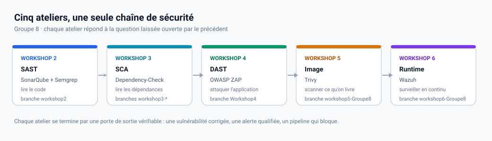

# Workshops DevSecOps — Groupe 8

**Groupe 8** — Ouzziki Lhoussaine · Hasna elhassani · Zineb Hajaj   \
**Dépôt :** https://github.com/ZinebHajaj/workshops-groupe8 \
**Application analysée :** OWASP Juice Shop (Node.js / Angular / TypeScript) \
**Module :** DevSecOps — ateliers 2 à 6

Ce dépôt n'est pas une collection de travaux séparés. C'est **une seule chaîne de sécurité**, construite
atelier après atelier : chaque étape répond à la question que la précédente a laissée ouverte.

On commence par lire le code (atelier 2), puis ses dépendances (atelier 3). On attaque ensuite
l'application en fonctionnement (atelier 4), on scanne l'image qu'on s'apprête à livrer (atelier 5), et
on finit par surveiller la machine qui la fait tourner (atelier 6).



## Plan de ce document

1. Comment lire ce dépôt — les branches et la méthode de travail
2. Les cinq README, en accès direct — un lien par atelier
3. Vue d'ensemble — les cinq ateliers en un tableau
4. Atelier 2 — analyse statique du code (SAST)
5. Atelier 3 — analyse des dépendances (SCA)
6. Atelier 4 — tests dynamiques (DAST)
7. Atelier 5 — sécurité de l'image Docker
8. Atelier 6 — supervision, détection et réponse
9. Ce que les cinq ateliers démontrent ensemble
10. Repères techniques

---

## 1. Comment lire ce dépôt

### Ce que contient `main`

**`main` ne contient pas le travail des ateliers.** C'est la page d'accueil du dépôt et l'index de ce
qui a été livré : ce document, les preuves SCA (`docs/workshop3/`) et le schéma de la chaîne
(`docs/synthese/`).

### Où vit chaque atelier

Chaque atelier a sa **branche de remise** — une branche dédiée, conservée telle quelle, qui constitue
le rendu déposé sur Classroom. Elle n'est **jamais fusionnée dans `main`**.

| Atelier | Branche de remise | Où sont les documents et les captures |
|---|---|---|
| 2 — SAST | [`workshop2`](https://github.com/ZinebHajaj/workshops-groupe8/tree/workshop2) | sur la branche : `README.md`, `docs/screenshots/`, `docs/RESULTATS-semgrep.md` |
| 3 — SCA | [`Workshop3`](https://github.com/ZinebHajaj/workshops-groupe8/tree/Workshop3) | sur la branche : `README.md`, `docs/workshop3/` (pipeline, scan, remédiation, captures) |
| 4 — DAST | [`Workshop4`](https://github.com/ZinebHajaj/workshops-groupe8/tree/Workshop4) | sur la branche : `README.md`, `docs/workshop4/` (29 captures + rapports) |
| 5 — Image | [`workshop5-Groupe8`](https://github.com/ZinebHajaj/workshops-groupe8/tree/workshop5-Groupe8) | sur la branche : `README.md`, `docs/workshop5/` (scan, remédiation, CI) |
| 6 — Supervision | [`workshop6-Groupe8`](https://github.com/ZinebHajaj/workshops-groupe8/tree/workshop6-Groupe8) | sur la branche : `README.md`, `docs/workshop6/` (plateforme, captures) |

### La méthode de travail, identique aux cinq ateliers

1. Une **branche d'atelier** est créée depuis `main`.
2. Chacun travaille sur **sa propre branche**, créée depuis la branche d'atelier, nommée
   `workshopN-<outil>-<volet>-<prénom>`. Personne ne pousse sur la branche d'un camarade.
3. Chaque volet est intégré par **pull request** dans la branche d'atelier, après relecture.
4. La branche d'atelier **n'est pas fusionnée dans `main`** : elle reste intacte, avec son historique.

**Pourquoi ce choix.** Il produit trois effets concrets : l'**attribution** est vérifiable (l'historique
porte le nom de l'auteur de chaque volet), les **conflits** restent rares et n'apparaissent qu'au moment
de la fusion — là où ils sont visibles et arbitrables —, et chaque volet reste **relisible seul**, sans
devoir lire les deux autres.

### Le vérifier soi-même

Trois commandes suffisent, sans rien installer d'autre que `git` :

```bash
git branch -r                                   # les branches de remise et de travail
git log --graph --oneline --all --decorate -20  # la forme réelle de l'historique
git shortlog -sn origin/workshop5-Groupe8       # qui a écrit combien de commits
```

### La règle commune aux cinq ateliers

**Aucun chiffre n'est annoncé sans sa source.** Chaque compteur, chaque durée, chaque identifiant se
recalcule par une commande citée à côté, ou se lit sur une capture datée. Ce qui n'a pas été observé
s'écrit `<à relever>` — jamais une valeur plausible. Cette règle a un coût : elle oblige à écrire les
limites et les cases vides. C'est précisément ce qu'on attend d'un audit.

---

## 2. Les cinq README, en accès direct

Chaque atelier a son propre `README.md`, sur sa branche de remise. **Ils ne sont pas recopiés ici** :
ce document les résume et renvoie à eux pour les détails, les commandes et les captures. Un clic suffit
pour lire l'atelier dans son intégralité.

| Atelier | Sujet du README | Lien direct vers le README | Toute la branche |
|---|---|---|---|
| **2** | SAST — SonarQube, Semgrep, Terraform, security gate | [workshop2/README.md](https://github.com/ZinebHajaj/workshops-groupe8/blob/workshop2/README.md) | [arborescence](https://github.com/ZinebHajaj/workshops-groupe8/tree/workshop2) |
| **3** | SCA — OWASP Dependency-Check, Dependabot, gate CVSS ≥ 9 | [Workshop3/README.md](https://github.com/ZinebHajaj/workshops-groupe8/blob/Workshop3/README.md) | [arborescence](https://github.com/ZinebHajaj/workshops-groupe8/tree/Workshop3) |
| **4** | DAST — OWASP ZAP passif, actif, pipeline | [Workshop4/README.md](https://github.com/ZinebHajaj/workshops-groupe8/blob/Workshop4/README.md) | [arborescence](https://github.com/ZinebHajaj/workshops-groupe8/tree/Workshop4) |
| **5** | Image — Trivy, remédiation, seuil et dérogation | [workshop5-Groupe8/README.md](https://github.com/ZinebHajaj/workshops-groupe8/blob/workshop5-Groupe8/README.md) | [arborescence](https://github.com/ZinebHajaj/workshops-groupe8/tree/workshop5-Groupe8) |
| **6** | Supervision — Wazuh, détection, réponse | [workshop6-Groupe8/README.md](https://github.com/ZinebHajaj/workshops-groupe8/blob/workshop6-Groupe8/README.md) | [arborescence](https://github.com/ZinebHajaj/workshops-groupe8/tree/workshop6-Groupe8) |
| **`main`** | ce document — index de la chaîne | [README.md](https://github.com/ZinebHajaj/workshops-groupe8/blob/main/README.md) | [arborescence](https://github.com/ZinebHajaj/workshops-groupe8/tree/main) |

### Ce que chaque README contient

- **Atelier 2** — les rapports SonarQube et Semgrep, le tableau des faux positifs écartés, le détail des
  8 `ERROR` restantes, le fonctionnement du gate et la démonstration du passage au rouge.
- **Atelier 3** — le pipeline `build → dependency-check → security gate`, les trois états de rapport
  (baseline locale à 46 findings, référence CI du 2026-10-31 à 13:27:17, run après corrections), les
  codes de sortie (15 = gate bloqué, 13 = erreur d'outil) et la comparaison Dependabot /
  Dependency-Check.
- **Atelier 4** — les scans passif et actif, le périmètre écrit, les rapports HTML, les journaux et les
  29 captures.
- **Atelier 5** — le scan de référence, le tri des 43 HIGH+CRITICAL, la remédiation, le seuil de la CI,
  la dérogation nominative et ses 4 tests de vérification.
- **Atelier 6** — l'architecture de la plateforme, les versions et digests, la chronologie du
  déploiement, les preuves, les 4 incidents et les 5 limites.

> **Note de navigation.** Sur GitHub, un lien `blob/<branche>/chemin` ouvre le **fichier** ; un lien
> `tree/<branche>` ouvre l'**arborescence** de la branche. Les branches d'atelier n'étant pas fusionnées
> dans `main`, leurs fichiers ne sont visibles qu'en passant par ces liens ou par le sélecteur de
> branche.

---

## 3. Vue d'ensemble

| Atelier | La question posée | Outil | Cible | Résultat clé |
|---|---|---|---|---|
| **2 — SAST** | le code contient-il des failles ? | SonarQube, Semgrep | code source de Juice Shop (37 000 lignes) | 8 vulnérabilités `ERROR` réelles ; un gate qui **bloque** le pipeline |
| **3 — SCA** | les dépendances sont-elles saines ? | OWASP Dependency-Check | `package-lock.json` racine et frontend | 3 findings critiques **corrigés et revérifiés** |
| **4 — DAST** | l'application qui tourne est-elle attaquable ? | OWASP ZAP 2.17.0 | Juice Shop 20.3.0 en réseau Docker privé | 116 puis 155 URLs scannées, 16 puis 19 alertes |
| **5 — Image** | ce qu'on livre est-il propre ? | Trivy 0.75.0 | `bkimminich/juice-shop` épinglée par digest | 115 constats, 43 HIGH+CRITICAL triés, gate CI avec dérogation bornée |
| **6 — Supervision** | que se passe-t-il en ce moment ? | Wazuh 4.14.10 | machine hôte + agent `cible-ssh-01` | agent actif, 64 événements qualifiés par des règles |

Chaque atelier s'est terminé par une **porte de sortie vérifiable** : une vulnérabilité réellement
corrigée, une alerte réellement qualifiée, un pipeline qui refuse réellement de passer.

---

## 4. Atelier 2 — analyse statique du code (SAST)

**Branche de remise :** `workshop2` · **Trois volets :** SonarQube (Zineb), Semgrep et Terraform
(Hasna), pipeline et gate (Lhoussaine)

### Le principe

L'analyse statique lit le code **sans l'exécuter**. Deux familles d'outils ont été installées parce
qu'elles ne voient pas la même chose : **SonarQube** est un serveur qui donne une vision globale (bugs,
vulnérabilités, *code smells*, Quality Gate) ; **Semgrep** est un outil en ligne de commande qui
applique des motifs précis, avec des règles communautaires et des règles écrites par le groupe.

### Ce que SonarQube a trouvé

Projet de 37 000 lignes. Le **Quality Gate passe**, mais deux notes sont mauvaises :

| Métrique | Valeur | Lecture |
|---|---|---|
| Quality Gate | **Passed** | toutes les conditions passent |
| Security (rating) | **E** — 75 issues | une marche avant le pire |
| Reliability (rating) | **D** — 104 issues | bugs de fiabilité à traiter |
| Maintainability (rating) | **A** — 38 issues | bonne maintenabilité |
| Coverage | **0,0 %** | aucun test exécuté en CI → métrique non alimentée |
| Duplications | **11,3 %** | sous le seuil d'alerte |
| Issues ouvertes | **184** | |

Les cinq règles de sécurité les plus déclenchées :

| Règle | Occurrences | Catégorie |
|---|---|---|
| Clear-text protocol | 29 | CWE-319 — transmission en clair |
| PRNG (aléa non cryptographique) | 13 | CWE-338 |
| Contournement de la sanitisation Angular | 9 | CWE-79 — XSS |
| Clear-text protocol (variante) | 5 | CWE-319 |
| Mauvaise configuration cloud | 5 | infrastructure |

**La leçon de lecture, et elle est importante :** sur **3 309 issues** au total, environ **3 300 sont
des *code smells*** — des problèmes de style. Les 75 vraies issues de sécurité s'y noient. Sans
filtrage, un tableau de bord SonarQube donne l'illusion d'un gouffre. C'est exactement ce qui
justifie un gate sur le **code nouveau** plutôt que sur le code hérité.

### Ce que Semgrep a trouvé

Configurations employées : `p/default`, `p/owasp-top-ten`, `p/secrets`, plus des règles maison
(injection SQL, XSS via `innerHTML`, `eval`, secrets en dur, TLS désactivé, hash faible, redirection
ouverte, injection de commandes).

| Étape | Findings | ERROR | WARNING |
|---|---|---|---|
| Règles maison non calibrées (1er run CI) | 117 | 65 | 49 |
| Après calibrage, exclusions et dédoublonnage | **30** | **8** | **21** |

**57 faux positifs ont été écartés**, et le détail est conservé dans `docs/RESULTATS-semgrep.md`. Les
8 vulnérabilités `ERROR` restantes sont toutes dans du code applicatif réel :

| Fichier | Règle | Catégorie |
|---|---|---|
| `routes/login.ts:34` | `groupe8-sql-injection-concat` | CWE-89 |
| `routes/search.ts:23` | `groupe8-sql-injection-concat` | CWE-89 |
| `routes/userProfile.ts:65` | `code-string-concat` | CWE-95 |
| `routes/captcha.ts:22` | `groupe8-eval-usage` | CWE-95 |
| `lib/xml.ts:12` | `groupe8-eval-usage` | CWE-95 |
| `routes/currentUser.ts:31` | `remote-property-injection` | CWE-915 |
| `…/hacking-instructor/index.ts:126` et `:142` | `groupe8-xss-innerhtml` | CWE-79 |

### Les corrections apportées

| Vulnérabilité | Outil | Correctif |
|---|---|---|
| Injection SQL par concaténation | Semgrep | requête paramétrée |
| `eval()` sur une entrée utilisateur | Semgrep + SonarQube | suppression de l'évaluation dynamique |
| XSS via `innerHTML` | Semgrep + SonarQube | `textContent` / sanitisation |
| Sous-réseau AWS avec IP publique | Semgrep (Terraform) | `map_public_ip_on_launch` : `true` → `false` |

La correction Terraform mérite un mot : `map_public_ip_on_launch = true` attribue automatiquement une
IP publique à **toute** instance lancée dans le sous-réseau — une surface d'attaque inutile pour des
ressources internes. Repasser la valeur à `false` ne casse rien : l'accès public reste possible via
l'Internet Gateway et des règles explicites, mais il devient un choix plutôt qu'un défaut.

### Le security gate — ce qui distingue cet atelier

Le pipeline GitHub Actions enchaîne trois jobs : `SonarQube - scan + quality gate`, `Semgrep -
analyse statique`, puis `Security Gate - decision`, qui agrège les deux rapports et **fait échouer la
construction** si un finding de sévérité `ERROR` subsiste ou si le Quality Gate est en échec.

**La preuve :** une vulnérabilité est introduite volontairement (`const t = eval(process.argv[2])`),
poussée, et le pipeline passe au rouge — puis repasse au vert après `git revert`. Le gate n'est donc
pas un rapport consultatif : c'est une **condition de fusion**.

**Le piège technique rencontré :** Semgrep laisse `results[].level` à `null` dans son SARIF. La
sévérité réelle vit dans `tool.driver.rules[].defaultConfiguration.level`. Un gate qui lit le mauvais
champ reste vert en toutes circonstances — et on croit avoir bloqué alors qu'on n'a rien bloqué.

---

## 5. Atelier 3 — analyse des dépendances (SCA)

**Branche de remise :** `Workshop3` · **Preuves :** `docs/workshop3/` · **Quatre branches de travail :**
`workshop3-pipeline-zineb`, `workshop3-dependabot-hasna`, `workshop3-dependency-check-lhoussaine`,
`workshop3-critical-remediation-lhoussaine`

### Le principe

Une application moderne est faite à 90 % de code qu'on n'a pas écrit. **OWASP Dependency-Check**
confronte les versions déclarées dans les *lockfiles* aux bases publiques de vulnérabilités (NPM
Advisory, NVD) et produit un rapport par dépendance.

### Le point de départ

**46 findings** côté NPM sur les manifestes et lockfiles de la racine et du frontend. Trois ont été
traités jusqu'à la vérification complète :

| Dépendance | Advisory | Sévérité | Correction | Après |
|---|---|---|---|---|
| `crypto-js@3.3.0` via `pdfkit@0.11.0` | GHSA-xwcq-pm8m-c4vf | Critical 9,1 | `pdfkit` 0.11.0 → **0.20.2** (`a1c15a5`) | absente |
| `crypto-js@3.3.0` via `pdfkit@0.11.0` | GHSA-rg76-677x-56q9 | Critical 9,0 | idem | absente |
| `express-jwt@0.1.3` | GHSA-6g6m-m6h5-w9gf | High 7,7 | `express-jwt` → **6.0.0** (`c60aca3`) | absente |

**Pourquoi corriger le parent plutôt que l'enfant.** `pdfkit@0.20.2` ne déclare plus `crypto-js` du
tout : il utilise `@noble/hashes` et `@noble/ciphers`. Mettre à jour **le parent** supprime la
dépendance vulnérable sans l'ajouter en direct — on ne remplace pas une faille par une dépendance
forcée.

**Pourquoi `express-jwt` est un bon cas d'école.** Passer de 0.1.3 à 6.0.0 a obligé à rendre les
`algorithms` explicites (`RS256` pour `isAuthorized`, `HS256` pour `denyAll`) et à retirer des `as
any` qui masquaient des options devenues obligatoires. Une montée de version de sécurité n'est pas un
`npm install` : c'est une modification de code, vérifiée par 54 tests unitaires.

### La leçon de lecture des totaux

Après correction, le total passe de **46** à **68** constats. Ce n'est **pas** une régression : la
couverture diffère (NPM seul avant, NPM + NVD après, avec `--noupdate` car la mise à jour NVD échouait).

La seule mesure honnête est la comparaison **normalisée** par `paquet:version + advisory` :

- **3 couples supprimés** — exactement les trois findings ciblés ;
- **25 couples ajoutés** — 23 NVD et 2 NPM, qui restent à trier et ne prouvent pas que les commits ont
  introduit 25 vulnérabilités.

Un total global comparé naïvement raconte une fausse histoire. Le dire fait partie du résultat.

### Ce qui reste ouvert

`jsonwebtoken@0.4.0` reste une dépendance directe à traiter séparément, et `express-jwt@6.0.0` introduit
`jsonwebtoken@8.5.1` dont les CVE doivent faire l'objet d'un tri dédié. Les empreintes SHA-256 des
rapports avant et après sont conservées dans `resultats.md` : le rapport est une pièce, pas une capture
d'écran.

---

## 6. Atelier 4 — tests dynamiques (DAST)

**Branche de remise :** `Workshop4`

### Le principe

Cette fois, on n'analyse pas le code : on **attaque l'application telle qu'elle tourne**. Cible :
**Juice Shop 20.3.0** lancée en local dans un réseau Docker privé. Scanner : **OWASP ZAP 2.17.0**.

**Le périmètre a été écrit avant les scans** (`docs/workshop4/zap-actif/perimetre.txt`). Aucun scan n'a
visé un système tiers, un site public ou la production. C'est la condition pour qu'un scan actif soit
un travail de sécurité et non une attaque.

### Les trois volets

| Volet | Auteur | Résultat | Intégration |
|---|---|---|---|
| Scan **passif** | Lhoussaine | 31/10/2026 18:22 — **116 URLs, 16 alertes** (0 High, 2 Medium, 5 Low, 9 Info), code de sortie `0` | PR #40 |
| Scan **actif** | Zineb | 01/11/2026 01:22 → 01:36 UTC — **155 URLs, 19 alertes** (0 High, 5 Medium, 5 Low, 9 Info) | commit `7323e7a` |
| **Intégration continue** | Hasna | workflow `DAST - ZAP Baseline` — **run #6 réussi en 1 min 53 s** sur la branche de remise | PR #55 → `7f33a69` |

### Ce que la comparaison des deux scans apprend

Le passage du passif à l'actif ajoute **39 URLs explorées** et **3 alertes Medium**, sans faire
apparaître **aucune alertes High**. Autrement dit : l'attaque automatisée n'a pas trouvé de faille
critique que l'observation seule aurait manquée — mais elle a bien confirmé et élargi le spectre des
faiblesses moyennes.

C'est un résultat à assumer, pas à maquiller. Un scan actif qui ne trouve rien de grave n'est pas un
scan raté : c'est une information sur la robustesse de la cible, et sur les limites de l'outil
lui-même (ZAP ne devine pas une logique métier).

**29 captures, rapports et journaux** sont rangés dans `docs/workshop4/`, à côté du périmètre et des
commandes de rejeu.

---

## 7. Atelier 5 — sécurité de l'image Docker

**Branche de remise :** `workshop5-Groupe8` · **Quatre branches :** scan (Lhoussaine), remédiation
(Hasna), CI (Zineb), dérogation (`workshop5-seuil-derogation`, PR #53)

### Le principe

Entre le code et la production, il y a une **image**. **Trivy 0.75.0** l'analyse sous trois angles :
vulnérabilités des paquets, secrets embarqués, mauvaises configurations.

L'image `bkimminich/juice-shop` est épinglée **par digest** (`sha256:42843723…5853f4`), pas par tag :
un tag peut être réécrit, un digest non. C'est ce qui rend le scan de référence du 2026-11-01 et le
re-scan du 2026-11-04 comparables.

### Le scan de référence

| Sévérité | Nombre |
|---|---|
| CRITICAL | 11 |
| HIGH | 32 |
| MEDIUM | 60 |
| LOW | 11 |
| UNKNOWN | 1 |
| **Total** | **115** |
| **HIGH + CRITICAL** | **43** |
| dont avec correctif publié | 40 |
| dont sans correctif | 3 |

Le périmètre de travail est le sous-ensemble **HIGH + CRITICAL = 43**, pas les 115 : c'est sur lui que
portent la remédiation et le seuil de la CI. Le dire évite la question « pourquoi 43 et pas 115 ? ».

### Trois observations qui portent

- **`tar` pèse 10 alertes à lui seul** (1 CRITICAL + 9 HIGH) alors que le correctif existe depuis
  plusieurs versions mineures : la dette la plus volumineuse de l'image, et la priorité n° 1 d'une
  reconstruction.
- **`jsonwebtoken` est présent en deux versions** (0.1.0 **et** 0.4.0) : dépendance transitive non
  dédupliquée, symptôme d'un arbre mal entretenu plutôt que d'une erreur isolée.
- **`crypto-js` et `handlebars` portent 2 CRITICAL chacun** — et `crypto-js` est exactement la
  dépendance corrigée à l'atelier 3. **Les deux ateliers se répondent** : corrigée dans les
  dépendances de l'application, encore présente dans les paquets de l'image.

### Le gate, et surtout la dérogation

Le seuil est explicite : `HIGH,CRITICAL` **signale** (code de sortie 0) pour produire un rapport, mais
`CRITICAL` **bloque** (code de sortie 1). L'option `ignore-unfixed: true` évite de bloquer sur des
correctifs qui n'existent pas.

**Le run rouge :** `Total: 8 (CRITICAL: 8)`, `exit code 1`. Le chiffre se recoupe :
**11 CRITICAL − 3 sans correctif = 8**. Le pipeline refuse de passer.

**La dérogation, et sa preuve.** Après durcissement, l'image présente **les mêmes 8 CRITICAL** — un
run vert est donc impossible sans décision explicite. Le groupe a écrit une **dérogation nominative**
dans `.trivyignore` : un identifiant par ligne, aucun joker, un commentaire qui dit **quoi**,
**pourquoi**, **jusqu'à quand** et **qui** a décidé.

Puis il a **testé le mécanisme** — c'est ce qui distingue une dérogation d'un seuil baissé :

| Test | Situation | Attendu | Obtenu |
|---|---|---|---|
| A | sans dérogation | le gate bloque | `exit=1` ✅ |
| B | dérogation vide | le gate bloque encore | `exit=1` ✅ |
| C | les identifiants dérogés | le gate passe | `exit=0` ✅ |
| D | une CVE inventée | **le gate bloque** | `exit=1` ✅ |

Le **test D** est le plus important : il prouve que la dérogation est **bornée**. Sans lui, un
`.trivyignore` n'est qu'un seuil déguisé en commentaires.

**Le run vert**, sur la branche de remise : run **#10**, commit `7dad1b3`, ✅ Success, **1 min 05 s**
(artefacts : SARIF, table, SBOM CycloneDX). Un second run manuel (#11, `5dc8b06`) passe en 55 s.

> **Ce que ce vert ne dit pas.** Il ne dit pas que les vulnérabilités ont disparu — elles sont toujours
> là. Il dit que le pipeline sait bloquer, que l'équipe a mesuré ce qui est réellement fermable, et
> qu'elle a écrit ce qu'elle accepte de ne pas fermer. C'est la différence entre un seuil baissé et une
> décision d'ingénierie.

### Ce qui n'a pas pu être fait

Les **43 alertes HIGH+CRITICAL subsistent** après durcissement : elles vivent dans `node_modules`,
inaccessibles sans reconstruire l'application (`npm ci` échoue en `ERESOLVE`). Les paquets système ne
peuvent pas être mis à jour par couche sur une image **distroless**. Et **l'atteignabilité n'est
prouvée pour aucune alerte** : toutes les lignes du tri portent la mention « non vérifié ».

---

## 8. Atelier 6 — supervision, détection et réponse

**Branche de remise :** `workshop6-Groupe8`

### Le principe

Les quatre ateliers précédents regardent ce qu'on **écrit** et ce qu'on **livre**. Le dernier regarde
ce qui **se passe** : une application qu'on n'observe pas ne se défend pas.

**Wazuh** collecte les journaux des machines surveillées, les analyse par des règles et remonte les
événements anormaux dans une interface de recherche. La plateforme tourne en conteneurs —
`wazuh-docker` épinglé au tag **`v4.14.10`** (commit `76ddb88b`) — avec trois services : un **manager**
(règles et alertes), un **indexer** (stockage) et un **dashboard** (interface), plus un **agent**
`cible-ssh-01` enrôlé sous l'identifiant `001`.

### Trois notions que l'atelier sépare

| Notion | Définition | Exemple mesuré |
|---|---|---|
| **événement** | une ligne de journal collectée par l'agent | 64 événements sur 24 h |
| **alerte** | un événement qu'une règle a jugé digne d'attention | règles `5710`, `5503`, `2502` |
| **incident** | une alerte qui exige une action et une trace écrite | runbook en six phases (volet 3) |

### État livré

| Élément | État |
|---|---|
| Plateforme : 3 services `Up`, indexer `GREEN`, connexion manager → indexer établie | ✅ |
| 64 événements remontés, rattachés à des règles nommées (`5710` utilisateur inexistant, `5503` échec PAM, `2502` mot de passe manqué — niveau 10) | ✅ |
| Scanneur de vulnérabilités de l'agent : 258 critiques, 2 018 élevées, 829 moyennes, 241 faibles | ✅ |
| Volet détection : deux scénarios rejoués, alerte qualifiée, contrôle automatique en CI | ⏳ en cours |
| Volet réponse : inventaire CVE recalculable, MTTD / MTTA / MTTR, runbook | ⏳ en cours |

**Le lien avec l'atelier 5 saute aux yeux :** le scanneur de Wazuh retrouve des paquets vulnérables
sur la machine, là où Trivy les trouvait dans l'image. Même famille de constats, deux points de vue —
c'est exactement ce qu'on attend d'une chaîne de sécurité cohérente.

### Les incidents réels du déploiement

Un déploiement qui se passe bien n'apprend rien. Ceux-ci sont documentés dans le README de la branche :

1. **Une *release candidate* récupérée sans le vouloir** — le clone par défaut livrait Wazuh 5.0.0-rc2 :
   trois conteneurs `healthy`, mais `/var/ossec` inexistant et plus aucune commande du cours utilisable.
   *Une version se fige par tag, et se vérifie par digest.*
2. **Un agent de la mauvaise génération** — l'agent 5.0 s'enrôlait toutes les 60 s sur le port **1517**,
   qui n'existe pas en 4.14 (enrôlement sur **1515**, données sur **1514**). *La version de l'agent doit
   être identique à celle du manager.*
3. **`find: command not found`** pendant la génération des certificats — erreur bruyante, conséquence
   nulle : les neuf certificats étaient bien écrits. *Vérifier le résultat, pas le message.*
4. **Un mot de passe changé à moitié** — modifier le compose sans que l'indexer ait accepté le nouveau
   mot de passe coupe les alertes sans message d'erreur. *Un secret vit à trois endroits et doit rester
   synchrone.*

---

## 9. Ce que les cinq ateliers démontrent ensemble

| Notion du module | Où elle est démontrée | La preuve |
|---|---|---|
| une faille dans le code se détecte **avant** la fusion | atelier 2 | gate rouge sur `eval(process.argv[2])`, vert après `revert` |
| une dépendance vulnérable se corrige **et se revérifie** | atelier 3 | 3 couples absents du rapport après, empreintes SHA-256 conservées |
| une application peut être attaquée **sans être cassée** | atelier 4 | périmètre écrit avant le scan actif, 155 URLs, 0 High |
| ce qu'on livre peut être scanné **avant** la production | atelier 5 | `Total: 8 (CRITICAL: 8)` → `exit 1`, puis dérogation bornée testée |
| ce qui tourne peut être **surveillé en continu** | atelier 6 | agent `active`, 64 événements qualifiés par des règles |
| **un gate n'a de valeur que s'il est borné** | ateliers 2 et 5 | test D : une CVE inventée fait échouer le pipeline dérogé |
| **un compteur qui monte n'est pas une régression** | ateliers 2, 3 et 5 | 46 → 68 constats SCA ; 28 → 30 findings Semgrep |

---

## 10. Repères techniques

| Élément | Valeur |
|---|---|
| Application analysée | OWASP Juice Shop (Node.js / Angular / TypeScript) |
| CI | GitHub Actions — `ubuntu-latest`, actions épinglées par SHA |
| Outils | SonarQube Community, Semgrep, OWASP Dependency-Check, OWASP ZAP 2.17.0, Trivy 0.75.0, Wazuh 4.14.10 |
| Conteneurisation | Docker, Docker Compose |
| Branches de remise | `workshop2`, `Workshop3`, `Workshop4`, `workshop5-Groupe8`, `workshop6-Groupe8` |
| Ce que contient `main` | ce document, `docs/workshop3/` (preuves SCA), `docs/synthese/` (le schéma) |

> Les captures, journaux et rapports de chaque atelier vivent **sur sa branche de remise**, à côté de
> ses documents. C'est volontaire : une branche doit pouvoir être ouverte, comparée et évaluée seule —
> sans dépendre du reste du dépôt.
