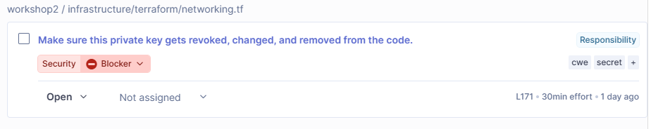
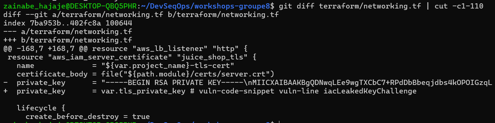
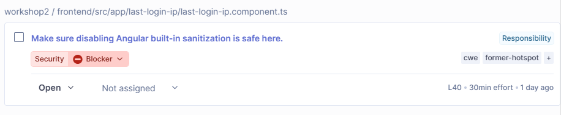
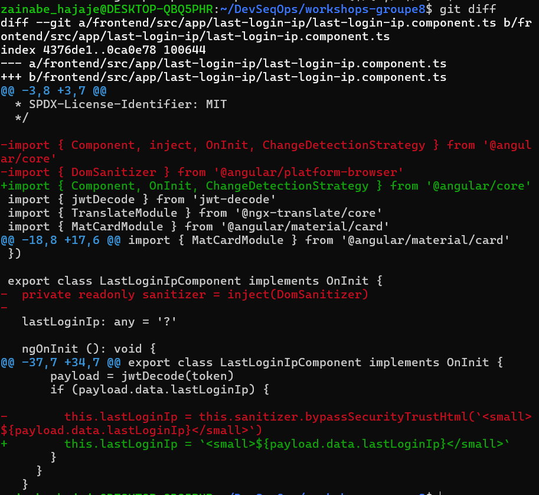
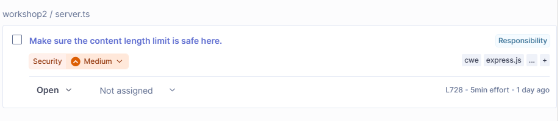
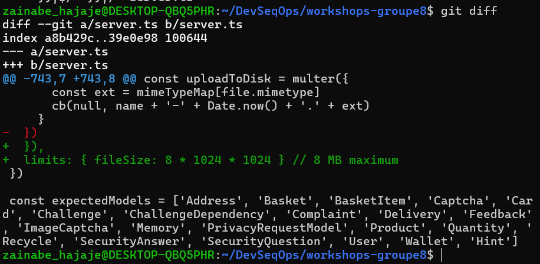
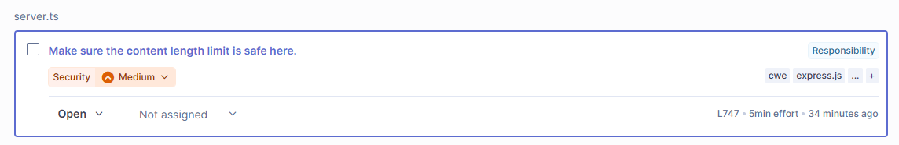
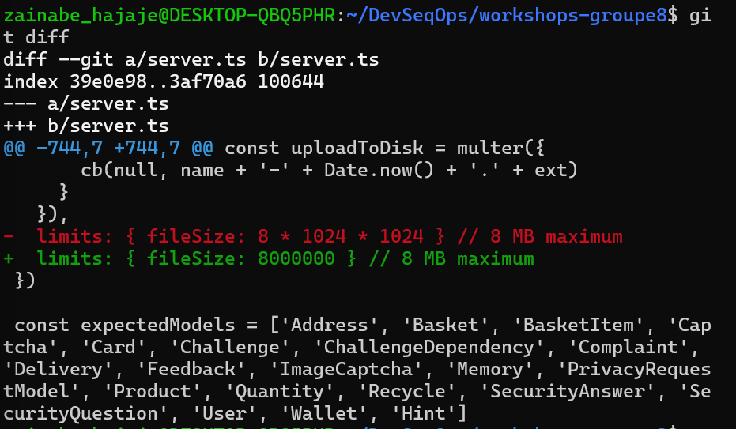

# Vulnérabilités corrigées — Zainabe (SonarQube)

Projet analysé : OWASP Juice Shop, avec SonarQube Community lancé dans Docker (projet `workshop2`).

| Avant les corrections | Après les corrections |
|---|---|
| 184 issues ouvertes, dont **75 de sécurité** | **71 issues de sécurité** (soit 4 de moins), Quality Gate **Passed** |

Captures de l'Overview : [avant](sonarqube/overview-avant.jpeg) et [après](sonarqube/overview-apres.png).

| # | Problème | Fichier | Sévérité | Commit |
|---|---|---|---|---|
| 1 | Clé privée écrite dans le code | `terraform/networking.tf` et `infrastructure/terraform/networking.tf` (ligne 171) | Blocker | `e249715` |
| 2 | XSS : protection d'Angular désactivée | `frontend/src/app/last-login-ip/last-login-ip.component.ts` (ligne 40) | Blocker | `2b738be` |
| 3 | Pas de limite de taille sur l'envoi de fichiers | `server.ts` (ligne 728) | Medium | `07a3593`, puis `096937e` |

---

## 1. Clé privée écrite dans le code (Terraform)

**Cause.** Une clé privée RSA était écrite en clair à la ligne 171 de `networking.tf` (le fichier existe en deux copies identiques). Quiconque peut lire le dépôt peut copier cette clé et l'utiliser. Les captures [Why](sonarqube/p1-why.png) et [Where](sonarqube/p1-where.png) détaillent le risque et l'endroit.

**Solution recommandée par SonarQube.** Ne pas garder le secret dans le code, mais le lire depuis une source externe ([capture](sonarqube/p1-fix.png)).

**Correction appliquée.**
- Ajout d'une variable Terraform `tls_private_key` marquée `sensitive = true` dans les deux `variables.tf`.
- La ligne 171 utilise maintenant `var.tls_private_key` au lieu de la clé.

**Limite.** La clé reste visible dans l'historique Git (commit d'import). En situation réelle, il faudrait la révoquer et en générer une nouvelle.

---

## 2. XSS : contournement de la protection d'Angular

**Cause.** `bypassSecurityTrustHtml` dit à Angular de ne pas nettoyer le HTML. La valeur affichée vient du token (`payload.data.lastLoginIp`), donc d'une donnée contrôlable par l'utilisateur : du code malveillant pourrait s'exécuter dans le navigateur. Voir [Why](sonarqube/p2-why.png) et [Where](sonarqube/p2-where.png).

**Solution recommandée par SonarQube.** Ne pas contourner la sanitisation et laisser Angular nettoyer la valeur ([capture](sonarqube/p2-fix.png)).

**Correction appliquée.**
- Suppression de l'appel à `bypassSecurityTrustHtml` à la ligne 40.
- Suppression de l'import `DomSanitizer` et de son injection, devenus inutiles.
- Le fichier HTML n'a pas changé : `[innerHTML]` applique la sanitisation par défaut d'Angular.

**Effet.** Cette faille est un défi volontaire de Juice Shop : une fois corrigée, ce défi ne fonctionne plus.

---

## 3. Pas de limite de taille sur l'envoi de fichiers

**Cause.** `multer` (envoi de fichiers) était créé sans limite à la ligne 728 de `server.ts`. Un attaquant pourrait envoyer des fichiers énormes pour saturer la mémoire ou le disque du serveur (déni de service). Voir [Why](sonarqube/p3-why.png) et [Where](sonarqube/p3-where.png).

**Solution recommandée par SonarQube.** Fixer une option `limit` ([capture](sonarqube/p3-fix.png)). L'exemple de SonarQube concerne `body-parser` ; dans notre code, l'option équivalente de `multer` est `limits.fileSize`.

**Correction appliquée.** Ajout de `limits: { fileSize: 8 * 1024 * 1024 }` (8 Mo).

---

## 4. Nouvelle issue après le deuxième scan, corrigée

Après les trois corrections, le deuxième scan a fait passer la **Quality Gate à « Failed »** : 1 nouvelle issue, de la même famille, sur la ligne que nous venions d'ajouter (`server.ts`, ligne 747).

**Cause.** SonarQube accepte au maximum **8 000 000 octets** pour un envoi de fichier. Notre limite `8 * 1024 * 1024` vaut 8 388 608 octets, donc légèrement au-dessus du seuil. Voir [Why](sonarqube/p4-why.png), [Where](sonarqube/p4-where.png) et [Fix](sonarqube/p4-fix.png).

**Correction appliquée.** `limits: { fileSize: 8000000 }` (commit `096937e`). Après un troisième scan, la Quality Gate repasse à **Passed**.

Cet épisode illustre le cycle du cours : corriger, relancer le scan, constater, corriger à nouveau.

---

## Observations et limites

- **Quality Gate « Passed » ne veut pas dire code sûr** : il reste 71 issues de sécurité (note E), notamment d'autres Blocker non traités (secrets de `lib/insecurity.ts`, autres contournements Angular).
- **Vérification des corrections** : nouveau scan SonarQube et relecture du `git diff`. L'application n'a pas été relancée pour tester le comportement.
- **Limites de l'outil** : SonarQube signale `eval` même quand la donnée n'est pas contrôlée par l'utilisateur ; les messages « Make sure… » demandent un jugement humain.
