# Workshop 4 — Scan actif OWASP ZAP (Zineb Hajaj, Groupe 8)

Cible : OWASP Juice Shop 20.3.0, instance locale (Docker, réseau zap-net). Détail complet : [resultats.md](resultats.md), [correlation.md](correlation.md), [perimetre.txt](perimetre.txt), [scope.context](scope.context).

## Résultat en bref
- 155 URLs explorées, 19 alertes : 0 High, 5 Medium, 5 Low, 9 Informational.
- Confirmées par rejeu manuel : Backup File Disclosure, Bypassing 403, CORS, Full Path Disclosure, Feature-Policy obsolète.
- Aucune alerte XSS ni injection : non détectées par ce scan, ce qui ne prouve pas leur absence (application Angular, spider 2 min, sans AJAX spider, non authentifié).
- Aucune alerte de cookie (HttpOnly, Secure, SameSite) sans connexion.

## 1. Périmètre et cible
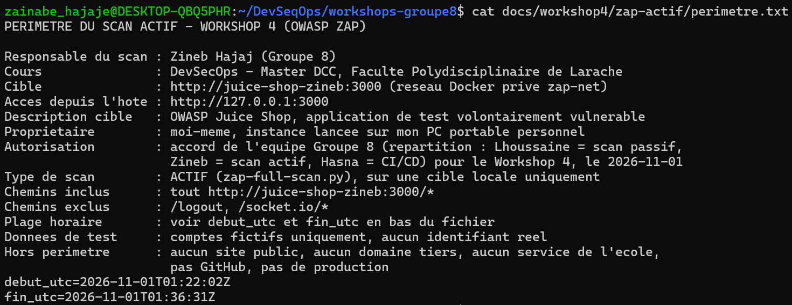
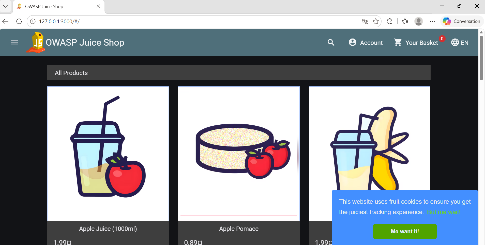
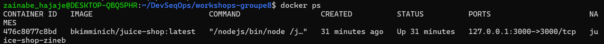
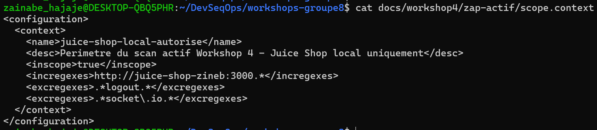

## 2. Scan actif
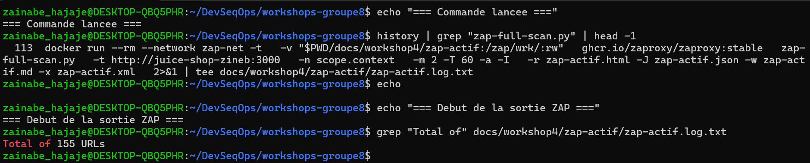
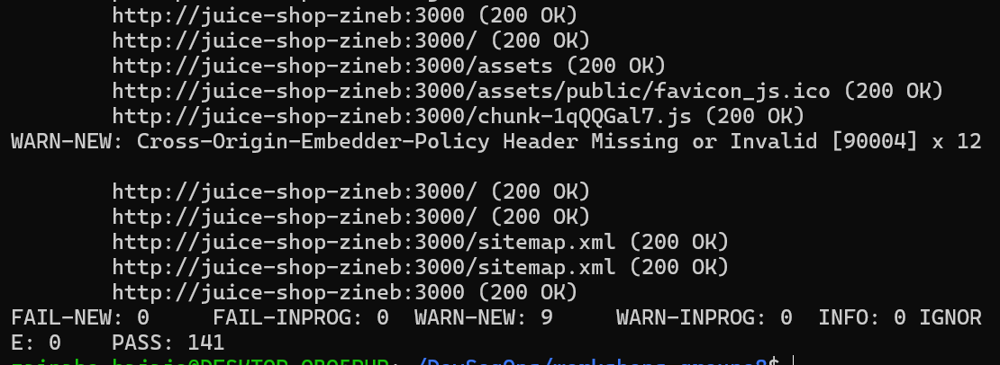
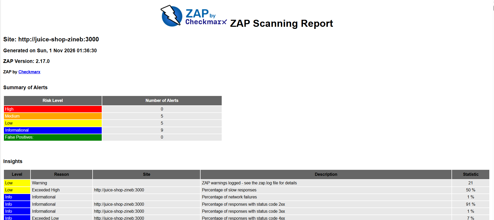

## 3. XSS et injections : non détectées
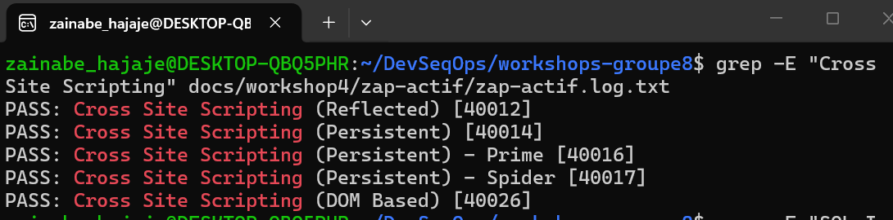
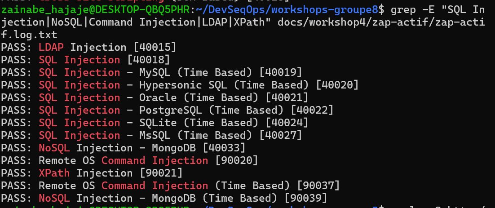

## 4. Rejeu manuel
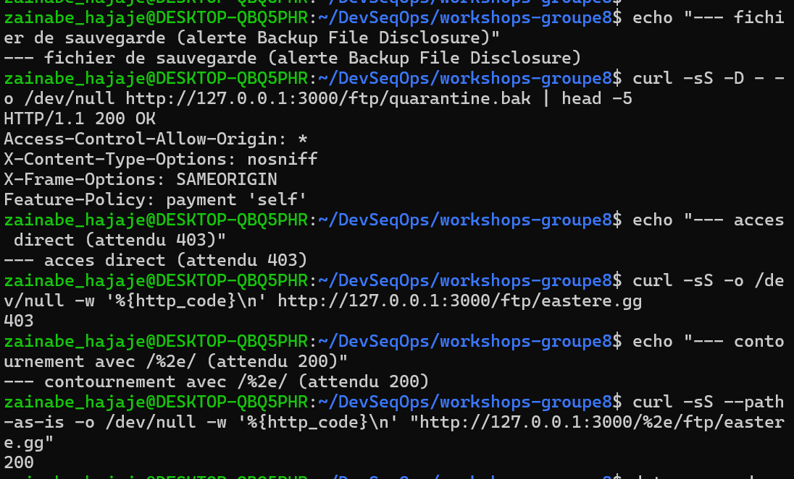
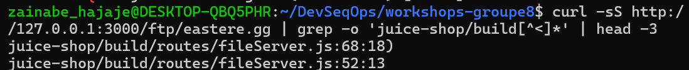
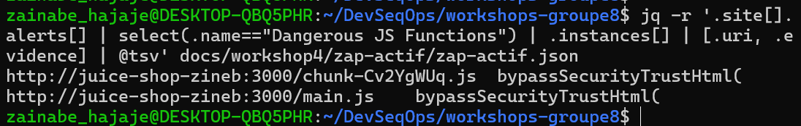

## 5. Corrélation avec le workshop 2 (SAST)
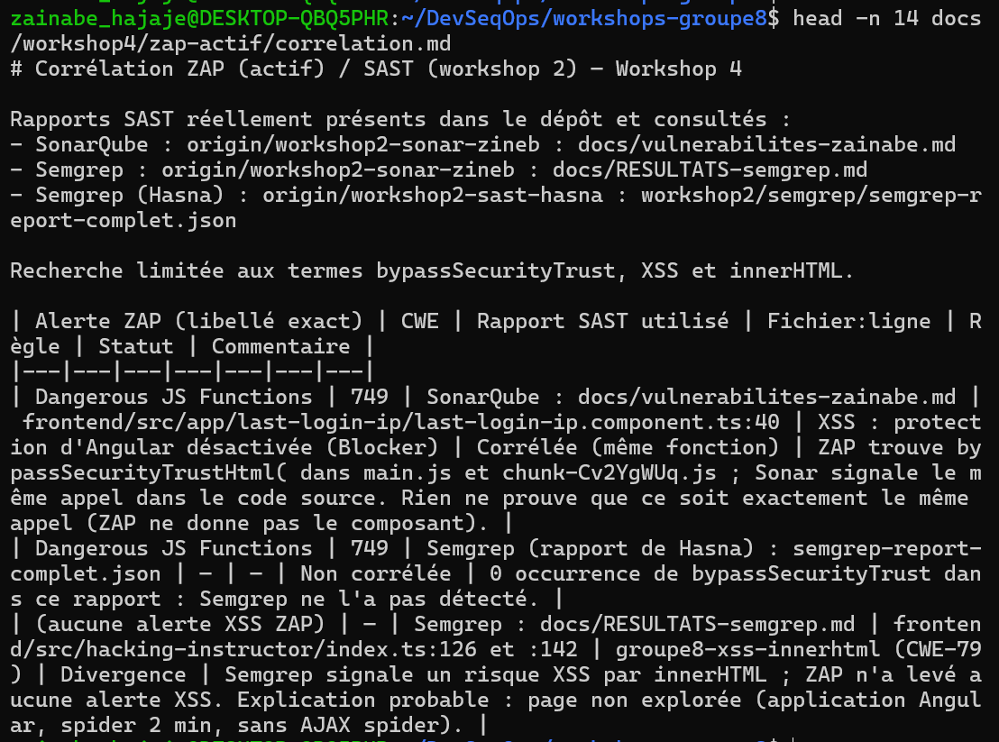

## 6. Commit
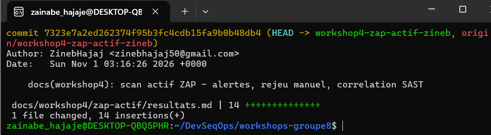
