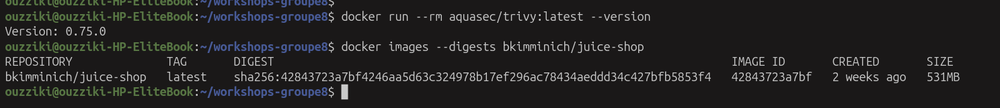
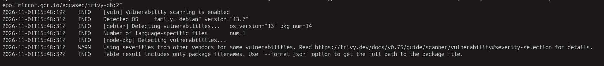
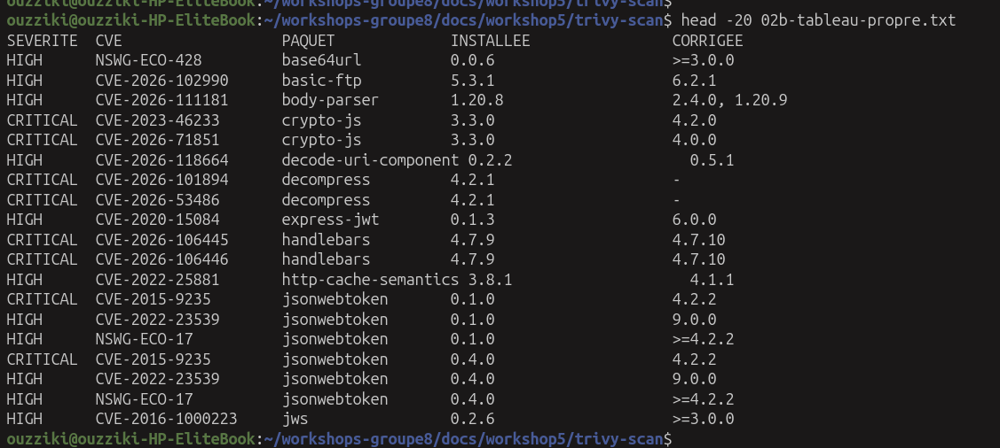
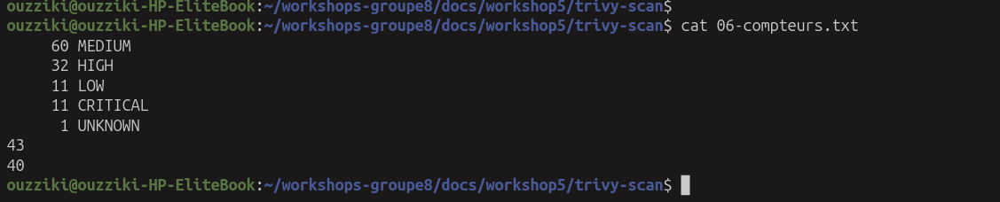
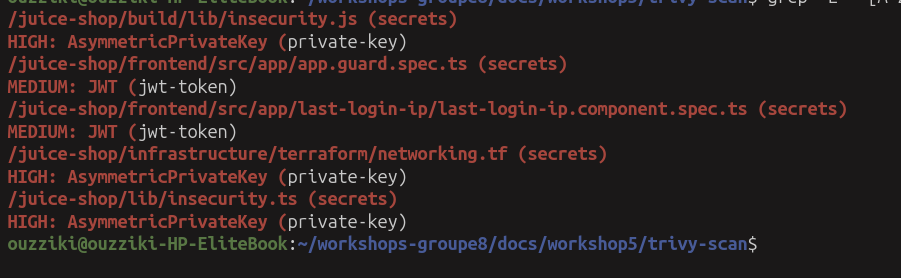
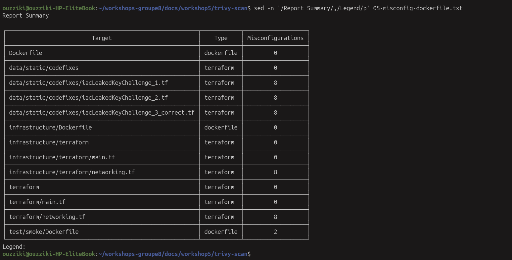

# Scan Trivy — image de référence (volet Lhoussaine)

## Identité de la cible et de l'outil

| Élément | Valeur |
|---|---|
| Image scannée | `bkimminich/juice-shop:latest` |
| Digest | `sha256:42843723a7bf4246aa5d63c324978b17ef296ac78434aeddd34c427bfb5853f4` |
| Scanner | Trivy **0.75.0** (`aquasec/trivy:latest`) — 0.76.1 disponible au moment du run |
| Date du run | `2026-11-01T15:47:26Z` (UTC) |
| Cibles analysées | **7** blocs `Results` dans le rapport JSON |
| Formats produits | table, JSON, SARIF, SBOM CycloneDX |

> Le digest est **identique** à celui relevé au workshop 4 (`docs/workshop4/zap-passif/image-digest.txt`) :
> la même image a donc été attaquée en fonctionnement par ZAP, puis analysée au repos par Trivy.

## Commandes exécutées

```bash
docker run --rm aquasec/trivy:latest --version
docker images --digests bkimminich/juice-shop

docker run --rm -v /var/run/docker.sock:/var/run/docker.sock \
  aquasec/trivy:latest image --severity HIGH,CRITICAL --scanners vuln \
  bkimminich/juice-shop:latest

docker run --rm -v /var/run/docker.sock:/var/run/docker.sock \
  -v "$PWD:/out" aquasec/trivy:latest image --format json \
  --output /out/03-rapport.json bkimminich/juice-shop:latest

docker run --rm -v /var/run/docker.sock:/var/run/docker.sock \
  -v "$PWD:/out" aquasec/trivy:latest image --format cyclonedx \
  --output /out/03-sbom.cdx.json bkimminich/juice-shop:latest

docker run --rm -v /var/run/docker.sock:/var/run/docker.sock \
  aquasec/trivy:latest image --scanners secret \
  bkimminich/juice-shop:latest

docker run --rm -v "$PWD:/src" aquasec/trivy:latest config --severity HIGH,CRITICAL /src
```

## Résultat du scan de vulnérabilités

| Sévérité | Nombre |
|---|---|
| CRITICAL | **11** |
| HIGH | **32** |
| MEDIUM | 60 |
| LOW | 11 |
| UNKNOWN | 1 |
| **Total, toutes sévérités** | **115** |
| **HIGH + CRITICAL** | **43** |

Parmi les **43** alertes HIGH et CRITICAL :

| Indicateur | Valeur |
|---|---|
| avec une version corrigée disponible | **40** |
| sans version corrigée | **3** |
| paquets les plus touchés | `libc6` 22 · `tar` 12 · `sanitize-html` 11 · `jsonwebtoken` 10 · `minimatch` 6 |

Ces chiffres sont recalculés depuis le JSON, jamais saisis à la main :

```bash
cut -f1 06-inventaire.tsv | sort | uniq -c | sort -rn
awk -F'\t' '$1=="CRITICAL"||$1=="HIGH"' 06-inventaire.tsv | wc -l
awk -F'\t' '($1=="CRITICAL"||$1=="HIGH") && $5!="" && $5!="-" && $5!="NA"' 06-inventaire.tsv | wc -l
```

> Formulation correcte dans le rapport : « **43 vulnérabilités HIGH et CRITICAL** », et non
> « 115 vulnérabilités » — 115 est le total toutes sévérités, MEDIUM et UNKNOWN inclus.

## Extrait des alertes (15 premières lignes HIGH / CRITICAL)

| Sévérité | Identifiant | Paquet | Version installée | Version corrigée |
|---|---|---|---|---|
| CRITICAL | CVE-2023-46233 | crypto-js | 3.3.0 | 4.2.0 |
| CRITICAL | CVE-2026-71851 | crypto-js | 3.3.0 | 4.0.0 |
| CRITICAL | CVE-2026-101894 | decompress | 4.2.1 | — |
| CRITICAL | CVE-2026-53486 | decompress | 4.2.1 | — |
| CRITICAL | CVE-2026-106445 | handlebars | 4.7.9 | 4.7.10 |
| CRITICAL | CVE-2026-106446 | handlebars | 4.7.9 | 4.7.10 |
| CRITICAL | CVE-2015-9235 | jsonwebtoken | 0.1.0 | 4.2.2 |
| HIGH | NSWG-ECO-428 | base64url | 0.0.6 | >=3.0.0 |
| HIGH | CVE-2026-102990 | basic-ftp | 5.3.1 | 6.2.1 |
| HIGH | CVE-2026-111181 | body-parser | 1.20.8 | 2.4.0, 1.20.9 |
| HIGH | CVE-2026-118664 | decode-uri-component | 0.2.2 | 0.5.1 |
| HIGH | CVE-2020-15084 | express-jwt | 0.1.3 | 6.0.0 |
| HIGH | CVE-2022-25881 | http-cache-semantics | 3.8.1 | 4.1.1 |
| HIGH | CVE-2022-23539 | jsonwebtoken | 0.1.0 | 9.0.0 |
| HIGH | NSWG-ECO-17 | jsonwebtoken | 0.1.0 | >=4.2.2 |

La liste complète des 115 lignes est dans `06-inventaire.tsv` (calculée depuis `03-rapport.json`).

### Ce que l'extrait montre déjà

- **`jsonwebtoken 0.1.0`** : version très ancienne de la bibliothèque qui signe les jetons d'authentification.
  Deux CVE HIGH et une CRITICAL la visent, avec correctifs disponibles (4.2.2 puis 9.0.0) : c'est le
  premier candidat de remédiation pour Hasna.
- **`crypto-js 3.3.0`** : deux CVE CRITICAL avec correctifs (4.0.0 et 4.2.0). Même conclusion.
- **`decompress 4.2.1`** : deux CVE CRITICAL **sans version corrigée** (`—`). Aucune mise à jour ne les fermera :
  cas à documenter en « accepter et surveiller », pas à corriger.
- **`express-jwt 0.1.3`**, **`base64url 0.0.6`**, **`body-parser 1.20.8`** : versions d'une autre époque,
  toutes corrigeables.

## Les 3 alertes HIGH / CRITICAL sans correctif disponible

Sur les 43 alertes HIGH et CRITICAL, **40 ont une version corrigée** et **3 n'en ont aucune**. Ces trois-là ne
peuvent pas être fermées par une mise à jour : elles se documentent, elles ne se corrigent pas.

| Sévérité | Identifiant | Paquet | Version installée | Version corrigée |
|---|---|---|---|---|
| CRITICAL | CVE-2026-101894 | decompress | 4.2.1 | — |
| CRITICAL | CVE-2026-53486 | decompress | 4.2.1 | — |
| CRITICAL | GHSA-5mrr-rgp6-x4gr | marsdb | 0.6.11 | — |

Elles sont transmises à Hasna pour la colonne « accepter et surveiller » du tableau de tri. La commande qui les
isole :

```bash
awk -F'\t' '($1=="CRITICAL"||$1=="HIGH") && ($5==""||$5=="-")' 06-inventaire.tsv
```

## Secrets — 5 secrets détectés (3 HIGH, 2 MEDIUM)

| # | Sévérité | Règle | Fichier | Ce que c'est |
|---|---|---|---|---|
| 1 | HIGH | `AsymmetricPrivateKey` | `/juice-shop/lib/insecurity.ts:21` | la clé privée RSA qui signe les JWT, **dans le source TypeScript** |
| 2 | HIGH | `AsymmetricPrivateKey` | `/juice-shop/build/lib/insecurity.js:55` | **la même clé**, dans le JavaScript compilé livré dans l'image |
| 3 | HIGH | `AsymmetricPrivateKey` | `/juice-shop/infrastructure/terraform/networking.tf:171` | une clé privée de certificat TLS, dans un fichier d'infrastructure |
| 4 | MEDIUM | `JWT` | `/juice-shop/frontend/src/app/app.guard.spec.ts:46` | un jeton JWT en dur dans un test unitaire Angular |
| 5 | MEDIUM | `JWT` | `/juice-shop/frontend/src/app/last-login-ip/last-login-ip.component.spec.ts:72` | un second jeton JWT dans un test unitaire |

Total annoncé par Trivy : `HIGH: 3`, `MEDIUM: 2`. Les manifestes `package.json` de l'image sont, eux, tous propres (`-`).

**Ce que ça raconte — et c'est plus intéressant qu'un simple « 1 secret » :**

- Les deux HIGH `insecurity` sont **la même clé, présente deux fois** : une fois dans le fichier TypeScript, une fois
  dans sa version compilée. Conséquence concrète : la clé de signature des jetons est livrée **dans l'image publiée**,
  donc toute personne qui télécharge l'image peut forger des jetons valides. C'est un choix pédagogique de Juice Shop
  (le module s'appelle `insecurity.ts`), mais le constat est réel.
- La troisième HIGH est une **clé privée de certificat TLS** rangée dans un fichier Terraform : même logique, un
  secret ne doit jamais vivre dans un dépôt ni dans une image.
- Les deux MEDIUM sont des **jetons de test** dans des fichiers `.spec.ts` : ce sont des fixtures, pas des secrets de
  production. On peut les écarter, mais seulement en le disant — et en citant le fichier.

**Décision :** aucune correction de notre part (nous ne modifions pas le code de l'application), mais les cinq
constats sont documentés, avec leur nature exacte. Aucune valeur n'est recopiée dans ce document.

> Preuve : `04-secrets.txt` contient le rapport complet ; la commande qui isole les constats est
> `sed -n '/insecurity.js (secrets)/,$p' 04-secrets.txt`.

## Mauvaises configurations — 42 alertes, dont **0** dans le Dockerfile de l'application

Scan `trivy config` sur le répertoire du dépôt : **13 fichiers de configuration détectés**.

| Cible | Type | Mauvaises configurations |
|---|---|---|
| `Dockerfile` (racine) | dockerfile | **0** |
| `infrastructure/Dockerfile` | dockerfile | **0** |
| `test/smoke/Dockerfile` | dockerfile | 2 (HIGH ×2) |
| `data/static/codefixes/iacLeakedKeyChallenge_1.tf` | terraform | 8 (4 HIGH, 4 CRITICAL) |
| `data/static/codefixes/iacLeakedKeyChallenge_2.tf` | terraform | 8 (4 HIGH, 4 CRITICAL) |
| `data/static/codefixes/iacLeakedKeyChallenge_3_correct.tf` | terraform | 8 (4 HIGH, 4 CRITICAL) |
| `infrastructure/terraform/networking.tf` | terraform | 8 (4 HIGH, 4 CRITICAL) |
| `terraform/networking.tf` | terraform | 8 (4 HIGH, 4 CRITICAL) |
| `terraform/main.tf`, `infrastructure/terraform/main.tf`, dossiers `.tf` | terraform | **0** |
| **Total** | | **42** (22 HIGH, 20 CRITICAL) |

Règles rencontrées :

| Règle | Sévérité | Constat |
|---|---|---|
| `DS-0002` | HIGH | aucun `USER` non-root dans `test/smoke/Dockerfile` |
| `DS-0025` | HIGH | `apk add curl` sans `--no-cache` (cache conservé dans l'image) |
| `AWS-0037` | HIGH | système de fichiers EFS non chiffré au repos |
| `AWS-0052` | HIGH | le load balancer ne rejette pas les en-têtes invalides |
| `AWS-0053` | HIGH | load balancer exposé publiquement |
| `AWS-0054` | CRITICAL | écouteur HTTP sans HTTPS |
| `AWS-0104` | CRITICAL | règles de sortie ouvertes vers `0.0.0.0/0` |
| `AWS-0164` | HIGH | sous-réseau qui attribue une IP publique |

**Lecture critique, à écrire telle quelle dans le rapport :** ces 42 alertes **ne concernent pas l'image livrée**.
- Les cinq fichiers `.tf` en cause appartiennent à Juice Shop : trois sont des **fixtures pédagogiques**
  (`data/static/codefixes/…`, volontairement vulnérables), deux décrivent une infrastructure AWS d'exemple
  (`terraform/`, `infrastructure/terraform/`) que nous n'utilisons pas.
- Le `Dockerfile` de l'application est **propre** au regard de `trivy config` — les deux seules alertes Dockerfile
  sont dans un fichier de test de fumée.

Autrement dit : le scan ne dit pas « notre image est mal configurée », il dit « le dépôt contient des exemples
d'infrastructure non conformes ». C'est exactement le genre de nuance qu'un correcteur attend.

## Limites de ce scan

- Le scan est **non authentifié** et porte sur l'image : aucune logique métier, aucune route dynamique.
- L'image est analysée **au repos** : les vulnérabilités d'exécution relèvent du workshop 4 (ZAP).
- Les CVE `UNKNOWN` (1) n'ont pas de score attribué : comptées à part, pas rangées de force.
- La base de vulnérabilités et les règles évoluent : ces chiffres valent **au 2026-11-01**, avec Trivy 0.75.0.
- Un secret détecté dans une image publique de démonstration est un **choix de conception** de l'éditeur, pas une
  erreur de notre pipeline — mais il illustre pourquoi un secret ne doit jamais être copié dans une image.

## Preuves produites

| Fichier | Contenu |
|---|---|
| `00-version-trivy.txt` | version de Trivy, date UTC, état du poste |
| `01-digest-image.txt` | digest de l'image scannée |
| `02-vulns-high-critical.txt` | journal du scan filtré (sortie console) |
| `02b-tableau-propre.txt` | tableau des 43 lignes HIGH / CRITICAL, dérivé du JSON |
| `03-rapport.json` | rapport complet, **non filtré** |
| `03-rapport.sarif` | même contenu, format CI |
| `03-sbom.cdx.json` | SBOM CycloneDX |
| `04-secrets.txt` | rapport du scan de secrets (5 constats : 3 HIGH, 2 MEDIUM) |
| `05-misconfig-dockerfile.txt` | rapport de `trivy config` (42 alertes) |
| `06-inventaire.tsv` | une ligne par CVE, extraite du JSON |
| `06-compteurs.txt` | compteurs recalculés depuis le TSV |
| `07-sha256.txt` | empreintes de toutes les preuves |

## Captures d'écran

Les six captures sont dans `docs/workshop5/screenshots/` (un dossier au-dessus de ce readme). Chacune répond à une
question précise : qui a scanné quoi, avec quel outil, et qu'a-t-il trouvé.

### 1. L'outil et la cible — `trivy-01-identite.png`



`Version: 0.75.0` pour l'outil, et pour la cible : tag `latest`, mais surtout le **digest**
`sha256:42843723a7bf…5853f4`. Le tag `latest` bouge ; le digest, non. C'est lui qui rend le scan reproductible : si
Hasna re-scanne dans deux semaines et obtient le même digest, toute différence de résultat viendra des mises à jour de
la base de vulnérabilités, pas de l'image.

### 2. Le scan en cours d'exécution — `trivy-02-scan-execution.png`



Deux lignes à retenir : `Detected OS family="debian" version="13.7"` et `pkg_num=14`, plus
`Number of language-specific files num=1`. Ce sont exactement les valeurs annoncées plus haut : la capture et le
rapport se confirment l'un l'autre, aucun chiffre n'est posé sans preuve.

### 3. Le tableau des alertes — `trivy-03-vulns-tableau.png`



Les 20 premières lignes des **43** alertes HIGH / CRITICAL, sur cinq colonnes : sévérité, identifiant, paquet, version
installée, version corrigée. Le fichier complet (`02b-tableau-propre.txt`) en contient 43. On voit déjà les deux
`decompress` avec un tiret en dernière colonne : ce sont deux des trois alertes sans correctif.

> Pourquoi un fichier `02b` ? Le journal brut `02-vulns-high-critical.txt` fait environ 2 700 lignes, en grande partie
> occupées par la barre de progression du téléchargement de la base. `02b` a été dérivé du JSON (`03-rapport.json`) pour
> obtenir un tableau lisible sans relancer de scan.

### 4. Les compteurs — `trivy-04-compteurs.png`



`60 MEDIUM`, `32 HIGH`, `11 LOW`, `11 CRITICAL`, `1 UNKNOWN` — soit 115 alertes — puis `43` (HIGH + CRITICAL) et `40`
(celles qui ont une version corrigée). Ces nombres sont **recalculés** à partir de l'inventaire ligne par ligne
(`06-inventaire.tsv`), pas recopiés d'un résumé : c'est pour cela qu'ils tombent juste.

### 5. Les secrets — `trivy-05-secret.png`



Les cinq fichiers concernés, avec leur règle : trois `HIGH: AsymmetricPrivateKey` et deux `MEDIUM: JWT`. Trivy masque
les valeurs sensibles, il n'y a donc rien de confidentiel dans cette image — seulement des chemins et des
identifiants de règle.

### 6. Les mauvaises configurations — `trivy-06-misconfig.png`



Ici la colonne des compteurs est fiable, fichier par fichier : `Dockerfile` à **0** et `infrastructure/Dockerfile` à
**0** (les Dockerfiles de l'application sont propres), `test/smoke/Dockerfile` à **2**, et cinq fichiers `.tf` à **8**
chacun. Total : 42. À lire avec la réserve du chapitre suivant : l'essentiel de ces alertes vise des fichiers
d'infrastructure d'exemple livrés avec Juice Shop, pas l'image applicative.

## Ce que le volet transmet à Hasna

| Élément | Où |
|---|---|
| les 43 alertes HIGH / CRITICAL à trier | `06-inventaire.tsv` |
| les 5 secrets à statuer (3 HIGH, 2 MEDIUM) | `04-secrets.txt` |
| les 3 sans version corrigée | filtre `$5=="" || $5=="-"` sur le TSV |
| les 40 corrigeables, dont `jsonwebtoken` et `crypto-js` en tête | tableau ci-dessus |
| l'identité exacte de l'image (digest) pour comparer avant / après | `01-digest-image.txt` |
| l'état de configuration du dépôt, pour son durcissement | `05-misconfig-dockerfile.txt` |
