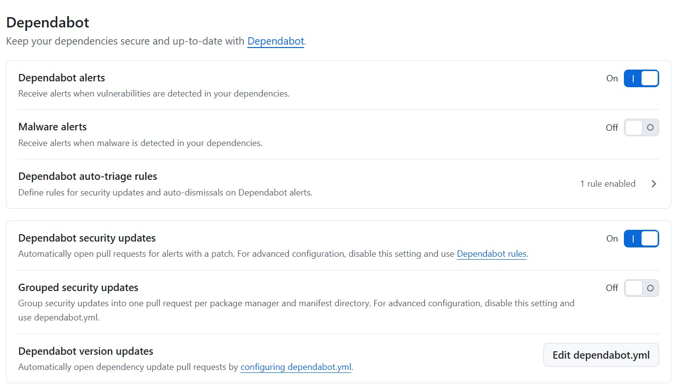
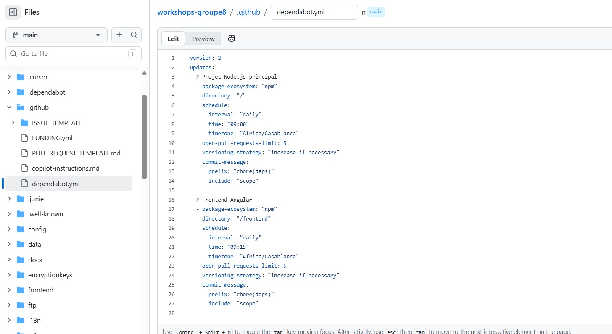
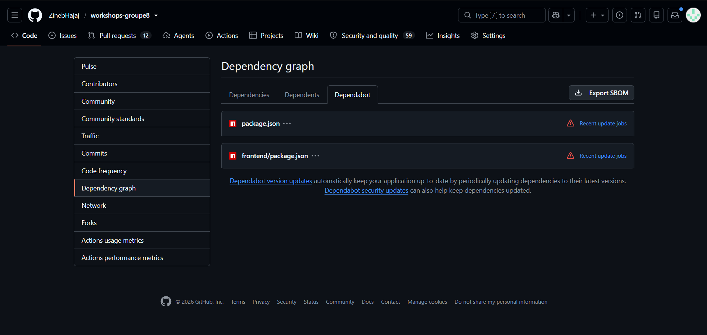
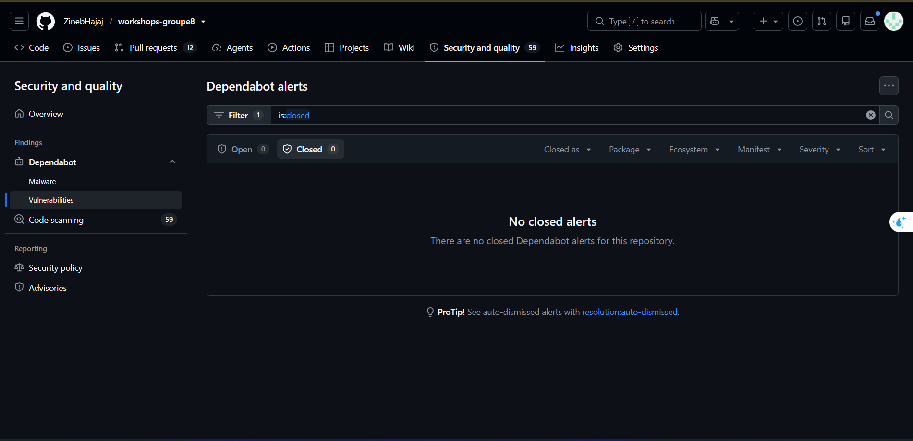
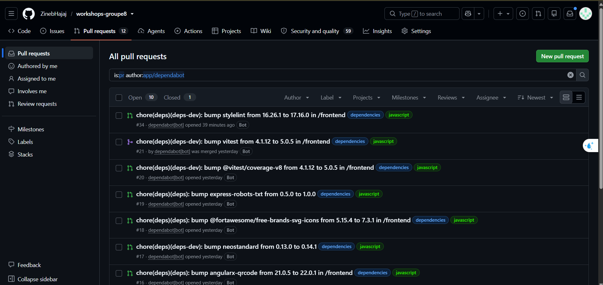

# Workshop 3 : Dependabot (Hasna)

## Objectif
Automatiser la détection et la mise à jour des dépendances vulnérables du projet (OWASP Juice Shop, npm).

## Configuration
Le fichier `.github/dependabot.yml` contient deux blocs npm : `/` (projet principal) et `/frontend` (Angular). Il doit être sur la branche par défaut (`main`) pour activer les version updates.

## Mise en œuvre
1. Ajout du lockfile `frontend/package-lock.json` (retiré du `.gitignore` du frontend)
2. Ajout de `.github/dependabot.yml` (PR #11)
3. Activation de Dependabot dans Settings
4. Déclenchement de l'analyse (Check for updates)

## Résultats

### Activation de Dependabot
Les alertes et les security updates sont activés ; les version updates sont pilotés par `dependabot.yml`.

### Fichier de configuration sur main

### Projets surveillés
Dependabot surveille bien les deux projets npm (`package.json` et `frontend/package.json`).

Les triangles rouges indiquent que les jobs ont signalé *Dependabot cannot open any more pull requests* :
la limite `open-pull-requests-limit: 5` du fichier `dependabot.yml` est atteinte.
Dependabot a bien ouvert 5 PRs pour le projet racine (#12 et 4 autres).

### Alertes
Aucune alerte de dépendance ouverte n'était affichée au moment du test. Les mises à jour ont été proposées via les *version updates*.

### Pull requests automatiques
Dependabot a ouvert des PRs automatiques, par exemple la PR #21 : mise à jour de `vitest` de 4.1.12 à 5.0.5 dans `/frontend`, qui a été mergée.

## Comparaison
Voir [comparaison-dependabot-dependency-check.md](comparaison-dependabot-dependency-check.md).
